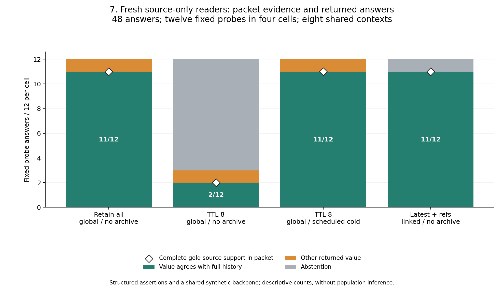

# Fresh source-only readers after pruning

The fixed follow-up collected and structurally accepted **48 answers in eight
fresh contexts**, with no missing batches, output repairs or answer retries.
The requested model was `gpt-6.1-sol`. Across the four cells, 35 packets contained
the complete gold source support; all 35 produced matching values and citations
to every required source. The remaining answers were ten abstentions and three
stale values. These observations concern supplied structured packets, with
substantial shared context and workload dependence.

## Fixed sample and results

The [reader plan](READER-PLAN.md) fixed twelve probes before root inspected the
main outcome tables: the last six scenarios, seed zero, high density, epoch 32,
with their current and standing questions. Four previously fixed cells yield
48 packets. No examples were replaced based on outcomes. The sample includes
only those two task types; historical questions, dependency interpretation,
autonomous navigation and actual pruning by a model are not tested here.

| Cell, twelve probes each | Complete gold support in packet | Matching value and complete gold citations | Abstentions | Other returned value |
| --- | ---: | ---: | ---: | ---: |
| Retain all, global, no archive | 11 | 11 | 0 | 1 |
| TTL eight, global, no archive | 2 | 2 | 9 | 1 |
| TTL eight, global, scheduled cold | 11 | 11 | 0 | 1 |
| Latest plus references, linked, no archive | 11 | 11 | 1 | 0 |
| Total | 35 | 35 | 10 | 3 |



All ten abstentions occurred on packets lacking complete gold support; none
occurred when complete gold support was present. An appropriate refusal to
invent a missing fact still leaves the requested task unresolved. These null
outputs are retained rather than silently counted as fabricated answers.

The three nonmatching answers are the same lexical-clutter current-setting
probe in three cells. Each returns `revision_28_0` while the complete history
requires `revision_32_0`. The newer original was absent from those packets.
Each reader marks its answer supported and cites an actually present older
record. There are **zero outside-packet citations**, yet current-state agreement
still fails. A citation can faithfully identify available evidence without
showing that retrieval supplied the latest governing source.

This also illustrates a limit of unresolved-only archive triggers: a visible
old answer can look complete. The reader sample compares scheduled recovery
with archive unavailable; it does not itself compare both trigger policies.
The separate deterministic study supplies that broader contrast.

## What fresh means here

Each context was created with `fork_turns="none"` and received one staged inbox.
The [collection record](reader-data/collection.json) preserves the requested
model and canonical context/task identities. A requested identity is not an
independent attestation of backend implementation. The [sampling manifest](reader-data/sampling-manifest.json)
binds the exact source/plan/helper files, original packets and prompt-byte
accounting. Each packet is the original selected source text, in actual call
order, with the same 8,192-byte maximum. Query text, common instructions, output
schema and serialization add bytes outside that source cap.

Contexts receive six cases each, one per scenario, with opaque IDs and without
arm labels, gold answers, full histories or project navigation. Readers are
instructed to read only their inbox and write their assigned answer file, using
only each case's own packet. This is a logical instruction boundary, not OS
confinement or proof of an empty runtime. Original answer bytes are preserved.

The context assignment has two material limitations. Even contexts contain
current questions and odd contexts standing questions, so context and task type
are confounded. Shared-backbone standing values repeat across scenarios,
allowing possible cross-case transfer despite the case-only instructions.
Distinct source IDs and citation checks constrain the reported support metric,
but do not prove independent reasoning. These are eight conversations from one
requested model, not 48 independent agents, model-family replication or a
population sample of unfamiliar users.

The packets contain machine-readable `ASSERT` claims, supplied project/key/time
metadata and explicit prerequisites. Common instructions explain the exact
eligibility and ordering rule. This is a narrow source-reading test, rather
than evidence of reliable interpretation of unstructured real notes. It does
not test a fresh agent finding or loading the PARA entry point.

## Verification and preserved evidence

The [mechanical results](reader-data/results.json) keep every case and the
planned 48-case denominator. All eight batches pass exact case/schema/type and
packet-citation checks. The helper's fourteen controls include duplicate cases,
invented citations, changed packet hashes and byte counts. Missing outputs were
tested separately: the checker reports them and writes nothing. No completed
answer file was overwritten or retried.

A separate implementation reconstructs all 48 sampled packets and assignments
from the complete 64,512-row trial census, independently replays the twelve
complete-source gold records, checks every original output and recounts every
existing per-case/aggregate metric. Seven deliberate corruption controls are
rejected. See the [independent receipt](verification/readers.json) and
[checker](check_reader_results.py). This does not judge explanation entailment
or replace the authored gold with independent human truth.

From this directory, the consuming verification routes are read-only:

```sh
python reader_followup.py --check reader-data
python check_reader_results.py --collection reader-data --results reader-data/results.json
```

The [inputs, opaque mapping and original outputs](reader-data/) are fictional
research data. Mapping and gold were available to evaluators, excluded from
reader inboxes by the staging contract, and published after collection. No
personal vault contents or native session logs were used as reader evidence.

The [seventh figure](reader-figures/manifest.json) binds its exact result JSON,
renderer and PNG/SVG bytes; it is separate from the main study's six-figure
manifest. Root inspected the rendered PNG. Re-render only to a new destination:

```sh
python render_readers.py reader-data/results.json reproduced-reader-figures
```

Future probes should use independently authored histories and distinct values,
one case per context or a balanced task/context design, richer historical and
qualifier questions, and autonomous memory discovery. The present sample
supports the narrower observation that supplying complete evidence mattered
more than repairing interpretation in these particular structured probes.
