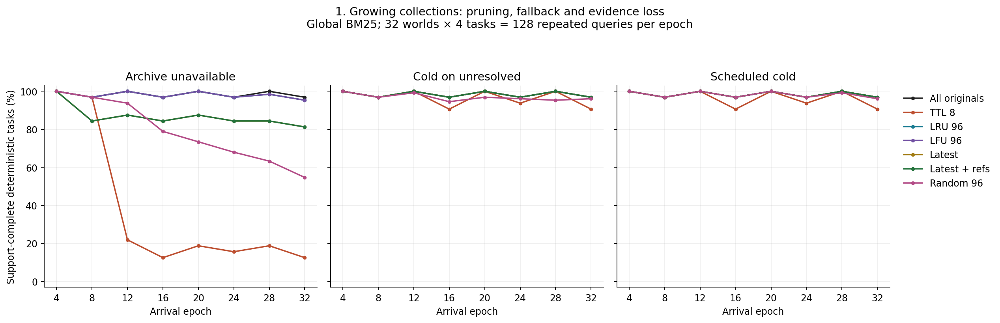
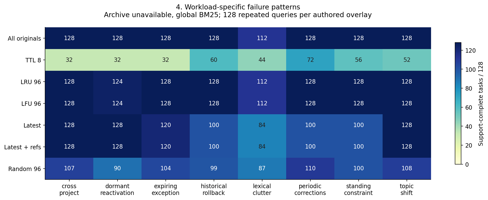
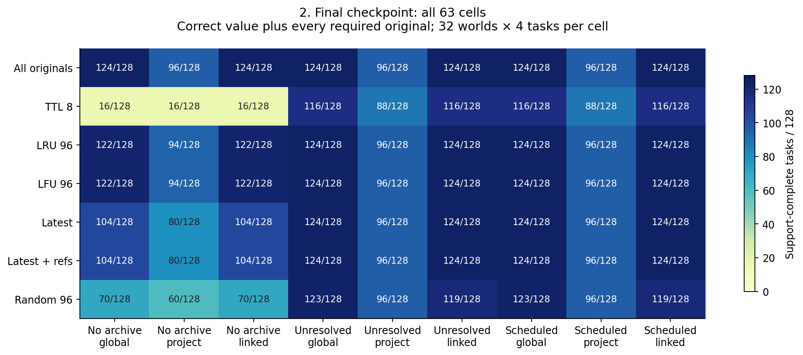
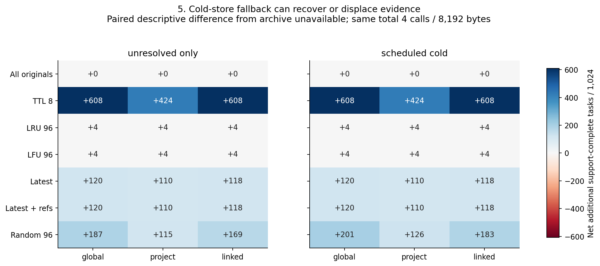
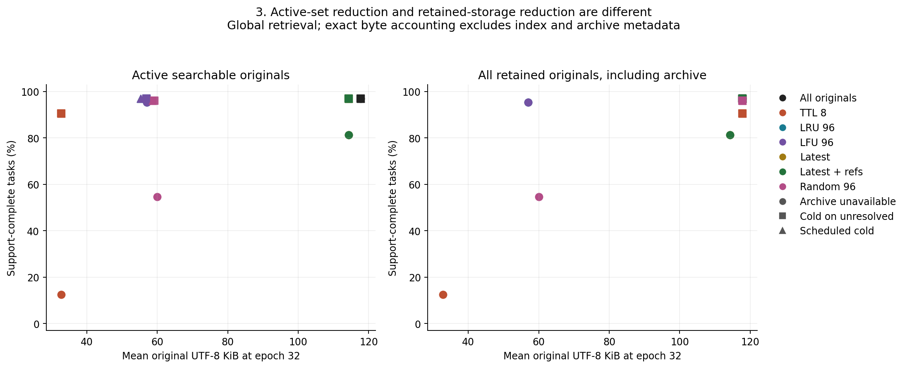
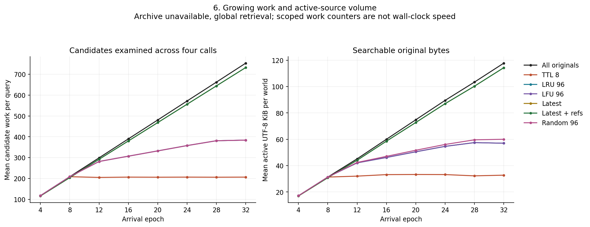

# Longitudinal pruning: preserve recoverability before shrinking memory

**Collected October 16 UTC.** This new deterministic experiment contains 32
fictional growing worlds, 1,024 queries and **64,512 paired query-arm trials**.
The practical result is conditional: a bounded active set with an accessible
archive preserves substantially more evidence than irreversible age-based
removal. Pruning does not improve answer quality over the strong all-retained
global baseline in these worlds. It can reduce active-source volume and scoped
candidate examinations while approaching that baseline's evidence recovery.

These are engineered source-selection and deterministic-reading results, not
measured LLM answers, natural PARA usage or an optimal production policy. Eight
workload overlays share one authored backbone. All conditions were fixed in the
[prospective plan](PLAN.md) and [seal](seal.json) before the single full run.

A separately collected [fresh-reader follow-up](READER-REPORT.md) contains 48
answers in eight contexts and a seventh figure. It preserves its own sampling,
requested-model, answer/citation and dependence limits; those answers are not
part of the 64,512 deterministic trials.

## Main comparisons

Every cell has the same 1,024 queries, four discovery calls and maximum 8,192
rendered UTF-8 source bytes per query. Success means the reader returns the
correct value **and** receives every gold-required original and its explicit
qualifiers. Value correctness alone is reported separately in [tables](tables.json).

| Retention policy, global retrieval | Archive unavailable | Cold on unresolved | Scheduled cold |
| --- | ---: | ---: | ---: |
| Retain all | 1,008 | 1,008 | 1,008 |
| TTL eight epochs | 380 | 988 | 988 |
| LRU 96 records | 1,004 | 1,008 | 1,008 |
| LFU 96 records | 1,004 | 1,008 | 1,008 |
| Latest per project/key | 888 | 1,008 | 1,008 |
| Latest plus dependency pins | 888 | 1,008 | 1,008 |
| Random demotion to 96 | 805 | 992 | 1,006 |

The all-retained baseline has real unseen paging across all four calls. Its 16
failures are current-setting questions in the lexical-clutter overlay at epochs
8, 16, 24 and 32, when the governing revision is long. They are stale answers,
despite the relevant original remaining available. Neither lower nor higher
distractor density changes that baseline's quality: each has 504/512 successes.
Availability, ranking, byte fit and reading are distinct potential failure points.

LRU and LFU without an archive lose the same four dormant prerequisites: the
epoch-one design source needed by a reactivated bundle at epochs 28 and 32 in
both high-density seeds. They lose none in the matching low-density worlds.
Their archive-enabled counterparts recover those four cases. Access counts come
from actual returned records, so these are endogenous policy trajectories,
including incidental reads, rather than oracle relevance traces.

The two latest policies are **identical in the actual collection**. Every
referenced old source already has a distinct key, so plain latest retention
keeps it. Dependency pinning is exercised by a self-check but its added value is
unidentified in this bank. Unique distractor keys also mean latest-version
compaction cannot remove the accumulating distractors. These null comparisons
are limits of the workload, not evidence that dependency pins are useless.



*Figure 1.* Repeated query outcomes at eight checkpoints. Identical LRU/LFU and
latest/latest-plus-dependency curves overlap. These are complete fixed-census
counts, without population confidence intervals.

## What grew, and what was pruned

Each world advances through 32 arrival epochs. Low-density worlds receive three
distractor records per epoch; high-density partners receive eight. Governing
sources and the query schedule are otherwise identical within each density
pair. Original bodies range from 419 to 1,399 UTF-8 bytes. There are 6,024 source
instances across the 32 worlds, including the deliberately duplicated governing
sources in density pairs. Final collections range from 104 to 272 records each;
this is a modest-scale test, not a large natural vault. The source-instance
count is not a count of independent facts.

Four questions arrive every fourth epoch: current configuration, a standing
constraint, a fixed-as-of historical configuration and a bundle with an explicit
dependency or exception. The overlays add periodic corrections, long-lived
standing constraints, dormant reactivation, historical rollback, cross-project
links, lexical near duplicates, a topic/access shift and an expiring exception.
They share old standing rules, version history and bundle/license scaffolding;
they do not constitute eight independent mechanisms or held-out topologies.

Pruning occurs once per epoch, before disclosure of that epoch's query batch.
The retention interface receives arrived source metadata and past selected-ID
access only. TTL retains age exactly eight and removes older records. LRU/LFU
and random demotion cap the active set at 96. In archive-enabled quota policies,
cold hits are eligible for promotion at the next epoch, using their original
age and past read ledger, then the cap is applied again. Archive reads do not
reset TTL age or change latest-version semantics.

Latest retention uses supplied project/key/effective-time metadata. It is
deliberately naive about expiry: keeping the newest exception can remove an
older base that should become applicable again after the exception expires.
The deterministic reader correctly restores that base when both originals are
available. The experiment does not test a complete expiry-aware compactor.

Archive-unavailable means logical irreversible loss for that arm. The evaluator
preserves every original in a separate source bank, but the selector cannot read
unavailable records. Archive-enabled arms retain all arrived originals in an
immutable cold store and maintain a smaller active index. Their total retained
original bytes therefore do not shrink when active bytes shrink.

## Historical and rare evidence carry much of the risk

| Archive unavailable, global retrieval | Current / 256 | Standing / 256 | Historical / 256 | Dependency / 256 |
| --- | ---: | ---: | ---: | ---: |
| Retain all | 240 | 256 | 256 | 256 |
| TTL eight | 164 | 64 | 88 | 64 |
| LRU 96 | 240 | 256 | 256 | 252 |
| LFU 96 | 240 | 256 | 256 | 252 |
| Latest | 240 | 256 | 144 | 248 |
| Latest plus dependencies | 240 | 256 | 144 | 248 |
| Random 96 | 209 | 214 | 206 | 176 |

TTL's eight-epoch cutoff removes still-binding old rules by construction: old
does not imply obsolete in this authored workload. Latest retention loses 112
historical successes and eight dependency/exception successes relative to
retain-all. The latter eight require the older base after an exception expires.
The bank intentionally contains many permanent facts, so TTL's large aggregate
loss is not an estimate of how often real files become useless.

Random demotion shows that a smaller search space alone is insufficient. Its
archive-off global successes fall from 494/512 at low density to 311/512 at high
density. LRU/LFU fall only from 504 to 500; their feedback protects frequently
read originals but misses the dormant reactivation prerequisite. No pruning arm
gains a global archive-off success that the all-retained baseline misses.



*Figure 4.* Each scenario column contains 128 related queries across two seeds,
two densities and eight checkpoints. These scenario labels summarize authored
overlays; their common backbone limits external generalization.

## Routing and archive policy interact

The organization factor represents **access paths**, not different OS
filesystems. Global search scores all available originals. Project routing
scores the supplied project index. Linked routing starts there and can follow
real references across projects, depth two and at most eight probes per call.
Query keys, project names, record metadata and explicit references are clean,
source-visible scaffolding. They were supplied, not extracted by an ML model.

All 63 cells appear below. Entries are support-complete successes / 1,024;
G = global, P = project, L = project plus real links.

| Policy | Off G | Off P | Off L | Unresolved G | Unresolved P | Unresolved L | Scheduled G | Scheduled P | Scheduled L |
| --- | ---: | ---: | ---: | ---: | ---: | ---: | ---: | ---: | ---: |
| All | 1008 | 760 | 1008 | 1008 | 760 | 1008 | 1008 | 760 | 1008 |
| TTL 8 | 380 | 316 | 380 | 988 | 740 | 988 | 988 | 740 | 988 |
| LRU 96 | 1004 | 756 | 1004 | 1008 | 760 | 1008 | 1008 | 760 | 1008 |
| LFU 96 | 1004 | 756 | 1004 | 1008 | 760 | 1008 | 1008 | 760 | 1008 |
| Latest | 888 | 650 | 890 | 1008 | 760 | 1008 | 1008 | 760 | 1008 |
| Latest + refs | 888 | 650 | 890 | 1008 | 760 | 1008 | 1008 | 760 | 1008 |
| Random 96 | 805 | 633 | 805 | 992 | 748 | 974 | 1006 | 759 | 988 |

Project-only routing often finds a correct bundle value but cannot retrieve its
commons-project license. With all originals retained, its 760 complete successes
contrast with global and linked routing's 1,008. Scope narrowing can remove
needed qualifiers along with irrelevant candidates. Explicit cross-project
links restore this comparison under the clean authored metadata.



*Figure 2.* Final-checkpoint outcomes, 128 repeated queries per cell. This figure
uses the final checkpoint, while the preceding table includes all checkpoints.

Unresolved-only fallback inspects the reader after active calls one and two. It
uses cold calls three and four only for an unknown answer or explicit unresolved
reference. Scheduled fallback uses those calls whenever cold originals exist,
even if an active answer appears complete. Retain-all has no cold-only originals
and continues normal active paging in every archive mode.

Scheduled cold improves random/global from 992 to 1,006 complete tasks over
unresolved-only, showing the risk of a confident but stale active answer. Its
other two retrieval routes also improve, but linked random retention reaches
only 988. Cold selection changes later promotion and access histories, so these
are whole-trajectory comparisons, not a fixed-packet causal decomposition.

Archive calls reserve **calls, not bytes**. Across all arms, 15,433 queries enter
cold mode. Of those, 672 (4.35%) have fewer than 512 bytes left before their first
cold call; none has exactly zero. Of 30,866 cold calls, 16,213 return no new
record. That includes empty second pages and budget-fit failures, not just failed
queries. Actual cold exposure is 45,858 returned records and 22,806,290 framed
bytes. These are repeated arm exposures, not unique source counts. TTL with cold
recovery still has 20 unknown answers, in the historical-rollback and periodic-
correction overlays. Reserving a byte share for cold evidence is an unexecuted
next factor; these residual losses do not establish a limit of archiving itself.



*Figure 5.* Net paired success changes against archive-unavailable conditions.
Every cell keeps the same total call and source-byte caps. Net counts do not
show every individual gain/loss or make the repeated queries independent.

## Smaller active sets reduce scoped work, with maintenance costs

At epoch 32, global archive-off mean active original bytes are 120,577.62 for
retain-all, 58,392.69 for LRU/LFU, 33,556.62 for TTL and 117,045.50 for latest.
That is a 51.57%, 72.17% and 2.93% active-byte reduction, respectively. LRU/LFU
retain exactly 96 active records; retain-all averages 188.25. Archive-enabled
total retained original bytes remain 120,577.62 on average for every policy.
Index, metadata, filesystem and archive-management bytes are excluded.

Across all checkpoints, global archive-off candidate examinations fall from
445,696 under retain-all to 303,296 under LRU/LFU (31.95% less), 200,000 under TTL
(55.13% less), and 434,176 under latest (2.58% less). LRU/LFU with unresolved cold
recovery examine 303,456 candidates and match the baseline's 1,008 successes.
This is a promising bounded-active-set result within this workload, with four
dormant losses avoided through archive recovery.

Those counters count scoped candidates examined on every exhaustive BM25 call.
They omit tokenization/index construction, document-frequency passes, sorting
comparisons, text parsing, ledger maintenance and Python overhead. No native
filesystem speed or end-to-end latency advantage follows from them. Retention
operation counters also increase: archive-off LRU/LFU use 149,240 counted
operations versus retain-all's 102,484. Sort comparisons are excluded there too.
Access-ledger updates and promotions are separately retained in the tables and
maintenance stream. Search preparation tokenizes the authored full bank once
per world, including future text, while a tested pool boundary prevents future
records from affecting past ranks or packets. This setup is not a chronological
indexing-cost benchmark.



*Figure 3.* Active bytes and total retained originals are different costs.
Coincident policies and archive conditions overlap; exact values remain in the
tables. Archive modes can have different active sets after causal promotions.



*Figure 6.* Mean candidate examinations and mean active original KiB over epochs.
LRU/LFU and latest/dependency trajectories overlap where the policies coincide.

The single full collection took 187.51 elapsed seconds and 182.48 process CPU
seconds in the available shared environment. This is an execution observation,
not a replicated policy timing experiment. Every query uses exactly four calls;
some calls return no record. Returned source-byte counts include wrappers and
whole source text, while query text and selector/index metadata are outside that
cap. All raw retained files occupy 19,804,756 bytes versus 256,649,598 bytes before
gzip compression, excluding the manifest itself and derived reports/figures.

## Reproducibility, acceptance and next tests

The 19 frozen self-checks cover TTL boundaries, quota access, buffered archive
admission, superseded dependency preservation, cold recovery, incorrect/stale
answers, incomplete proof, exception expiry/base restoration, retrospective
corrections, exact source hashes, byte accounting, unseen paging, genuine
path-metadata renaming and future-content perturbation invariance. They are
checks of these explicit interfaces, not proof of production safety.

The [execution record](EXECUTION.md) identifies sealed inputs, retained outputs,
commands and verification boundaries. [Raw source-only trajectories](run/trials.jsonl.gz),
[active-set checkpoints](run/snapshots.jsonl.gz), [maintenance](run/maintenance.jsonl.gz),
[separate scores](run/scored.jsonl.gz), [gold replay](run/gold.json),
[source bank](run/source-bank.json) and [hash manifest](run/manifest.json) remain
available. No source originals are removed by public verification commands.

The [acceptance record](ACCEPTANCE.json) links independent trajectory, numeric,
figure and reader checks. Read-only consuming commands from this directory are:

```sh
python audit_pruning.py --run run
python check_pruning_tables.py --run run --tables tables.json
python reader_followup.py --check reader-data
python check_reader_results.py --collection reader-data --results reader-data/results.json
python check_release.py
```

The priority next comparisons are independent authored topologies containing
superseded dependency targets; expiry/scope-aware compaction; fixed external
access traces versus policy feedback; reserving cold-store byte budgets;
larger naturalized corpora; and broader source-bounded reader trials. The
originally optional 48-answer follow-up has now been collected separately, with
all original outputs and an independent mechanical audit. Its twelve fixed
probes, shared values and task-confounded contexts do not supply independent
confirmation or a natural-vault accuracy estimate.

For a real memory vault, these results support testing reversible active-index
demotion before adopting destructive pruning. A production decision still needs
the user's actual task mix, recoverable originals, source applicability checks,
and prospective evidence that archive fallback retrieves what later work needs.
This experiment authorizes no production migration or deletion.
