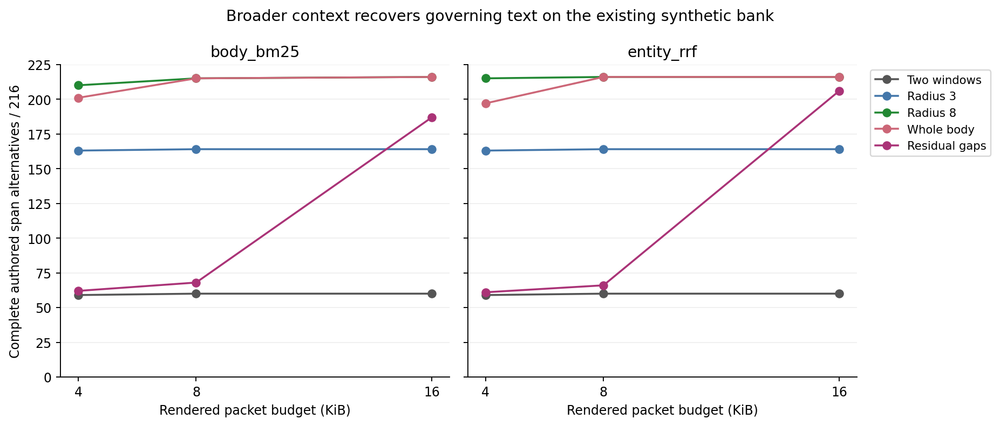
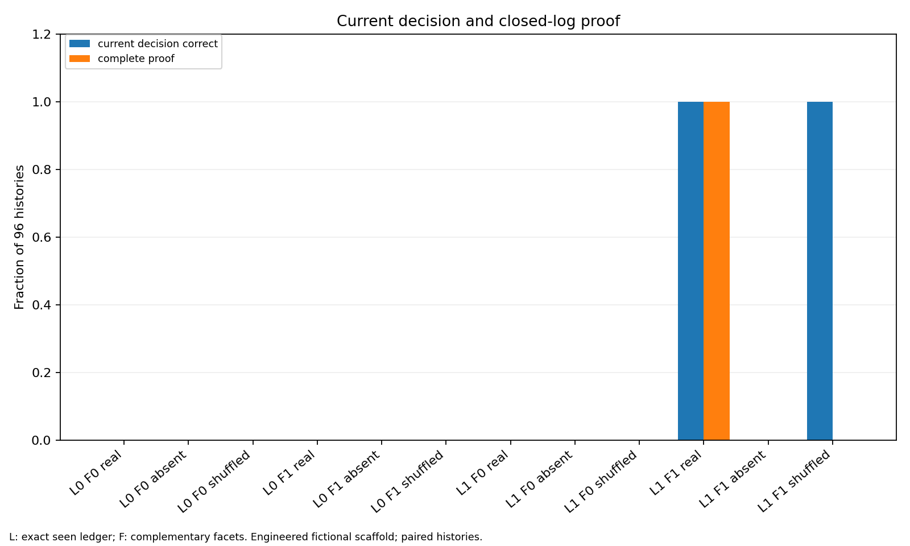
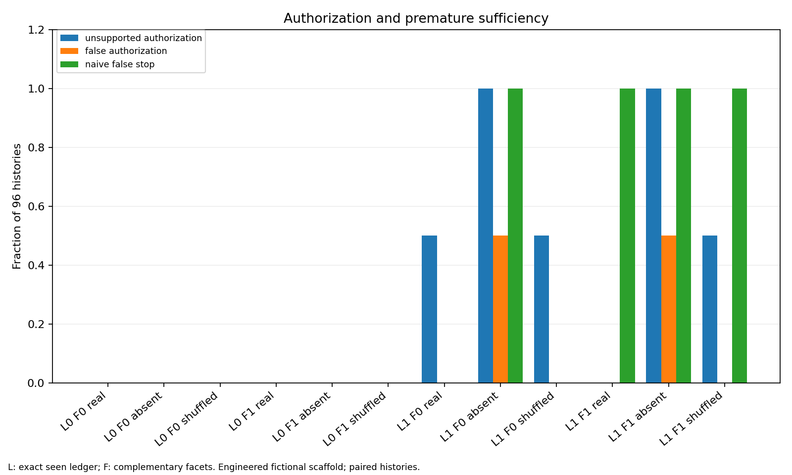

# Context, state and proof: October 15 mechanism sprint

This sprint asks why finding a relevant record can still leave an agent without the evidence needed to continue safely. It separates three questions: how much governing text reaches a packet, whether a current decision follows the full source history, and whether the retrieved evidence is sufficient to justify that decision. A bounded fresh-context check tests whether the existing public research routes remain usable.

The results are promising within their constructed scope. Wider context removes much of the earlier packet's authored-span omission at 8 KiB. A state demonstration shows that correct values and complete proof can diverge, and that safe abstention has a measurable utility cost. Neither lane evaluates a learned decision controller or establishes a production memory architecture. Earlier study files and frozen outcomes remain unchanged.

## Reports and measured units

| Lane | Recorded measurements | Units and dependence | Report |
| --- | --- | --- | --- |
| Context expansion | 6,480 packets; 30 policy/ranker/budget cells; 360 template cells | The same 216 queries from 72 existing synthetic histories in 12 related template groups, repeated across five policies, two saved rankers and three budgets; no new reader trials | [Packing report](packing/REPORT.md) |
| State and proof | 1,152 deterministic trials across twelve arms | 96 parameterizations of one authored topology and event pattern; 24 development and 72 held-out seeds, without tuning between partitions; no natural-history or model replication | [State report](state/REPORT.md) |
| Public onboarding routes | Seventeen initial commands plus one separate semantic recount; additional maintenance-wrapper checks | One fresh research context, with sixteen direct initial routes and one isolated-copy replay; no unfamiliar-reader performance sample or proof of OS isolation | [Onboarding report](onboarding/REPORT.md) |

The packet and trial totals describe repeated measurements. They do not create thousands of independent histories or support population significance claims. The state seed split varies names, scopes, times, filler facets and release values while retaining the same causal structure.

## Wider context helps here, with a budget tradeoff

The packing comparison fixes the original 144-record collections, saved top-32 candidate lists, depth-two dependency closure and compact source wrappers. It changes how selected source bodies become packet text: two lexical windows, larger radius-3 or radius-8 windows, whole bodies, or residual gaps added after preserving the exact baseline packet. Selection receives observable records, query, candidate order and budget. Authored answers and sufficient-span alternatives enter evaluation after all packets have been written.

At 8 KiB, two windows contain a complete authored sufficient-span alternative for 60/216 queries under either ranker. Radius 8 and whole bodies reach 215/216 under body BM25 and 216/216 under entity RRF. These are source-exposure outcomes. They do not say that a reader will interpret the evidence correctly or produce a valid artifact.

Larger units can also displace useful evidence. At 4 KiB, whole bodies gain 144 queries and lose two relative to two windows under BM25; under entity RRF they gain 143 and lose five. Residual gaps preserve every baseline observation, yet improve only eight and six queries at 8 KiB because indivisible gaps compete for the remaining capacity. At 16 KiB their gains rise to 127 and 146. These contrasts concern the exact scheduling and fit rules, rather than a general verdict on incremental expansion.



Every byte limit includes rendered wrappers and separators. Equal limits therefore need not provide equal source text, and emitted source bytes may include repeated slices. The [byte-composition figure](packing/figures/02-budget-composition.png) and [exact thirty-cell table](packing/figures/cells.json) make that allocation inspectable. The [template figure](packing/figures/03-template-dependence.png) and [360-cell template table](packing/figures/templates.json) expose dependence: at 8 KiB, radius 8 and whole bodies reach 18/18 in eleven template groups under BM25 and 17/18 in metric-denominator; entity RRF reaches 18/18 in every group.

## Correct values do not certify complete evidence

The state experiment gives each arm the same 24 fictional records and four two-slot retrieval calls. Every arm uses eight record slots and 6,144 original-source bytes. A seen-ID ledger, complementary-facet penalty and real/absent/shuffled navigation edges produce twelve arms. The ledger-off selector deliberately restarts at the highest ranks each call; it is a weak restart control, rather than a stateful paging comparator. The metadata, topology, authored forward links and finite closed-log seal are substantial scaffolding.

Only the exact-ledger plus complementary-facets plus real-edge arm recovers both current values and complete closed-log proof in all 96 parameterizations. With shuffled edges, the same ledger/facet combination still returns both values correctly in 96/96 but completes proof in 0/96. It can land on terminal records without recovering all intervening evidence required by the authored proof contract. Shuffling is one fixed cyclic derangement, not a distribution of arbitrary wrong graphs.



Provisional grants, false grants and proof-gated safe authorization are separate outcomes. The absent-edge ledger arms make 48 false provisional grants, corresponding to histories ending in an authorized auditor revocation. Proof gating makes zero false grants in all twelve arms, partly by abstaining: every incomplete arm withholds all 48 true-grant opportunities. The complete-proof arm safely grants all 48. Even the shuffled arm with all current values correct loses those 48 safe grants when its proof is incomplete. Zero false authorization alone would conceal that utility difference; the [utility table](state/utility-table.json) reports safe true grants, withheld true grants and safe false grants explicitly.



The [source-exposure figure](state/figure-3.png) shows the repeated-record cost of restarting without a ledger. These results demonstrate reachable mechanisms under one engineered topology. They do not validate natural PARA histories, learned source selection, open-world absence proofs, resistance to forged authority policies or an external authorization boundary.

## What was checked

The [acceptance record](ACCEPTANCE.json) links the separate [packing review](verification/packing-review.json), [presentation refresh](verification/packing-presentation-review.json) and [state review](verification/state-review.json), including their checked file identities and scope limits.

The packing audit reconstructs all 6,480 packets from original source offsets, verifies actual UTF-8 budgets and hashes, and separately implements interval and endpoint scoring. A separate-agent review independently reloads source JSON, recalculates all four endpoints and every numeric field in all aggregate/template tables, and rejects corrupted byte charges, packet digests and boolean offsets. It also executes the consuming audit. All three PNGs were inspected. The execution audit shares the bank loader and aggregate formatter; the separate review supplies an additional implementation, not independent human validation or a new-corpus replication.

The state's postcollection independent checker imports neither selector, generator nor consumer. It replays selected and full source events, checks the exact 96-by-twelve-arm Cartesian census, and rejects five controls: an invented grant, a wrong completeness flag, a corrupted packet hash, invented safe authorization on incomplete proof, and an invalid arm outside the expected census. A supplementary utility checker independently derives grant opportunities and checks every arm's utility totals. All three scientific PNGs were inspected. Source seals and retained receipts establish local provenance; they are not independent timestamp attestations.

The onboarding context recorded seventeen initial commands with exit code zero, followed by one separate semantic recount over 192 supplied public artifacts. One nested directory-symlink fixture was skipped; the broad repository scan was not run in that bounded lane. The recount verifies public bytes, bounds and counts while creating zero new semantic judgments. It does not independently replay private extraction, condition mapping or native delivery. These explicit limits remain attached to the successful checks.

For preservation checks from the repository root:

```sh
python scripts/check_maintenance_replay.py --self-check
python evaluation/sprint-2026-10-15/packing/audit.py
python evaluation/sprint-2026-10-15/state/independent_check.py
python evaluation/sprint-2026-10-15/state/check_utility.py
```

The maintenance wrapper executes the exact frozen runner and fixture in a temporary copy and compares generated bytes without rewriting originals. The older pilot runner's `--self-check` command generates and replaces its results. State generation, original audit and rendering routes also write artifacts; its report explains isolated-copy reproduction. The packing audit checks an existing receipt when present, and writes one if absent. Consult each report before regeneration or rendering. No new model/provider calls are needed for these checks.

## Experiments still unexecuted

The context result now warrants freezing these policies before collecting a genuinely independent corpus, followed by unfamiliar-reader trials that measure decisions, citations, completion and cost separately from authored-span exposure. Short synthetic bodies, supplied aliases and dependency links may explain part of the present ceiling.

The state result needs stronger matched comparators: fixed-ranking paging and deduplication, equal-state bookkeeping budgets, alternative topologies and wrong-edge distributions, and histories whose authority and completeness must be discovered rather than supplied as a closed-world scaffold. Those comparisons would test whether the ledger/facet contrast survives a capable baseline.

Query-blind retention should be tested separately from query-time selection: freeze what is retained before future tasks are known, then measure lost qualifiers, source recovery and downstream errors. A learned controller is a further experiment, requiring fixed evidence interfaces, held-out tasks, simple rule and paging comparators, and explicit action/abstention utility. None of these follow-ups ran in this sprint.
