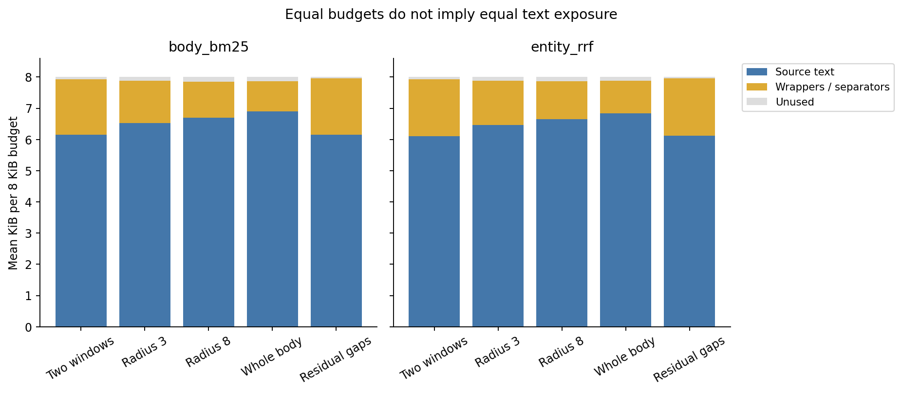
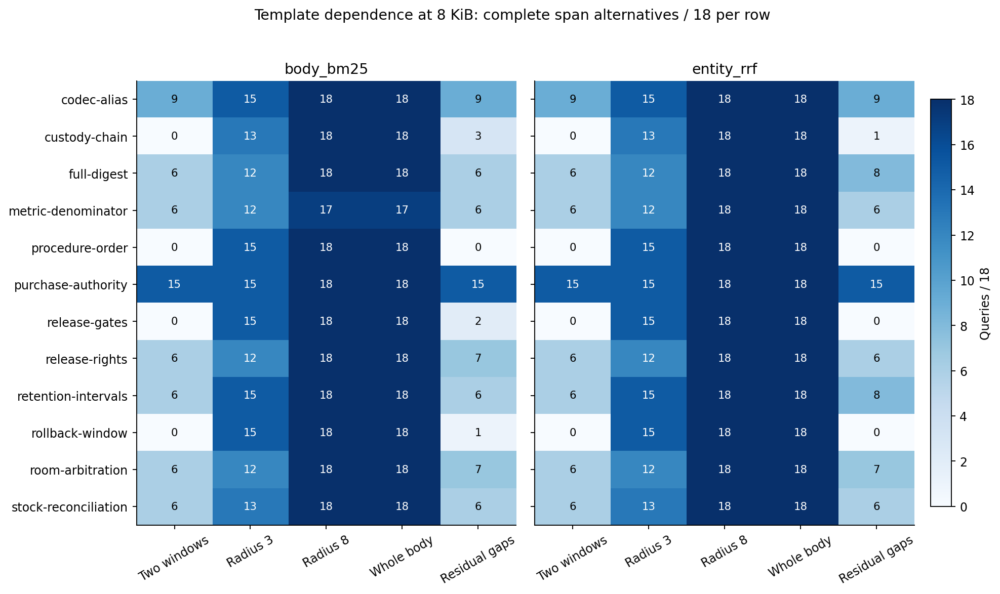

# Context expansion on the existing synthetic bank

This completed exploratory comparison isolates context width while holding saved candidate rankings, dependency closure, collection size and rendered byte budgets fixed. At 8 KiB, two windows expose a complete authored sufficient-span alternative for 60/216 queries under either ranker. Radius 8 and compact whole bodies expose 215/216 under body BM25 and 216/216 under entity RRF. These are source-exposure outcomes; no reader answered these packets.

The bank was already studied and prior aggregate results were known. “Confirmation” below names the original bank partition, not a new confirmatory claim. The new policies and source identities were sealed before this lane generated packets or computed its new gold-span outcomes. This is post hoc mechanism exploration, not preregistered confirmation or independent replication.

## Design and execution

The census contains 72 histories, 216 queries and 12 related template groups. Every query uses its original 144-record collection, two saved top-32 candidate rankings (body BM25 and entity RRF), five policies and three budgets (4,096 / 8,192 / 16,384 UTF-8 bytes): 6,480 packets. Ranking files were hash verified; no ranker was rerun. The supplied aliases and dependency links are authored scaffolding.

All policies use the original depth-two closure, with at most 16 new records per seed, and identical compact source wrappers. Two windows calls the original closure-passages implementation. Radius 3 and radius 8 expand the same two lexical anchors and retain window-pass/document-order scheduling. Whole body packs complete bodies in closure order, skipping bodies that do not fit. Residual gaps preserves the exact two-window prefix, then tries indivisible uncovered gaps in already selected documents in closure order. Oversized gaps are skipped. Selection receives only observable records, query, candidate order and byte budget; gold alternatives enter only after the packet file closes. Policy implementation is in [mechanisms.py](mechanisms.py); the sealed design is [PLAN.md](PLAN.md).

The source seal was created at 06:13:33 UTC on October 15. The authoring agent was interrupted around 06:14 during a usage reset; its already running child finished the complete census around 06:15, before the subsequent process check. Recovery preserved that completed run and did not silently rerun or overwrite it. The recorded run elapsed time is 81.38 seconds; it includes packing and evaluation and is not a controlled speed benchmark. Recovery checked the unchanged source/input hashes, all 432 saved ranking inputs, output hashes, census and endpoints. No provider calls, model calls, installations or changes to earlier study files were needed.

Seal SHA-256: `3205376794d040271ebb0818a25e39c98e76c0989d8cb925d5e2f356dbec6d22`. Run summary SHA-256: `e1e6bd14b06a7a1fa3e465d627b659827c663048c83abe20ea3f4e696b0a93b3`.

## Complete-span results

Each cell is queries with any complete authored sufficient-span alternative, out of 216. Repeated cells are paired measurements of the same queries.

| Policy | BM25 4 KiB | BM25 8 KiB | BM25 16 KiB | Entity 4 KiB | Entity 8 KiB | Entity 16 KiB |
| --- | ---: | ---: | ---: | ---: | ---: | ---: |
| Two windows | 59 | 60 | 60 | 59 | 60 | 60 |
| Radius 3 | 163 | 164 | 164 | 163 | 164 | 164 |
| Radius 8 | 210 | 215 | 216 | 215 | 216 | 216 |
| Whole body | 201 | 215 | 216 | 197 | 216 | 216 |
| Residual gaps | 62 | 68 | 187 | 61 | 66 | 206 |


At 8 KiB, radius 3 gains 104 queries over two windows with no losses under either ranker. Radius 8 and whole body gain 155 under BM25 and 156 under entity RRF, with no losses at that budget. At 4 KiB, whole body has 144 gains / 2 losses under BM25 and 143 gains / 5 losses under entity RRF. Larger text units can therefore displace useful evidence at a tight budget. Radius 8 has no observed losses against two windows in this census, but its original-ID coverage at 4 KiB is 211/216 under BM25 and 215/216 under entity RRF, versus 216/216 for two windows. Original-ID coverage and sufficient text coverage are different measures.

Residual gaps gains only 8 and 6 queries at 8 KiB, despite preserving every baseline observation; at 16 KiB it gains 127 and 146. A baseline that spends most of its budget on wrappers and scattered windows leaves little capacity for indivisible gaps. This is a property of this exact scheduling and gap rule, not evidence against all incremental expansion strategies.

## Whole originals, bytes and dependence

At 8 KiB, complete whole-original bundles are 53/216 for two windows and residual gaps, 144/216 for radius 3, 191/216 (BM25) and 192/216 (entity) for radius 8, and 215/216 / 216/216 for whole body. Whole-original completion requires one observation containing each entire required original; assembling all original characters from separate observations does not count as a whole original. Complete spans instead merge overlapping or adjacent intervals before testing the declared sufficient spans.

All rendered wrappers and separators count toward the budget. [Exact cell tables](figures/cells.json) provide mean source, wrapper/separator and unused bytes, plus original-ID coverage and paired gains/losses for all 30 cells. Source bytes count emitted source slices, including repeated text if a policy emits it; they do not measure unique semantic information.



The [template table](figures/templates.json) contains all 360 template cells, each with 18 queries. At 8 KiB, radius 8 and whole body recover all 18 queries in eleven groups under BM25, with 17/18 in metric-denominator; both recover all 18 in every group under entity RRF. The repeated templates and known bank limit generalization. No population significance test or independent-packet sample-size claim is made.



## Verification and reproduction

From the repository root, using Python and installed Matplotlib:

```sh
python evaluation/sprint-2026-10-15/packing/run_experiment.py --self-check
python evaluation/sprint-2026-10-15/packing/audit.py
python evaluation/sprint-2026-10-15/packing/render.py
```

To reproduce selection and scoring in a new directory without overwriting the retained run:

```sh
python evaluation/sprint-2026-10-15/packing/run_experiment.py --run --output /path/to/new-empty-packing-run
```

The fictional self-check passed seven positive groups and rejected three malformed inputs. The [independent audit](audit.py) passed all 6,480 source-offset reconstructions, packet hashes, rendered UTF-8 byte limits, source/wrapper byte accounting and independently implemented interval/endpoint computations. It checked the complete Cartesian census and 1,296 exact residual baseline prefixes. It shares the bank loader and aggregate formatter with execution; it does not claim wholly independent software. The receipt is [audit-receipt.json](audit-receipt.json). All three PNG exports were individually inspected for labels, cropping and legibility; their SVG counterparts and exact plotting tables are retained. The original execution sources and seal remain unchanged. Broad repository publication checks and root's separate review are outside this lane's receipt.

## Limits and implication

The result supports a narrow diagnosis on this bank: candidate/original-ID presence can coexist with severe omission of governing text, and larger source contexts can remove much of that omission under the same rendered budget. It does not establish answer accuracy, human usability, natural-vault onboarding, long-term retention, production latency or a universally best packer. Authored sufficient alternatives may omit other semantically sufficient evidence. Whole-body and wide-window performance near the ceiling may depend on short synthetic bodies, supplied links, aliases and related templates. The next useful test would freeze these policies before collecting a genuinely new corpus and evaluate unfamiliar readers separately; that test was not run here.
