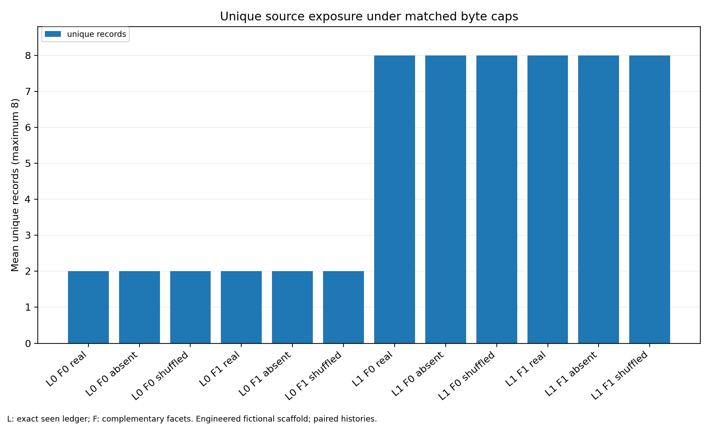

# State, authorization and recoverable proof

The 1,152 scheduled deterministic trials completed over 96 fictional histories.
Only the exact-ledger + complementary-facets + real-edge arm recovered complete
closed-log proof: 96/96. The corresponding shuffled-edge arm returned both
current values correctly in 96/96 while recovering complete proof in 0/96.
Correct decisions and sufficient proof are different outcomes here.

This is an engineered scaffold, not natural PARA validation, a natural-history
corpus, an LLM benchmark, or a production authorization system. Each seed uses a
separate PRNG instance, but the histories share one topology, ranking schedule
and event pattern. Names, scope IDs, timestamps, filler facets and release values
vary; half end in a new authorized grant and half in an auditor's revocation
exception. The 96 histories are template-related repeated cases, not 96 distinct
natural mechanisms. The strong contrasts were made reachable by the design.

## Design and boundary

[PLAN.md](PLAN.md), [state_lab.py](state_lab.py) and [sources.json](sources.json)
were hashed in [seal.json](seal.json) before the first selfcheck and collection.
There were no collection failures, amendments, outcome exclusions or policy
changes. The 24/72 development/held-out partition was sealed; both partitions
were collected in one unchanged census, without development tuning. Held-out
results are a seed-partition description, not an independently designed task
family. The existing earlier experiments were not rerun.

Every arm receives the same 24 records and fixed task: determine current access
and release for the fictional scope through tick 100. Each original source
record is exactly 768 UTF-8 bytes including whitespace padding. The four-call,
two-slot budget allows eight records and 6,144 source bytes. Source byte counts
exclude JSON container framing, IDs in receipts and selector metadata. All arms
actually used the full four calls, eight slots and 6,144 bytes. Ledger-off arms
repeated the two highest-ranked governance sources, yielding only two unique
records; ledger-on arms yielded eight unique records.
The no-ledger selector restarts from its top ranks each call: it does not page
through a fixed ranking. Its repeated governance records are consequently a
deliberately weak restart baseline, not a stateful paging comparison.

The source policy names authorized actors; a closed-log seal enumerates six
authoritative event IDs. Together with those six events it supplies a finite,
eight-record proof of the requested current state. Distractors include six
unauthorized-actor events and ten unrelated-scope events. A late unauthorized
grant cannot override a valid revocation. Older records carry authored forward
replacement links. The real, absent and shuffled conditions change only the
selector's navigation edges; delivered original source text remains identical.
Shuffling is a fixed cyclic derangement, not a randomly sampled wrong graph.

The selector receives only typed ID, facet, kind, discovery rank and navigation
fields. It receives neither hidden answers nor evaluator support/required IDs.
It does not parse the seal's closed-log membership or authority policy. Those
are explicit authored source evidence available to the consumer. The authored
facets, ranks, edge topology and closed-world log are substantial scaffolding;
they should not be mistaken for learned retrieval or a natural filing system.

## Outcomes

Each row below has 96 histories. L denotes the exact seen-ID ledger, F the
complementary facet penalty. Current requires both requested values; proof
requires policy, seal and all six sealed events. Unsupported counts provisional
grants without complete proof, even when the eventual access decision is grant.
False grants disagree with full-source authority replay. These are potential
errors in provisional output, not externally executed actions.

| L | F | Edges | Current correct | Complete proof | Unsupported grant | False grant | Naive false stop |
|---|---|---|---:|---:|---:|---:|---:|
| 0 | 0 | real | 0 | 0 | 0 | 0 | 0 |
| 0 | 0 | absent | 0 | 0 | 0 | 0 | 0 |
| 0 | 0 | shuffled | 0 | 0 | 0 | 0 | 0 |
| 0 | 1 | real | 0 | 0 | 0 | 0 | 0 |
| 0 | 1 | absent | 0 | 0 | 0 | 0 | 0 |
| 0 | 1 | shuffled | 0 | 0 | 0 | 0 | 0 |
| 1 | 0 | real | 0 | 0 | 48 | 0 | 0 |
| 1 | 0 | absent | 0 | 0 | 96 | 48 | 96 |
| 1 | 0 | shuffled | 0 | 0 | 48 | 0 | 0 |
| 1 | 1 | real | 96 | 96 | 0 | 0 | 96 |
| 1 | 1 | absent | 0 | 0 | 96 | 48 | 96 |
| 1 | 1 | shuffled | 96 | 0 | 48 | 0 | 96 |

The proof-aware consumer continues until complete or budget exhaustion; it
does not use the naive stopping heuristic. The naive diagnostic asks whether
policy plus one valid event per facet would have declared sufficiency before
closed-log completeness. Even the eventually successful real-edge arm trips
that diagnostic at round two in all 96 histories. Newer exception evidence is
still missing then. Proof-gated safe authorization makes zero false grants in
all 12 arms, while authorizing 48/96 cases only in the complete-proof arm.
Abstention is therefore part of that safety result.
The utility cost is substantial: every incomplete arm withholds all 48 true
grants. In particular, L1/F1/shuffled has 96/96 correct two-field current answers
and 48 correct provisional grants, yet proof gating safely authorizes 0/48
eligible cases. L1/F1/real safely authorizes all 48. Zero false authorization
alone would hide this difference. [utility-table.json](utility-table.json)
records true-grant opportunities, correct provisional grants, safe true grants,
withheld true grants and safe false grants separately for every arm.

The absent-edge ledger arms' 48 false grants are exactly the 48 histories whose
last authoritative access event is the auditor's revoke. Shuffled edges can
land directly on terminal records and recover the right values without the
intermediate events demanded by the sealed-log proof. This control directly
demonstrates why value correctness alone cannot certify evidence sufficiency.

[tables.json](tables.json) contains all-arm and partition totals. The same
success pattern holds in development (24/24) and held-out seeds (72/72);
absent-edge false grants are 12/24 and 36/72. [paired-effects.json](paired-effects.json)
contains 18 preplanned marginal paired contrasts and 2,000-resample percentile
intervals. These average over the other switches; interactions matter. Several
intervals collapse because the shared topology makes per-seed contrasts
identical. They quantify resampling of this constructed bank, not uncertainty
over real filing histories, people, future architectures or LLM behavior.

## Figures and reproducibility




The three Matplotlib PNG/SVG pairs use the underlying table totals without
filtering. All three PNGs were opened and individually inspected: labels,
legends and axes were legible; SVGs are matching vector exports.

From the repository root, check actual stored outputs without writing files:

```sh
python evaluation/sprint-2026-10-15/state/independent_check.py
python evaluation/sprint-2026-10-15/state/check_utility.py
```

The original `selfcheck`, `audit` and `render` stages write receipts or exports;
run them in an isolated copy when preserving retained deliverables. The
independent checker is read-only by default (`--receipt` explicitly writes its
receipt). `run` refuses to overwrite an existing census. To reproduce from scratch, copy
PLAN.md and state_lab.py to a fresh directory, then invoke `seal`, `selfcheck`,
`run`, `audit`, `render`; the plan and script hashes are part of the seal.
Copy both supplementary checkers as well to reproduce utility with
`python check_utility.py --write`; without `--write` it only checks the saved
utility table against source-replayed grant opportunities and stored outcomes.
The independent checker was added after collection as verification only; it
does not import the selector, generator or consumer and changes no outcomes.
It separately replays selected and full source events and tests rejection of
an invented grant, a wrong completeness flag, a corrupted packet hash, an
invented safe authorization without proof, and an invalid arm in the census.
Exact Cartesian seed/arm membership is required, beyond row and unique counts.

The ten precollection selfchecks passed. The actual audit checked every census
key, every original record's width, every returned packet hash, budgets,
consumer output, independent full-source current decision and proof membership.
Command receipts and artifact hashes are in [EXECUTION.md](EXECUTION.md).
No model/provider or external authorization boundary was exercised. No human
validation, natural-history transfer, open-world absence proof, adversarial
source-policy forgery or alternate graph-shuffle distribution was tested.
