# Filing hypotheses pilot: results and limits

**Execution date: 2026-10-09. Literature cutoff: 2026-10-08 UTC.** This report describes actual controlled continuation trials and filesystem replays. All public projects, records and artifacts are fictional. This is a first synthetic pilot, not a validated benchmark or evidence that one folder taxonomy is universally best.

**The main result is a failure mechanism, rather than a winning folder arrangement.** The final study recorded all **80 main reader trials**, plus **six exploratory onboarding trials**. The main frozen rubric passed **60/80**; requiring clean reader completion as well gives **57/80**. All required originals were fully read in **79/80**, yet one reader retained a superseded setting. Its structural checks passed. More available context and successful execution did not guarantee the correction governed the final artifact.

An independent reconstruction found **18 convention-sensitive failures among all 86 receipts**: an unspecified status synonym, valid section-qualified citations, supported additional history and a focused question missed by a lexical proxy. The score reconstruction is independently implemented; the secondary fixture author's semantic adjudications are unblinded LLM review, not independent human labels. A separately labeled posthoc audit accepts **77/80 main artifacts** (**74/80** with clean reader completion), rather than overwriting the preregistered scores. Across all 86, those figures are **83/86** and **80/86**. These are audited sensitivity counts from these fictional cases, not general accuracy estimates or a validated replacement metric.

The pilot also executed **five actual filesystem maintenance traces**. A canonical representation needed one fewer prescribed repair write than copies, but more reads. Update-triggered maintenance did not win the engineered capped timeline. An omitted dependency produced a falsely clean stale view, and an interrupted review left a correctly marked dirty view. Source coverage and commit integrity deserve direct tests.

Read the [independent audit](AUDIT.md), [interactive results viewer](https://github.com/BlueRaddish/filesystem-agent-memory-research/blob/main/evaluation/study-2026-10-09/index.html) and [machine-readable results](results.json). The HTML is a portable download; GitHub's file preview does not execute it.

## What was tested

The [eight hypotheses](../../research/filing-hypotheses.md) proposed small improvements to evidence recovery rather than a wholesale new filing system. This pilot tests H1/H2/H8 on four fictional workstreams each and H3/H5/H7 on two each. Forty case-condition pairs run once at each of two resource limits: 80 main trials. Six exploratory trials examine entry removal or an explicit schema briefing on three selected families. H4/H6 are five separate engineered maintenance traces, not reader-performance observations.

| Hypothesis | Actual implemented comparison | Scope limit |
|---|---|---|
| H1: source-linked current state | Sources only, an unlinked current view, and the same view with precise source links; includes stale views | Links are tested; automatic view extraction/repair is not |
| H2: discriminating cues | Generic versus problem/scope/alias headers; same original bodies and equal byte-length envelopes | Authored synonyms and token-cost differences remain |
| H3: coherent episodes | Fixed windows versus coherent grouping in a verbatim passage index, with originals retained | Tools read files/lines, not capsule objects; this is a grouping test |
| H4: canonical shared state | Canonical records versus copies, actual correction/rename/broken-link/exception repairs | Prescribed repair targets and indexed separator access, not maintainer competence |
| H5: eligibility separate from retention | Generic versus explicit source-derived eligibility headers; late old imports, proposals and unresolved authority | Correct metadata is supplied; extraction errors are not tested |
| H6: update-triggered maintenance | Update/handoff/periodic schedules on the same eight steps and capped reviews | One engineered timeline; reviewed source exposure differs |
| H7: dependencies | Bare references versus explicit links with cycles and a missing prerequisite | Neither a semantic top-k retriever nor an enforced graph-expansion algorithm |
| H8: obligations | Equivalent prose versus structured pending obligations; actual triggered checks | Local schema modes, not live uploads, releases or physical actions |

The original sources remain available in every arm. Source-only/current-view comparisons intentionally vary the view; linked/unlinked views otherwise share their wording. Fixture authors and an independent review audit froze the tasks, domain truth, sufficient evidence and check expectations before collection. Two LLM authors produced the fictional families; this is not a human-authored or statistically representative corpus. Inspect [primary authoring](AUTHORING.md), [secondary design](SECONDARY-DESIGN.md), [fixture JSON](cases.json) and [secondary JSON](secondary-cases.json).

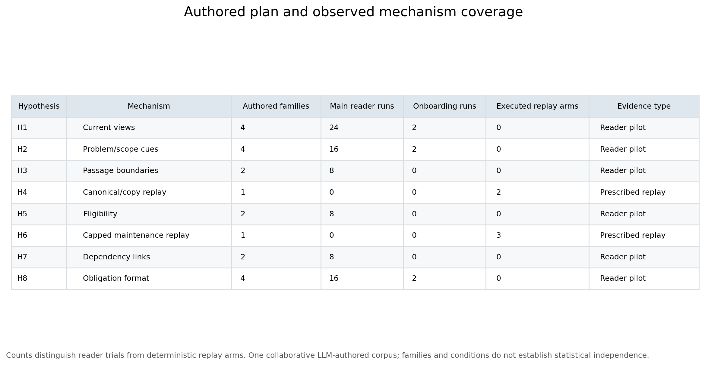

## Reader, freshness and execution controls

The final batch uses Muse `muse-spark-1.3-contributor` at high reasoning effort. The model sees a neutral tool/task prompt, its collection and explicit history within that trial. It receives no PARA layout primer, unrelated session, private gold, repository workspace, fixture builders or previous-trial answer. Every explicit reader call starts a new rootless native process and ephemeral session with clean task-local stores and zero enabled skills. Files and permitted checks are mediated by a virtual collection. The host allows only the artifact write and exact trusted check commands; original records are immutable to the reader.

**Freshness means new local sessions and no supplied personal-vault briefing or other-trial history.** General model knowledge remains. Remote account personalization/erasure and every detail of the native system prefix are unverified. Calls explicitly replay their own trial history; fresh calls do not mean forgetting evidence already read in that trial. Provider requests use `store:false` with no continuation association keys. That is observed request posture, not a proof of remote deletion. See [controls](READER-CONTROLS.md).

Native Muse advertises a session-local to-do tool. It sometimes also attempts unadvertised functions. The adapter accepts only an exact host-proven unknown-tool failure, with no file data or execution, then processes the reader's separate JSON actions. These blocked native attempts are counted as interoperability overhead. A successful non-bookkeeping native action or any other refusal invalidates the call. This does not expose a native filesystem or translate native calls into collection access.

Two earlier batches failed before meaningful retrieval. Attempt 1 preserved 25 completed failure receipts from 28 launched jobs and zero virtual actions. Attempt 2 preserved 22 failure receipts from 25 launched jobs, with lists and eight entry/draft/check/obligation reads but zero accepted original reads, searches or artifact writes. A short first-response canary had not tested multi-call replay. Before the final batch, a complete high-effort rehearsal recovered five originals, wrote a correct artifact, executed checks, received a later receipt and finished. The Glassmere rehearsal family is setup-exposed. Six concurrent transport canaries also passed; the final worker count is six. Original low-effort, three-worker attempts are never pooled with final results as unchanged or independent filing observations.

All aborted receipts and frozen source snapshots remain available. The final fixtures/gold are unchanged; the final prompt, high effort and recoverable-error boundary are prospectively frozen. See [original plan and amended final plan](PREREGISTRATION.md), [execution amendments](EXECUTION-AMENDMENT.md), [final freeze](freeze.json), [first abort](attempt-1/aborted-results.json), [second abort](attempt-2/aborted-results.json) and [unscored rehearsal](setup-rehearsal.json). No best-of-many scored retry was selected.

The matched regime permits six calls, 24 actions and nominally 12,288 returned tool bytes. Fidelity-first permits twelve calls, 72 actions and 65,536 bytes. Failed reads cannot masquerade as full reads; control-error envelopes can cause small final byte-cap overshoots. Regimes are distinct conditions, not independent replications. Timing includes local process/harness overhead and concurrent scheduling.

## What counts as success

The frozen **complete-task** gate requires an actual artifact write, all expected domain/history/obligation values, sufficient governing citations, all required successful checks after the last write, no prohibited virtual action, and appropriate uncertainty/hold behavior. Extra valid evidence and ordering do not fail. Exact H2 project-name wording is not scored because some generic originals do not expose the treatment's canonical label. Question focus uses a predeclared shallow lexical rubric; actual questions are inspected before interpreting it.

The **critical-field gate** covers declared important artifact fields, not every aspect of safety. It does not prove a check happened, nor does an untouched draft's failed field gate show a reader made a decision. The actual check gate and observed write state are separate. The local validator checks structure and operation-specific shape; the hidden evaluator grades source-derived values. A structural pass can accompany the wrong facts.

Full-original read coverage measures whether specified original files were read completely. It is a discovery proxy, not semantic recall: an index passage, linked view or search line may already supply a correct fact. It is not an additional success gate. Required citations are a requested compliance gate, and still do not prove reading. A later-turn receipt proxy shows at least one successful post-final-write check reached another reader call; it does not prove every mode was inspected or that the model understood its output.

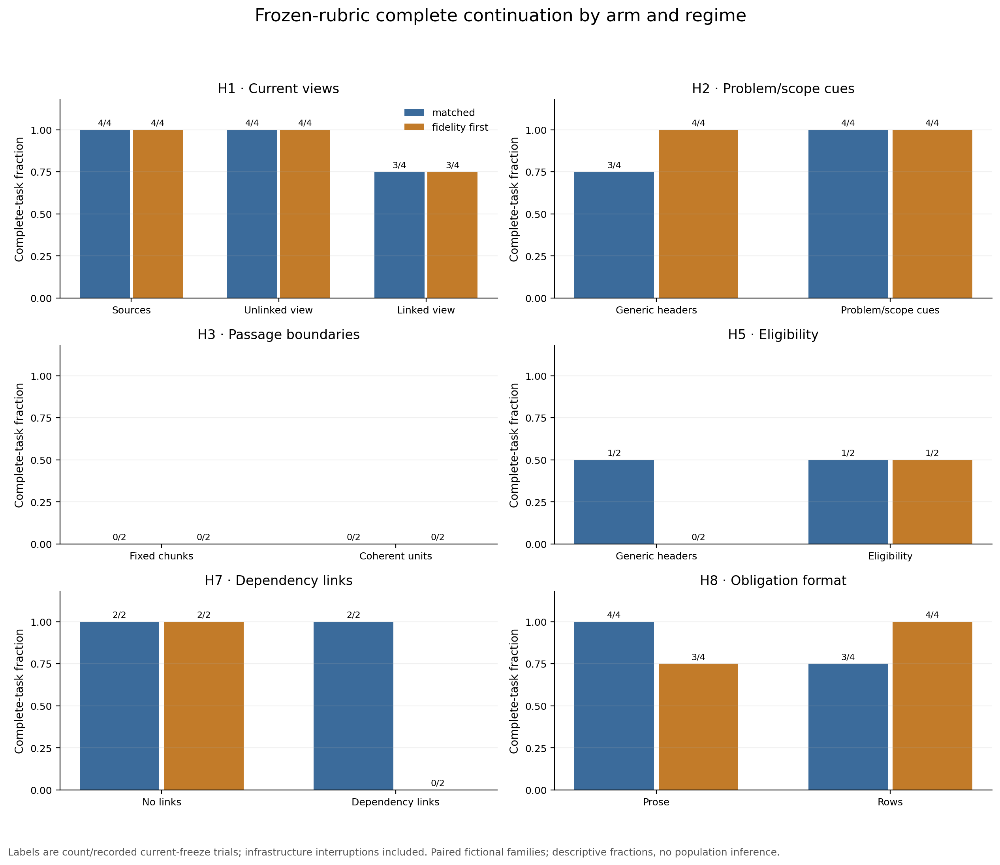

| Main comparison | Matched frozen passes | Fidelity-first frozen passes | Interpretation after source audit |
|---|---:|---:|---|
| H1: Unlinked view | 4/4 | 4/4 | One linked-view factual correction failure; another linked-view failure is citation formatting. |
| H1: Sources only | 4/4 | 4/4 | One linked-view factual correction failure; another linked-view failure is citation formatting. |
| H1: Linked view | 3/4 | 3/4 | One linked-view factual correction failure; another linked-view failure is citation formatting. |
| H2: Problem/scope/alias headers | 4/4 | 4/4 | One generic-arm budget/no-write failure; two rubric passes end without clean completion. |
| H2: Generic headers | 3/4 | 4/4 | One generic-arm budget/no-write failure; two rubric passes end without clean completion. |
| H3: Fixed passage windows | 0/2 | 0/2 | Every failure is the unspecified complete/ready status convention; no factual separation. |
| H3: Coherent passage groups | 0/2 | 0/2 | Every failure is the unspecified complete/ready status convention; no factual separation. |
| H5: Eligibility headers | 1/2 | 1/2 | Status conventions, a shallow question proxy and one infrastructure failure before an accepted response dominate. |
| H5: Generic headers | 1/2 | 0/2 | Status conventions, a shallow question proxy and one infrastructure failure before an accepted response dominate. |
| H7: Bare references | 2/2 | 2/2 | Linked fidelity failures are supported additional history; one matched pass has a later process failure. |
| H7: Dependency links | 2/2 | 0/2 | Linked fidelity failures are supported additional history; one matched pass has a later process failure. |
| H8: Prose obligations | 4/4 | 3/4 | The two main failures are section-qualified citations; all main required checks ran after final writes. |
| H8: Structured obligations | 3/4 | 4/4 | The two main failures are section-qualified citations; all main required checks ran after final writes. |

Each cell contains only two or four authored families. Each family occurs in several conditions; 80 trials are not 80 independent problems. No confidence interval, significance test or population ranking is justified by these data.

## Paired outcomes, failures and verification

The two resource regimes produce **31/40 matched** and **29/40 fidelity-first** frozen passes; clean reader completion reduces these to **29/40** and **28/40**. The larger regime is not a controlled token-price comparison, and the draws are not repeated independent samples. Its lower literal score is largely convention-sensitive. This pilot does not show that supplying less context improves truth, or that spending more tokens guarantees it.

**H1 gives a concrete warning about derived state.** Source-only and unlinked-view arms pass all eight main trials each. Linked views pass six of eight under the frozen rubric. One difference is merely a section-qualified citation; the other is a retained stale setting. It is reasonable to test whether source pointers anchor readers to an incomplete view, but a single draw does not establish that links caused the error. The linked view's rewrite date and precise citations were both insufficient as coverage guarantees.

**H2 supplies one navigation/resource countercase.** Northcanal's generic-header matched trial exhausted its returned-byte allowance while repeatedly searching for a canonical project label, and never wrote an artifact. The original bodies had already been received. The label is not part of the H2 scoring target. The problem/scope arm produced the correct artifact, but its matched draw hit the call cap before clean completion. This motivates measuring stopping behavior and task clarity alongside cue quality; it does not establish a stable cue advantage from one family.

**H3 is inconclusive for grouping benefits.** All eight trials fail the literal rubric, yet all eight have correct source-derived fields, sufficient citations and post-write checks. They use status `complete`, while the task and structural validator require a string without declaring the hidden `ready` enum. Calling this zero factual accuracy would be misleading. The grouping manipulation also leaves whole-index reads available, so it does not isolate matched retrieval units or a neighbor-expansion policy.

**H5 does not show that retention date should determine current authority.** The written artifacts correctly resolve the old import and unapproved proposal and preserve the unresolved signed-instruction conflict. Its frozen failures reflect three status synonyms, one lexically rejected but focused hold question and one infrastructure no-write. Eligibility metadata is author-supplied and correct here; reliable automatic tagging still needs its own experiment.

**H7 and H8 show ceiling effects in these small collections.** Dependency-linked fidelity artifacts retain extra supported history that an empty-object comparison rejected. All substantive H7 decisions, including a correct missing-calibration hold, are preserved. Prose and structured obligations both lead to the required authorized checks across all 16 main H8 runs; their two rubric failures are citation format only. These tasks do not establish an advantage for links or obligation tables when short collections and recursive inventory already make the evidence easy to find.

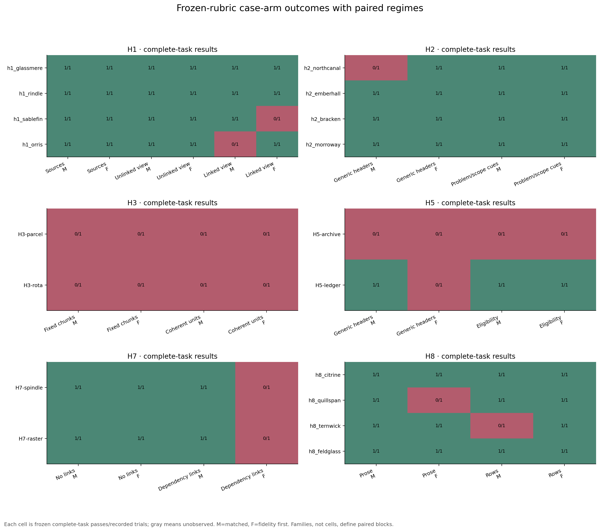

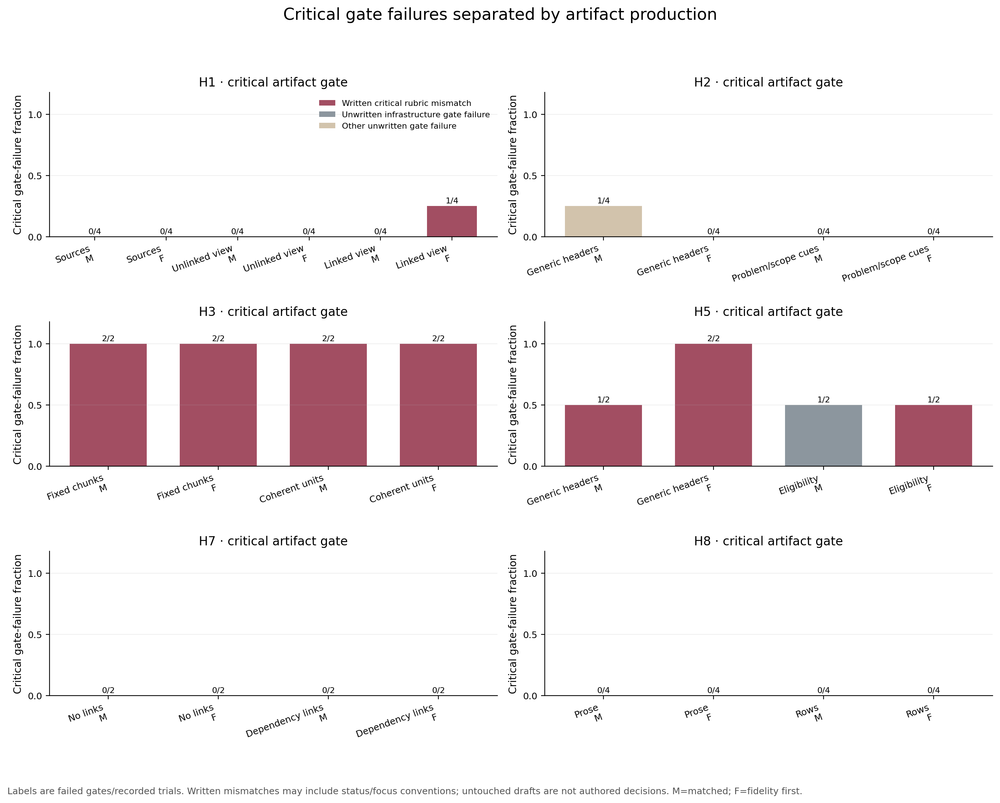

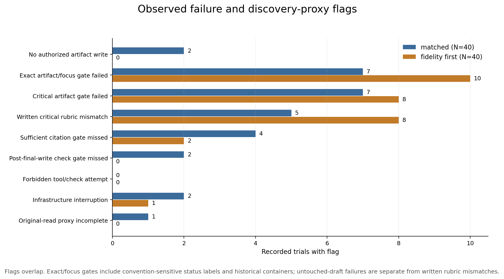

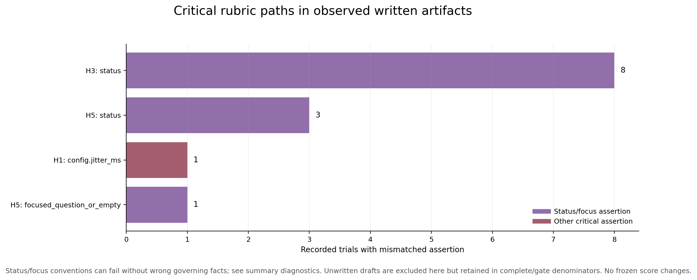

### Source read, source use and verification: the Sablefin failure

Trial **T043**, linked current view with fidelity-first caps, writes `config.jitter_ms: 200`. Original **SA-04:S2** explicitly corrects that value to **0**, superseding SA-03's initial 200. It also preserves the 90-second retry and local-buffer exception; the artifact gets those fields right. SA-04:S1 first says 200 remains acceptable, followed two minutes later by S2's final correction. The ambiguity is resolved inside the same original record.

The derived view still says 200 and links SA-01, SA-02, SA-03 and SA-05; it omits SA-04. Its May 9 rewrite is newer than the May 7 correction. The receipt sequence is:

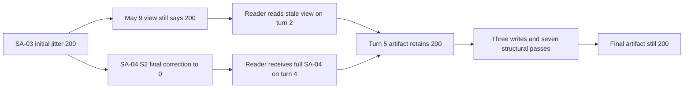

The reader had the complete correction before its first write, later reread the view, and ended with the stale value after **12 calls, 26 virtual actions, three writes and seven structural checks**. Its final citations omit SA-04. The observable fact is that the artifact agrees with the stale view despite receipt of the correction. View anchoring is a plausible interpretation, not a claim to have inspected hidden reasoning.

This case separates **retrieval completeness**, **authority interpretation**, **citation coverage** and **structural validation**. Full read coverage cannot certify source use. A shape validator cannot certify the value it accepts. A recently rewritten summary cannot certify which corrections it incorporates. A source-version ledger and a correction-specific acceptance check are concrete candidate repairs, but this study does not test their benefit.

### Scoring ambiguities, retained rather than hidden

The 21 frozen failures across all 86 receipts partition into 11 `complete` versus `ready` labels; four valid section-qualified citation formats; two supported additional-history objects; one focused hold question missed by the lexical proxy; T043's substantive stale value; T027's resource/no-write; and T082's infrastructure/no-write. No candidate convention repair removes T043's missing governing record or changes its wrong value. Read [adjudication.json](adjudication.json) and [AUDIT.md](AUDIT.md) for every affected ID and source justification.

The status problem is task underspecification. Citation membership compares bare IDs exactly instead of accepting valid record/section IDs. The empty-history comparison conflicts with the declared allowance for extra keys. The focused-question proxy misses a question that explicitly contrasts the two conflicting signed instructions, retention lengths and governing order. These are evaluator limitations discovered after outcomes. The posthoc sensitivity applies the same audited conventions throughout and keeps original gates, artifacts and receipts untouched. It is neither a preregistered primary endpoint nor a general automatic factual judge.

### Transport defect and attrition

Offline inspection established a Windows CP1252/UTF-8 mismatch at the private adapter's standard streams. Input curly apostrophes can become mojibake, and a CP1252 em dash can fail UTF-8 output decoding. Private coordinator evidence confirms that output failure for **T013**. **T053** and **T082** have nonzero reader-process exits; without separate stderr evidence their specific causes remain unclassified. T013 and T053 had already written artifacts that satisfy the frozen gates; T082 made no accepted call or write. They must remain in denominators.

The defect's input footprint is bounded but material: 11/18 task texts contain a curly apostrophe, two Rindle views contain one, and the Sablefin correction record contains one in every arm. All main gold keys and values are ASCII. This does not prove the prompt corruption harmless, especially for interpretation. The host prompt hash identifies the intended UTF-8 prompt, while the adapter's same-call-input check only proves its decoded input remained stable during native rounds. It does not prove end-to-end prompt fidelity.

The entire final 86-trial batch kept its frozen transport unchanged. A later diagnostic uses Python's process-local UTF-8 mode and is reported separately below. See the [offline default-stream reproduction and UTF-8 mode check](stdio-encoding-diagnostic.json), and the [prospective selected follow-up plan](followup-plan.md). Neither local freshness nor provider request flags establish remote account erasure.

Failure flags overlap; their totals are not a partition of failed trials. Infrastructure interruptions, no-write drafts, written factual mismatches, citation omissions, check failures and conservative blocking must not be described as the same kind of error. A completed blocked artifact can be correct when authority is unresolved. Conversely, missing a required check remains incomplete even if the JSON values happen to be right.

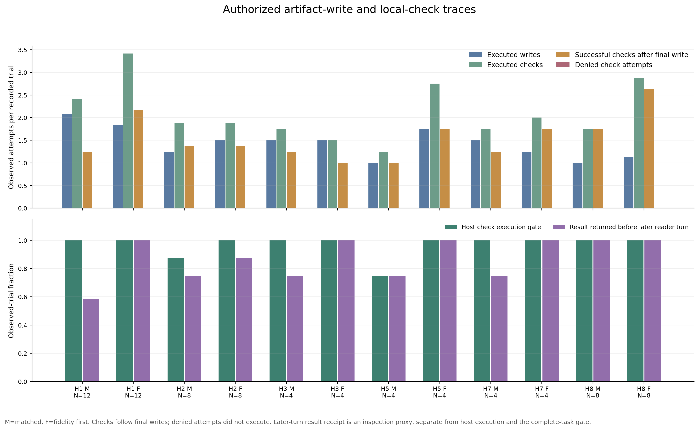

Across all 86 final receipts, **84 artifacts were actually written**, and all 84 have every required check succeeding after the last write. There were **127 executed writes**, **194 executed check attempts**, and **142 successful checks after final writes**, counting repeated modes/attempts. No denied virtual check or prohibited virtual action occurred. Native unavailable-tool requests are separately recorded, not execution.

The later-turn receipt proxy is true in **75/86**, or **69/80 main trials**. The remaining written cases can satisfy the executed-check gate without another accepted reader turn receiving a check result. Three literal passes lack clean reader completion: T013 and T053 end with process errors, and T073 reaches the call cap. Therefore report **65/86 literal gates**, **62/86 literal gates with clean completion**, and the two audited sensitivity counts separately.

The independent audit reconstructs all 86 scores, actions, full-read paths, citations, write/check ordering, returned-byte accounting and schedule membership with no discrepancy. Write receipts hash logical UTF-8 text with LF, while checks hash actual Windows file bytes with CRLF; those different hashes are consistent with the exact newline transformation, rather than evidence of an intervening edit. A successful reconstruction confirms what the harness did; it does not cure task underspecification or transport corruption.

## Retrieval resources and unfamiliar onboarding

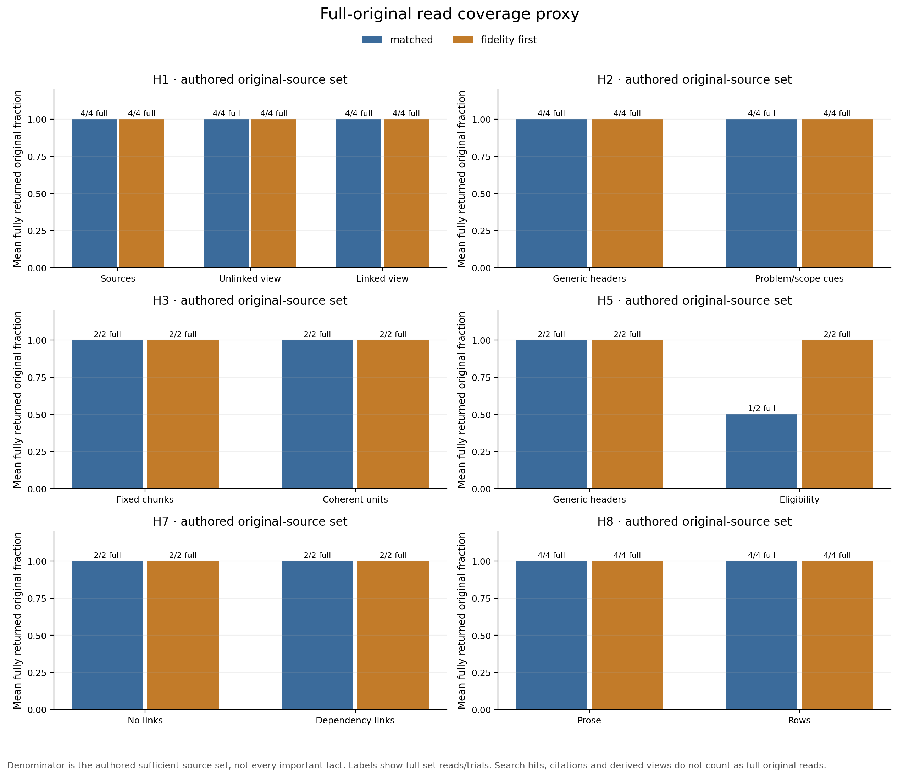

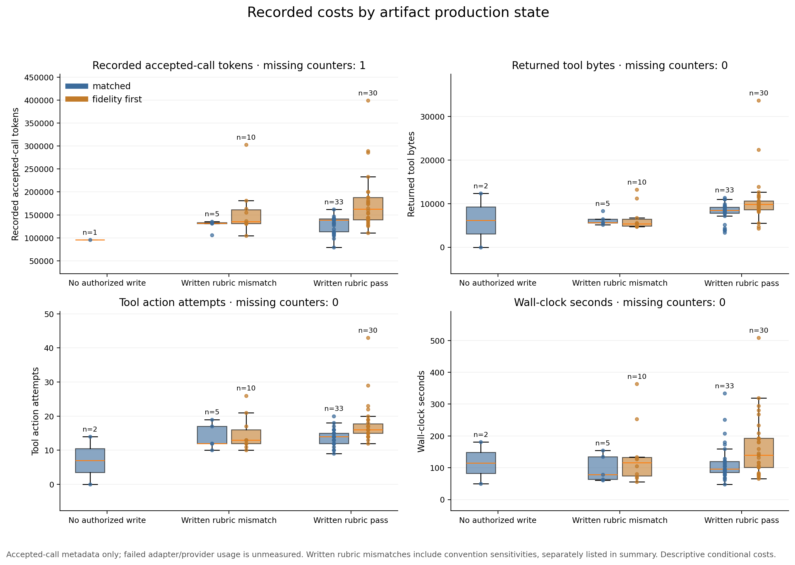

The final 86 trials contain **553 accepted reader calls**, **1,357 virtual actions**, **794,793 returned tool bytes**, and **13,217,302 recorded input-plus-output tokens**. Three failed adapter calls have unmeasured usage. One no-accepted-call trial has missing tokens, not measured zero. These totals exclude aborted attempts, rehearsal, setup probes and the later diagnostic. Internal native rounds and a large baseline system prefix make token counts much larger than collection bytes; caching is reported separately and cannot be converted here into a billed price.

| Main regime | Median actions | Median returned bytes | Median wall seconds | Median accepted-call tokens |
|---|---:|---:|---:|---:|
| matched | 14.0 | 8,310 | 94.7 | 133,303 |
| fidelity first | 16.0 | 9,290 | 130.8 | 154,703 |

There are **213 host-proven unavailable native attempts** recorded in accepted calls, of which **192** belong to the main trials. They return no source data or native filesystem execution. Model/tool interoperability contributes both latency and repeated input overhead. Costs conditional on rubric pass are descriptive survivor comparisons, not causal evidence that a storage arm is cheaper.

T027's error envelopes finish at 12,349 returned bytes against the nominal 12,288 cap. That small overshoot does not mean a full source was truncated and accepted: the harness refused results that could not fit, then counted its budget-error envelope. The final study's zero forbidden virtual operations and strict full-read accounting do not imply the separate native tool-routing layer was flawless.

Token figures sum observed accepted-call input/output counters, including any internal native rounds. Cached counters are reported but are not converted into billed cost. A rejected adapter call's missing usage is unmeasured, not zero. Aborted-attempt totals and setup calls are outside final trial token totals. Native unavailable attempts are distinct from denied virtual checks and actual forbidden operations.

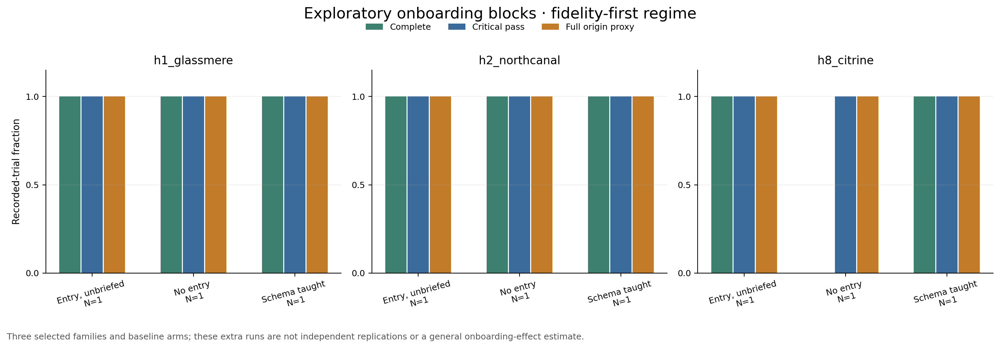

For each of Glassmere, Northcanal and Citrine, the plot compares **one identical arm at fidelity-first caps** with an ordinary entry note, no entry note or a layout-only schema briefing. It does not pool other arms into the baseline. The three ordinary-entry and three taught-schema runs pass literally; two of the three no-entry runs pass. Citrine's no-entry artifact has correct facts, required checks and full original reads, but uses valid section-qualified citations. It passes the convention audit. Thus the source audit finds correct checked artifacts in all nine selected observations, without evidence that an entry note is unnecessary for larger collections.

Glassmere was used for a complete setup rehearsal, and Citrine for a first-response setup canary. Those exposure limits are explicit. The reader itself gets a new local rootless session, no inherited PARA explanation and no prior trial output. Remote service-side exposure cannot be certified absent. The selected examples are neither held-out independent families nor an onboarding-effect estimate.

These imported fictional collections test navigation and local continuation without an inherited PARA briefing. They do not test installation, Drive authorization, the complete personal vault, Obsidian indexing or live curated publication. Recursive filename inventory and short case histories make discovery easier than a large evolving vault. A useful next benchmark must separate bootstrap instructions from pre-supplied answers and withhold full workstreams/source histories.

## H4 and H6: actual file evolution, bounded conclusions

H4 stages two storage designs and performs actual corrections, a rename, a broken project reference and a scoped exception repair. Canonical storage uses **four** prescribed repair writes; copies use **five**. Both experience two indexed-access failure checkpoints and two stale checkpoints before repair. The resolver is deliberately limited to indexed separator rules, including a local exception; it does not claim complete inherited-state access or fall back to retained source versions. Canonical resolution also performs more index/state reads, so one fewer repair write does not establish lower total cost. Repairs are specified by the experiment, not discovered by a maintainer.

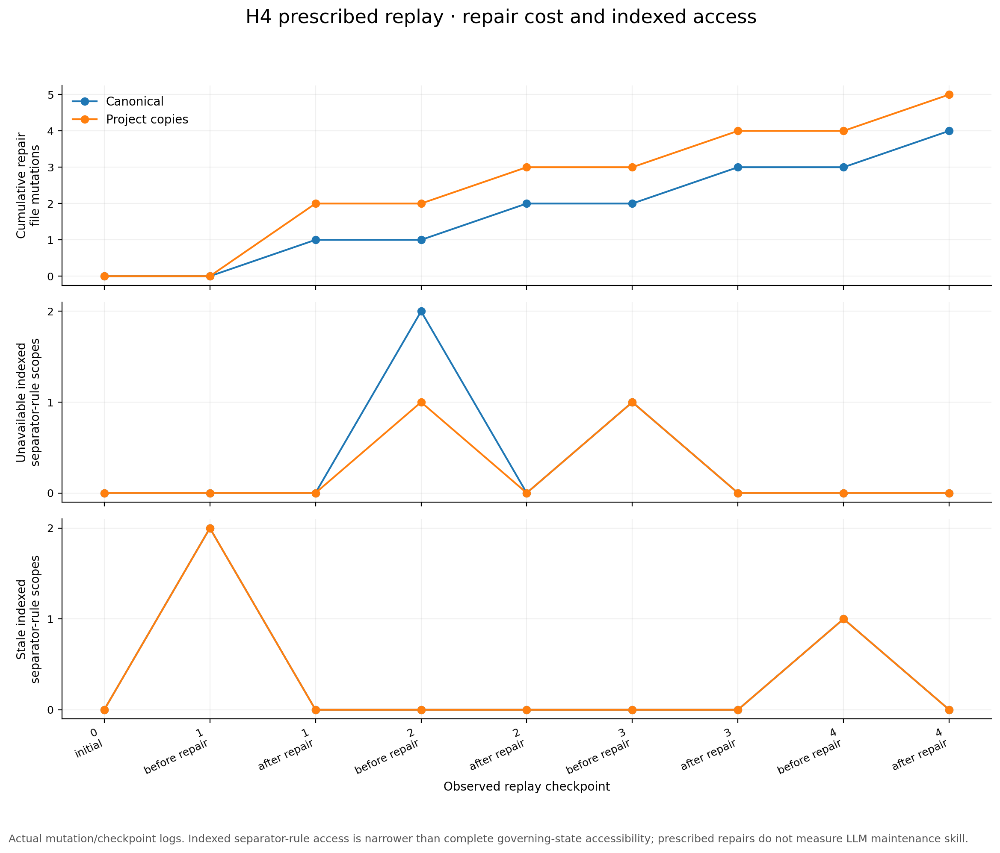

H6 replays the same eight events under three schedules. Every schedule gets three review attempts and six governing-record body inspections, plus separately counted metadata tracking/audit and evaluator reads. Update-triggered and fixed-period reviews encounter an interruption; handoff reviews do not. Candidate files are written, but interrupted candidates never replace committed state or advance coverage. A deliberately omitted dependency creates a false-clean stale view at step 3 in two schedules; an explicit coverage audit later detects the gap. A clean-looking flag is not a completeness certificate.

Observed stale event steps are **5 update-triggered, 4 handoff-triggered and 6 fixed-period**. The update-triggered schedule ends dirty with a known missing incorporation because its last capped review was interrupted; the other two end current. Governing source versions are retained; the irrelevant decorative source's earlier version is not. These outcomes show the declared mechanics ran, including the failure. They do not rank maintenance policies across other timelines: schedule position, reviewed source exposure and interruptions differ, and only one engineered sequence was tested. No LLM was asked to repair these maintenance states.

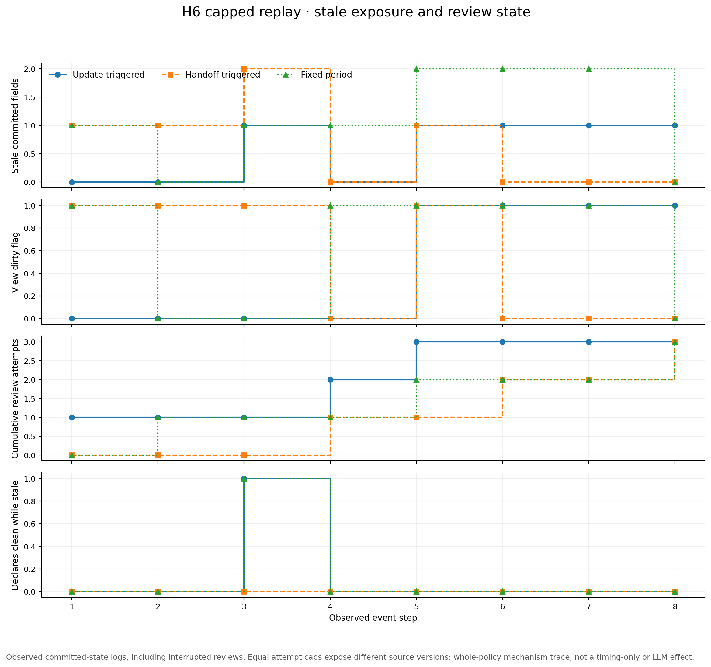

See [maintenance results](maintenance-results.json) and the runnable [replay](replay_maintenance.py). The checkpoint assertions compare actual staged files, committed coverage and costs; these are execution receipts, not a prose success claim.

## What to change next

### Separate UTF-8 diagnostic results

After the main results were complete, four prospectively frozen diagnostic trials invoked the unchanged private adapter with Python `-X utf8`. All four wrote the correct artifact, covered the required originals/citations, executed their post-final-write check, received its result in a later call and finished cleanly. None made a prohibited virtual action.

| Diagnostic | Actual result | Calls / actions | Returned bytes |
|---|---|---:|---:|
| D001: Sablefin sources only | Jitter 0, prior failed-check history preserved | 11 / 23 | 12,248 |
| D002: Sablefin unlinked view | Jitter 0, prior failed-check history preserved | 7 / 16 | 8,542 |
| D003: Sablefin linked view | Jitter 0, prior failed-check history preserved | 10 / 22 | 11,757 |
| D004: new fictional Unicode family | Exact label 青灯, symbol λ, final threshold 8; initial threshold 4 retained | 5 / 11 | 3,175 |

The Sablefin draws were selected after the main failure, and the same service had already processed that family. The Unicode family was independently authored for this diagnostic. These outcomes show successful continuation through the corrected transport and recovery of the Sablefin correction under the changed execution condition. They do **not** identify whether encoding, reader variability, service exposure or any other factor caused the change. They are not pooled with the 80 main or six onboarding trials, and do not erase T043. See [plan](followup-plan.md), [freeze](followup-freeze.json), [new Unicode case](unicode-case.json) and [all four diagnostic receipts](followup-results.json).

For a production filing system, keep the working distinctions small and testable. Preserve original records; organize curated notes by durable workstream; allow one session to update several relevant logs. None of the synthetic comparisons measures the mistake of dumping unrelated session topics into one project hub, so that earlier user correction remains an organizing requirement rather than a newly tested result.

The highest-priority hypothesis refinement is **incorporation-aware current views**: attach the exact governing source versions, explicit unresolved gaps and supersession relationships to a view, and challenge it against late corrections before action. A rewrite timestamp or a set of correct-looking links should not stand in for that ledger. The Sablefin failure and H6 omitted dependency directly motivate this candidate. Its effectiveness is still unmeasured.

Make the task contract explicit before improving the architecture: declare status enums, accept documented section-qualified citations, compare expected history fields without rejecting supported extras, and source-audit a meaningful hold question. Test Unicode through the entire adapter. Require actual checks for execution claims, and source-specific assertions for source-derived values. Preserve blocked tasks and unfinished infrastructure states in the record; avoid selecting a successful rerun and presenting it as the original result.

Keep H2, H3, H5, H7 and H8 as open comparisons. This pilot has mostly ceiling performance after convention audit, small histories and limited discovery pressure. A better next test should make it difficult to find the right workstream and simultaneously penalize choosing a plausible wrong one. It should evaluate a fresh agent completing the task after maintenance events, rather than only inspecting deterministic file state.

Several improvements already have a defensible role even without a filing winner: preserve authoritative sources and scoped exceptions; distinguish current eligibility from retention; keep derived views traceable to incorporated versions; retain failed-check receipts; and make required obligations discoverable. The pilot does not justify reorganizing the production vault solely from a small rate difference. The highest priority is extending the test to harder independent histories and measuring actual continuation after maintenance failures.

1. Use additional independently authored or consented real tasks, longer histories, plausible near-match projects and held-out paraphrases. Include historical questions and unresolved authority; never silently invent tie-breakers.
2. Run enough independent families and repeated reader draws to estimate variability; keep case clusters and multiple budget regimes separate. Match token costs when testing cue formatting, not only character envelopes.
3. For H3, expose matched-byte retrieval units and controlled neighbor expansion rather than whole-index reads. For H7, cross the link representation with an actual expansion policy and test missing/cyclic/irrelevant dependencies.
4. For H5, test imperfect metadata extraction and later correction. Correct eligibility labels supplied by an author do not establish reliable production tagging.
5. For H4, measure a maintainer finding repairs and a fresh reader continuing afterward. For H6, randomize many update/handoff/interruption timelines and read intermediate false-clean/dirty checkpoints with an actual model.
6. Require a complete read/write/check/receipt preflight for each new adapter; retain infrastructure failures and unavailable native requests. Test fresh personal-vault bootstrap separately, with private truth labels and public-only sanitized aggregates.

This connects the previous [literature synthesis](../../research/synthesis.md) to falsifiable measurements. Source-linked episodes, cues and obligations remain mechanisms worth testing. Their benefit depends on source quality, source coverage, reader interpretation and execution—not merely on an attractive folder arrangement.

## Inspect and reproduce

The [interactive viewer](https://github.com/BlueRaddish/filesystem-agent-memory-research/blob/main/evaluation/study-2026-10-09/index.html) provides hypothesis/regime filters, case-level gates, an authority/correction diagram, maintenance timelines and the aborted-batch history. Download and open its standalone HTML. This report embeds **12 scientific figures**, each available as PNG and SVG under [figures](figures/). The figure scripts derive them from recorded receipts rather than invented example rates.

The core files are [frozen main runner](run_study.py), [final freeze](freeze.json), [raw synthetic receipts](results.json), [derived summary](summary.json), [analysis script](analyze_results.py), [independent audit](AUDIT.md), [adjudication](adjudication.json), [maintenance runner](replay_maintenance.py) and [maintenance receipts](maintenance-results.json). Failed setup attempts and exact old public source snapshots remain under [attempt 1](attempt-1/aborted-results.json) and [attempt 2](attempt-2/aborted-results.json). The diagnostic reuses the same main runner through [run_followup.py](run_followup.py).

Matplotlib is needed only to regenerate the charts; the main trial runner, maintenance replay, self-checks and repository checker use the Python standard library. A model adapter and authenticated account are required for new reader execution. The synthetic fixtures and all published response/action text contain fictional workstreams, not private personal memories.

```sh
python evaluation/study-2026-10-09/run_study.py selfcheck
python evaluation/study-2026-10-09/replay_maintenance.py --self-check
python evaluation/study-2026-10-09/analyze_results.py --self-check
python evaluation/study-2026-10-09/analyze_results.py
python scripts/check_repository.py
```

The reader runner needs a private compatible command configuration and an empty external work directory. The public [adapter contract](READER-CONTROLS.md) explains what a replacement must report. Native login material and host paths are excluded from the public project. Figures are regenerated from actual JSON receipts; PNGs and SVGs are shareable. No raw personal session/vault content or hidden reasoning is published. Editorial privacy review and pattern/metadata checks are bounded verification, not a proof of the absence of every conceivable disclosure.

The [viewer construction and QA record](VIEWER-METHODS.md) documents rejected presentation drafts, exact data import, real browser interaction checks and privacy-review boundaries. Git attributes preserve the frozen study's exact file bytes so newline conversion cannot invalidate its input digests on publication.
