# Atomic memory retrieval: expanded study

**Completed primary results, execution audit, supplemental blinded review and final display inspection.** Study date: October 11, 2026 (Pacific); collection and analysis completed October 12 UTC. All 18,432 retrieval packets, 4,608 rankings, 144 uncached timing observations and 144 scheduled reader outcomes are present. Registered primary scores remain unchanged. All registered scores and failures remain preserved.

The strongest result is a context-budget constraint. At 144 documents with all three interventions enabled, complete held-out original-evidence recovery was only 6–10 of 72 queries at 4,096 bytes, rising to 54–61 at 8,192 bytes. All declared bundles fit the larger budget; fewer than half fit the smaller budget with index cues. Downstream exact value-and-source completion in the four 4 KB reader arms was 0, 1, 0 and 0 of 24 trials. Oracle evidence completed 5/12; both fresh discovery arms completed 0/12. These are frozen exact agreement and completion results, not semantic accuracy estimates.

The separate blinded review materially changes how those reader counts should be interpreted: all 24 diagnostic control artifacts are judged to answer their queries from supplied originals, despite only 6/24 passing the frozen complete-task gate. Across all 123 actual artifacts, 37 have source-supported requested values/status but fail exact answer matching. These single-reviewer LLM judgments show substantial convention sensitivity, while incomplete supplied evidence and 21 absent discovery artifacts remain real limitations. They do not establish human-validated accuracy or replace the primary endpoint. [Supplemental methods and cases](SEMANTIC-REVIEW.md)

Separately measured warm CPU median rank/pack times were 1.83–4.40 seconds for local scorers versus approximately 12–14 milliseconds for lexical policies. Decision-only scoring avoided generating a selection answer but still computed query/text pairs. Complete context and accuracy remain the priority; these observations identify no universal engine winner or production-vault recommendation.

The [frozen October 9 pilot](../study-2026-10-09/REPORT.md) is separate. It exposed a reader using an older value despite supplied correction evidence while structural checks passed. Its cases, retries and later convention-audit scores are not pooled here. The expanded study separates recovery, exact answer/source agreement, artifact production and clean completion.

## Protocol and trust boundaries

Three rounds examine atomic retrieval policies, local ranking/pruning engines and downstream reading/fresh discovery. A decision-only encoder scores query/document or query/branch pairs; relevance is not a calibrated probability of authority, correct facts or safe action. Each pair still needs tokenization and inference. [Sentence Transformers retrieval and reranking documentation](https://www.sbert.net/examples/sentence_transformer/applications/retrieve_rerank/README.html)

LongMemEval motivates separating indexing, retrieval and reading, including updates, temporal reasoning and abstention; its conversational benchmark does not certify this artifact workflow. The [model research note](MODEL-RESEARCH.md) records sixteen primary sources and licenses. Literature supplies mechanisms to test, not expected fixture results. [LongMemEval paper](https://arxiv.org/abs/2410.10813)

Two isolated LLM authors each produced 24 semantic families, two queries and ten retained records per family: 48 families, 96 tasks and 480 records. Author A has 192 originals/48 derived views; B has 216 originals/24 views. Authors share framing and causal templates. Peer LLM review corrected declared-answer evidence before collection; no human gold adjudication occurred. Author labels describe provenance, not sampled author populations.

Eight authored strata cover late correction, scope exception, unresolved conflict, missing prerequisite, Unicode/alias, late import, missing edge and wrong incorporation ledger. Every task declares status, expected values, critical fields and one sufficient-original evidence set. These bundles are non-exhaustive and not proven minimal; valid alternatives may exist.

The split retains 12 development and 36 held-out families and examples of every stratum. An initial unexecuted lowest-ID split could remove strata because authoring order grouped cases; correction preceded scored outcomes. Both queries and all paired conditions remain within their family. **The primary retrieval unit is 36 held-out families, not 18,432 independent cases.** Reader cases use a predeclared identity hash, not observed retrieval success. [Family split](family-split.json), [Author A bank](author-a.json), [Author B bank](author-b.json)

Nested 48/144-document environments retain all target-family records plus deterministic cross-family distractors. The builder uses target identity, but engines see queries, documents and public metadata without target-family labels or gold answers. Distractors add exposure, not independent histories. Metadata is authored; automatic extraction of aliases, dependencies and authority from arbitrary prose is not validated. [Prospective plan](PLAN.md), [benchmark](benchmark.py)

Bits mean A/B/C in that order; `000` disables all and `111` enables all. Every engine evaluates eight combinations at both collection sizes and byte budgets.

|Factor|Off|On|Contrast boundary|
|---|---|---|---|
|A: index cues|Generic header|Existing title, scope and aliases|Cues plus additional serialized bytes|
|B: dependency expansion|Ranked seeds only|Declared references/incorporation/supersession|Depth two; at most sixteen new records per seed|
|C: derived-view version gate|All records eligible|Exclude stale/absent/inconsistent ledgers|Declared metadata consistency; originals retained|

A leaves bodies unchanged. Graph/ledger metadata exists in every packet; branch identities/aliases exist in both A settings. A-on also adds record titles/scopes to branch descriptions. B bounds traversal and cycles; missing links can prevent closure. Expansion can recover originals outside initial candidates, so candidate availability is a ceiling only with B off. C uses literal scope equality or `all`, declared versions and supersession. It neither repairs summaries nor checks whether prose truthfully reflects a ledger: falsely current metadata can retain an incorrect view.

Six policies preserve tasks, corpus, factors and budgets, with deterministic ID tie-breaking and no model tuning on the bank.

|Engine|Candidate policy|
|---|---|
|Flat BM25|Unicode-normalized lexical ranking over all eligible documents|
|Hierarchical BM25|Rank branches; retain two; document BM25 within them|
|MiniLM rerank|Global BM25 top 32; pinned MiniLM pair scoring|
|Mixedbread rerank|Global BM25 top 32; pinned Mixedbread pair scoring|
|Learned branches|Mixedbread scores every branch; retain two; score records inside|
|Learned branches + rescue|Same routing plus fixed global BM25 top-eight rescue|

Branch descriptions are metadata, not generated answer summaries; rescue always applies. Useful hierarchical representation does not establish that branch pruning is superior. RAPTOR also distinguishes collapsed from layer-by-layer retrieval. [RAPTOR paper](https://arxiv.org/html/2401.18059v1)

The schedule is 96 tasks × 8 cells × 6 engines × 2 collection sizes × 2 budgets = 18,432 packets. Ranking reuse across B/budget gives 4,608 rankings; order uses seed 1011. Each cell averages two queries per family, then weights families equally. Atomic main effects are paired on/off differences averaged over other factors; AB/AC/BC are differences-in-differences and ABC a third difference. Joint `111−000` and engine comparisons remain separate.

Uncertainty uses 2,000 deterministic whole-family bootstrap replicates, seed 1011, with descriptive 95% percentile intervals. Both queries and all paired cells stay together. Intervals describe this non-random bank, with no multiplicity correction, population inference or general causal claim. All-zero bootstrap intervals do not prove zero population success probability. [Analysis code](analyze.py), [results](analysis.json)

## Held-out complete-evidence recovery

This compact table holds collection size at 144. Cells show recovered queries/72, percentage and interval; uncertainty resamples 36 families. Bundle recovery is distinct from downstream task completion.

|Engine|4 KB / 000|4 KB / 111|8 KB / 000|8 KB / 111|
|---|---|---|---|---|
|Flat BM25|8/72; 11.1 [4.2, 19.4]%|8/72; 11.1 [4.2, 18.1]%|43/72; 59.7 [47.2, 72.2]%|59/72; 81.9 [72.2, 90.3]%|
|Hierarchical BM25|10/72; 13.9 [6.9, 22.2]%|8/72; 11.1 [4.2, 18.1]%|52/72; 72.2 [59.7, 84.7]%|59/72; 81.9 [72.2, 90.3]%|
|MiniLM rerank|15/72; 20.8 [12.5, 31.9]%|6/72; 8.3 [2.8, 15.3]%|55/72; 76.4 [65.3, 86.1]%|61/72; 84.7 [76.4, 93.1]%|
|Mixedbread rerank|10/72; 13.9 [5.6, 23.6]%|10/72; 13.9 [6.9, 20.9]%|38/72; 52.8 [41.7, 63.9]%|54/72; 75.0 [63.9, 84.7]%|
|Learned branches|12/72; 16.7 [8.3, 26.4]%|10/72; 13.9 [6.9, 20.9]%|43/72; 59.7 [47.2, 72.2]%|54/72; 75.0 [63.9, 84.7]%|
|Learned branches + rescue|11/72; 15.3 [6.9, 25.0]%|10/72; 13.9 [6.9, 20.9]%|43/72; 59.7 [47.2, 72.2]%|54/72; 75.0 [63.9, 84.7]%|

At 4 KB/111, Mixedbread policies exceed BM25 by +2.8 percentage points [−4.2, 9.7]. At 8 KB/111, MiniLM exceeds BM25 by +2.8 pp [−5.6, 12.5], while Mixedbread is −6.9 [−16.7, 1.4]. MiniLM minus Mixedbread is +9.7 pp [4.2, 16.7] in this condition; ordering changes elsewhere.

Joint 8 KB gains are BM25 +22.2 pp [9.7, 33.3], Mixedbread +22.2 [11.1, 33.3] and learned routing/rescue +15.3 each. At 4 KB, BM25/Mixedbread have zero net gain and MiniLM declines −12.5 pp [−22.2, −4.2]. Joint policy changes do not isolate individual metadata mechanisms. At 48 documents/111, 4 KB counts match 144-document counts; 8 KB counts are BM25 58, hierarchical 59, MiniLM 61 and all Mixedbread policies 54 of 72. This limited noise comparison is not scalability evidence.

Enabling every switch is not the highest-recovery combination. At 144 documents/8,192 bytes, `011` keeps expansion and version gating while omitting added headers:

|Engine|011 recovery /72|111 recovery /72|
|---|---:|---:|
|Flat BM25|59|59|
|Hierarchical BM25|63|59|
|MiniLM rerank|69|61|
|Mixedbread rerank|59|54|
|Learned branches|59|54|
|Learned branches + rescue|60|54|

MiniLM `011` reaches 95.8 [91.7,100.0]% descriptive recovery here, the highest observed rate in the 144-document bank. At 48 documents, MiniLM `010` and `011` also reach 69/72. Selecting the largest held-out estimate is a descriptive observation, not an independent confirmation of a chosen policy. No downstream 8 KB/011 reader arm was scheduled. [Complete factorial tables](analysis.json)

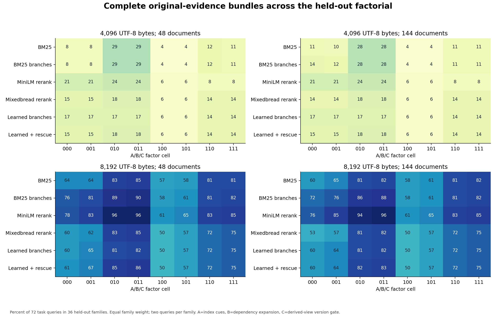

**Figure 1. Complete original-evidence bundles across the held-out factorial.** Percent of 72 task queries in 36 held-out families. Equal family weight; two queries per family. A=index cues, B=dependency expansion, C=derived-view version gate. [SVG](figures/01-heldout-factorial.svg)

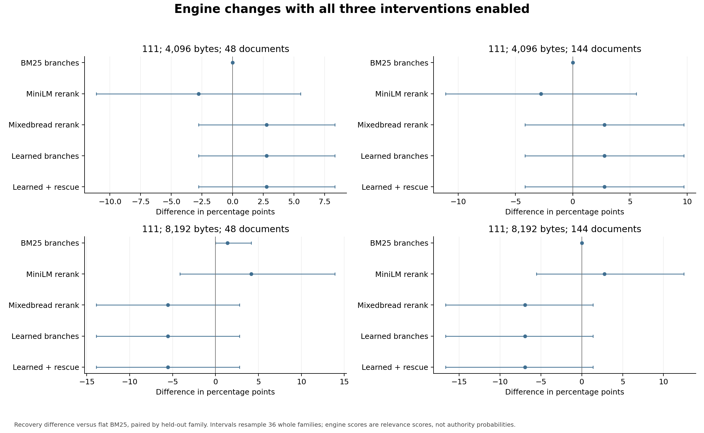

**Figure 4. Engine changes with all three interventions enabled.** Recovery difference versus flat BM25, paired by held-out family. Intervals resample 36 whole families; engine scores are relevance scores, not authority probabilities. [SVG](figures/04-engine-paired-comparison.svg)

### Atomic effects and interactions

Main effects below are paired percentage-point differences at 144 documents, averaged across the remaining factors, with descriptive intervals. Budget conditions stay separate.

|Engine|Bytes|A: cues (pp)|B: expansion (pp)|C: gate (pp)|
|---|---|---|---|---|
|Flat BM25|4,096|-11.5 [-18.4, -5.2]|12.2 [6.2, 18.8]|-0.3 [-1.0, 0.0]|
|Hierarchical BM25|4,096|-12.8 [-20.1, -5.6]|10.8 [4.5, 17.4]|-0.3 [-1.0, 0.0]|
|MiniLM rerank|4,096|-15.3 [-23.6, -7.6]|2.8 [-3.5, 9.0]|0.0 [0.0, 0.0]|
|Mixedbread rerank|4,096|-6.2 [-13.2, 0.0]|6.2 [0.7, 12.5]|0.0 [0.0, 0.0]|
|Learned branches|4,096|-6.9 [-13.9, -0.7]|4.2 [-0.7, 9.7]|0.0 [0.0, 0.0]|
|Learned branches + rescue|4,096|-6.9 [-13.9, -0.7]|5.6 [0.0, 11.1]|0.0 [0.0, 0.0]|
|Flat BM25|8,192|-1.4 [-9.4, 6.9]|20.1 [9.0, 31.6]|2.8 [0.3, 5.9]|
|Hierarchical BM25|8,192|-10.1 [-19.1, -1.4]|17.0 [5.9, 28.5]|2.4 [0.0, 5.6]|
|MiniLM rerank|8,192|-14.2 [-22.2, -6.9]|17.7 [9.7, 26.0]|3.8 [1.4, 6.9]|
|Mixedbread rerank|8,192|-4.5 [-12.8, 3.5]|23.3 [14.9, 31.9]|3.8 [0.7, 7.6]|
|Learned branches|8,192|-8.0 [-16.0, -0.3]|19.8 [11.8, 28.5]|3.8 [0.7, 7.6]|
|Learned branches + rescue|8,192|-8.7 [-15.6, -2.4]|20.5 [11.8, 29.9]|3.8 [0.7, 7.6]|

B is the most consistently positive point effect, particularly at 8 KB (+17.0 to +23.3 pp). A is negative in all these main-effect estimates; this combines changed ranking with serialized-byte overhead, not a clean test that richer indexing harms retrieval. C changes little at 4 KB and modestly improves 8 KB bundle recovery, without establishing semantic correctness of eligible views.

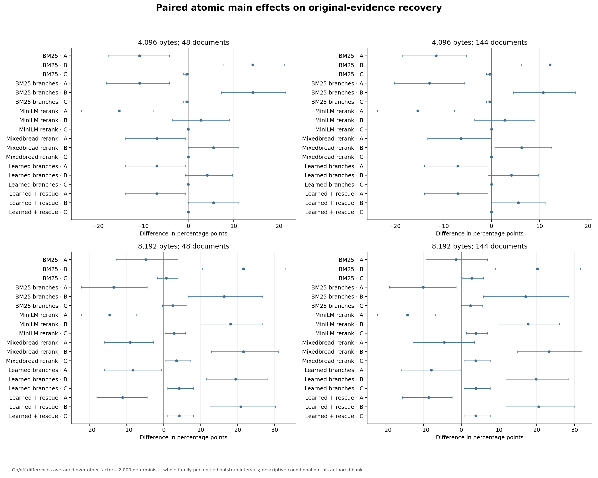

**Figure 2. Paired atomic main effects on original-evidence recovery.** On/off differences averaged over other factors. 2,000 deterministic whole-family percentile bootstrap intervals; descriptive conditional on this authored bank. [SVG](figures/02-main-effects.svg)

Interactions are rate-scale finite differences, not regression coefficients. The table shows point estimates; the figure and `factorial_contrasts` retain intervals.

|Engine|Bytes|AB (pp)|AC (pp)|BC (pp)|ABC (pp)|
|---|---|---|---|---|---|
|Flat BM25|4,096|-10.4|+0.7|+0.7|-1.4|
|Hierarchical BM25|4,096|-7.6|+0.7|+0.7|-1.4|
|MiniLM rerank|4,096|+0.0|+0.0|+0.0|+0.0|
|Mixedbread rerank|4,096|+4.2|+0.0|+0.0|+0.0|
|Learned branches|4,096|+8.3|+0.0|+0.0|+0.0|
|Learned branches + rescue|4,096|+5.6|+0.0|+0.0|+0.0|
|Flat BM25|8,192|+2.8|-1.4|-2.8|+2.8|
|Hierarchical BM25|8,192|+9.0|-0.7|-2.1|+1.4|
|MiniLM rerank|8,192|+6.2|-2.1|-4.9|+4.2|
|Mixedbread rerank|8,192|-6.2|+2.1|-3.5|-1.4|
|Learned branches|8,192|+0.7|+2.1|-3.5|-1.4|
|Learned branches + rescue|8,192|-0.7|+2.1|-3.5|-1.4|

For example, learned routing's 4 KB AB is +8.3 pp [1.4, 16.7], versus BM25 −10.4 [−22.2, 0.0]. At 8 KB, B/C point interactions are negative across engines, suggesting overlapping rather than additive gains on this endpoint. Small samples and multiple contrasts constrain inference.

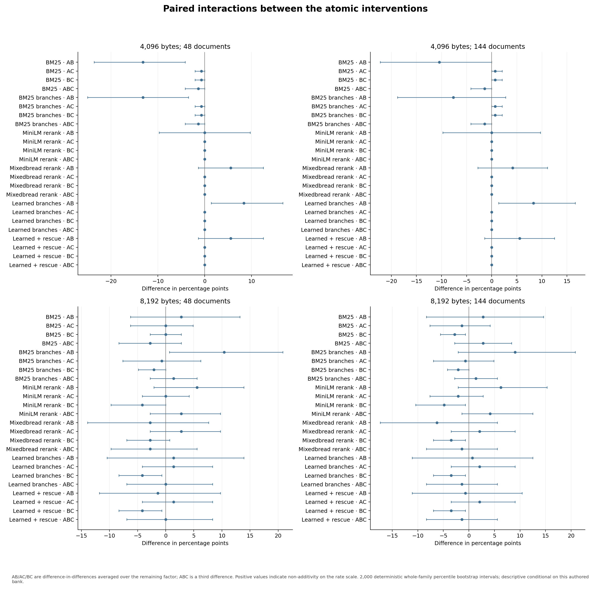

**Figure 3. Paired interactions between the atomic interventions.** AB/AC/BC are difference-in-differences averaged over the remaining factor; ABC is a third difference. Positive values indicate non-additivity on the rate scale. 2,000 deterministic whole-family percentile bootstrap intervals; descriptive conditional on this authored bank. [SVG](figures/03-interactions.svg)

### Packing loss and heterogeneity

Original bundles remain eligible under every gate. At 144/4 KB/101, candidates contain a complete bundle in all 72 queries for every engine, yet packets recover only three lexical and four model bundles. With expansion (`111`), recovery becomes eight lexical, six MiniLM and ten Mixedbread. Resource/ordering loss is substantial despite complete candidates. Some A-off routed/reranked candidates omit evidence; rescue plus expansion recovers one query outside initial candidates. Routing is not universally complete.

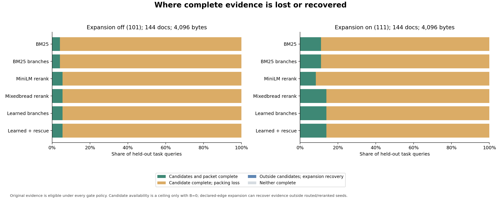

**Figure 5. Where complete evidence is lost or recovered.** Original evidence is eligible under every gate policy. Candidate availability is a ceiling only with B=0; declared-edge expansion can recover evidence outside routed/reranked seeds. [SVG](figures/05-candidate-versus-packing-loss.svg)

Joint 4 KB changes vary by authored stratum: unresolved conflict is +25 pp for most engines but 0 for MiniLM; Unicode/alias declines range −12.5 to −37.5 pp; wrong-ledger declines reach −30 pp. Each stratum has only four or five held-out families. Author-specific held-out joint effects differ: BM25 +2.8 pp for A/−2.8 for B, MiniLM −16.7/−8.3. Development results remain separate; shared templates limit generalization.

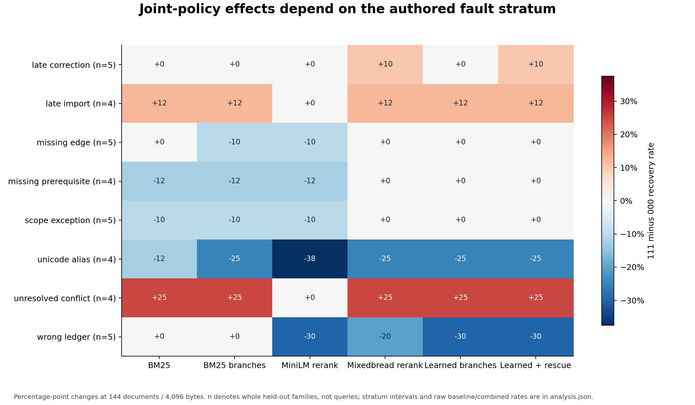

**Figure 6. Joint-policy effects depend on the authored fault stratum.** Percentage-point changes at 144 documents / 4,096 bytes. n denotes whole held-out families, not queries; stratum intervals and raw baseline/combined rates are in analysis.json. [SVG](figures/06-authored-strata-effects.svg)

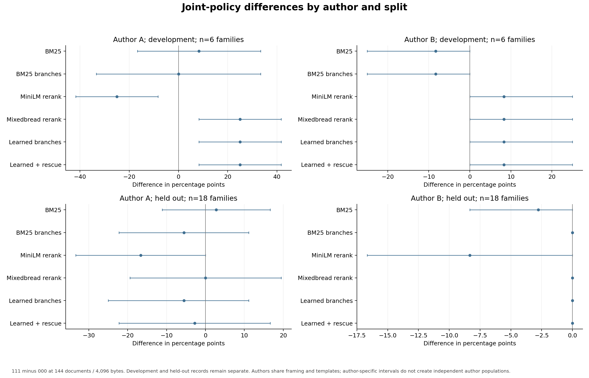

**Figure 13. Joint-policy differences by author and split.** 111 minus 000 at 144 documents / 4,096 bytes. Development and held-out records remain separate. Authors share framing and templates; author-specific intervals do not create independent author populations. [SVG](figures/13-author-and-split-heterogeneity.svg)

## Whole-record budgets and context cost

Budgets are exact UTF-8 serialized limits, not token allowances. The packer skips records that cannot fit; retention remains intact and records are not silently truncated. Of 72 held-out authored bundles, 49 (68.1%) fit 4,096 bytes with A off and 32 (44.4%) with A on. All 72 fit 8,192 bytes either way. These are ceilings for the frozen authored-bundle score, not semantic-success ceilings or proven minimal evidence requirements. A therefore has an encoding confound at fixed budget.

Feasibility-conditional recovery below retains the primary 72-query score separately. It divides successful by feasible query counts, jointly resampling whole-family numerator/denominator counts.

|Engine|4 KB / 000 feasible recovery|4 KB / 111 feasible recovery|
|---|---|---|
|Flat BM25|8/49; 16.3 [6.1, 27.8]%|8/32; 25.0 [10.8, 42.3]%|
|Hierarchical BM25|10/49; 20.4 [9.8, 31.1]%|8/32; 25.0 [10.8, 42.3]%|
|MiniLM rerank|15/49; 30.6 [18.2, 44.7]%|6/32; 18.8 [6.9, 30.8]%|
|Mixedbread rerank|10/49; 20.4 [8.5, 33.3]%|10/32; 31.2 [16.1, 47.4]%|
|Learned branches|12/49; 24.5 [12.5, 37.3]%|10/32; 31.2 [16.1, 47.4]%|
|Learned branches + rescue|11/49; 22.4 [10.4, 35.9]%|10/32; 31.2 [16.1, 47.4]%|

At 8 KB conditional and primary rates coincide. Even feasible 4 KB bundles are often missed. Median 111 packets have four records at 4 KB/eight at 8 KB; median bytes range 3,699–3,785/7,996.5–8,050 and Mixedbread text-only token medians 856–880.5/1,832–1,849. Reconstructed local counts exclude special tokens/truncation and are not Muse billable input. Observed frontier non-dominance is a point-estimate description, not an optimality theorem.

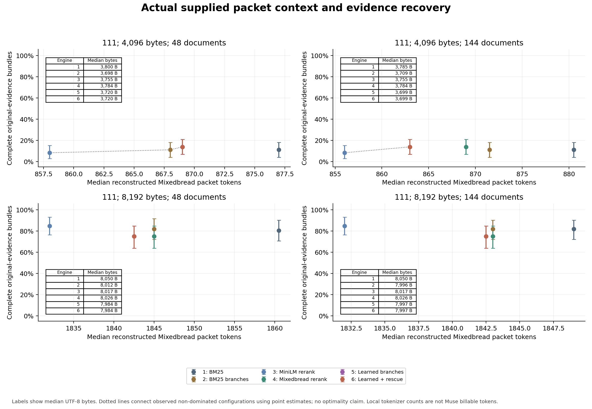

**Figure 7. Actual supplied packet context and evidence recovery.** Labels show median UTF-8 bytes. Dotted lines connect observed non-dominated configurations using point estimates; no optimality claim. Local tokenizer counts are not Muse billable tokens. [SVG](figures/07-context-recovery-frontier.svg)

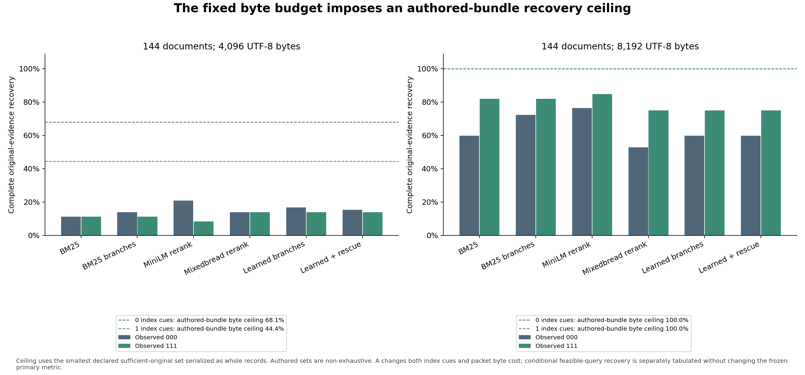

**Figure 15. The fixed byte budget imposes an authored-bundle recovery ceiling.** Ceiling uses the smallest declared sufficient-original set serialized as whole records. Authored sets are non-exhaustive. A changes both index cues and packet byte cost; conditional feasible-query recovery is separately tabulated without changing the frozen primary metric. [SVG](figures/15-whole-record-budget-feasibility.svg)

## Executed local models and uncached CPU cost

Both checkpoints were checksum-verified outside the repository and run via ONNX Runtime CPU on Intel Core i5-12450H with approximately 16.9 GB memory. Scorers use two intra-op threads, batch twelve and 512 combined query/document tokens. Exact quantized exports, tokenizers and backend are pinned; full-precision equivalence is not assumed. [Preflight](preflight.json), [runtime](model_runtime.py), [freeze](freeze.json)

|Scorer|Publisher size/language|Pinned revision|Quantized bytes|
|---|---|---|---|
|MiniLM L6 v2|22.7M; English|`233902d25c440f23af6f7d6e94d2946bac0bee0a`|23,200,716|
|Mixedbread xsmall v1|70.8M; English|`b5c6e9da73abc3711f593f705371cdbe9e0fe422`|87,245,802|

Cards specify Apache-2.0; training reproducibility is separate. MiniLM's published V 100 throughput is not a CPU estimate; Mixedbread's BEIR aggregate is not this task. Artifact SHA-256 values are `c80a8b34256ea453093d612e3ac48d3d965a0c0a48c7906709af8b8e28461bf9` and `15ef19a6de90be7d52b627f2c784107bd806e64826450f41fb75fa4f0179ab30`. [MiniLM card](https://huggingface.co/cross-encoder/ms-marco-MiniLM-L6-v2), [Mixedbread card](https://huggingface.co/mixedbread-ai/mxbai-rerank-xsmall-v1)

The separate serial warm block is six development families × two queries × two repeats × six engines:144 uncached observations, 24 per engine. It combines index/rank/pack and excludes model acquisition/loading. Mean intervals resample six family means; median columns are observed medians, not mean-interval estimates.

|Engine|Median s|Mean [interval] s|Observed range s|Mean pairs|Mean pair-input tokens|
|---|---|---|---|---|---|
|Flat BM25|0.0138|0.0158 [0.0137, 0.0194]|0.0123–0.0293|0.00|0.0|
|Hierarchical BM25|0.0117|0.0133 [0.0118, 0.0160]|0.0106–0.0246|0.00|0.0|
|MiniLM rerank|1.8341|1.9995 [1.6954, 2.3488]|1.4254–3.4958|32.00|8692.7|
|Mixedbread rerank|4.3993|4.6273 [3.8931, 5.6562]|3.3456–7.4345|32.00|8368.5|
|Learned branches|4.1177|4.3446 [3.5301, 5.3211]|2.9307–8.1898|58.17|8071.2|
|Learned branches + rescue|4.0353|4.2963 [3.5885, 5.0460]|3.0134–6.5702|58.42|8137.8|

No pair truncations occurred in this block; that does not certify every factorial pair. Branch routing scores more pairs here than top 32 reranking, with different text lengths. Small Mixedbread timing differences do not establish stable routing speed gains. Figure 8 joins development timing with held-out quality, not a same-query speed/accuracy experiment.

The factorial reused 34,383 unique cached pairs and cannot establish query latency. Representative original-worker acquire/checksum times were 0.196 s MiniLM/2.092 s Mixedbread, loads 0.543/26.495 s; these are individual manifests, not full download or aggregate fresh-worker costs. Decision-only models still consume pair computation; lack of generated reasoning is no speed guarantee. [Sentence Transformers efficiency guidance](https://www.sbert.net/docs/cross_encoder/usage/efficiency.html)

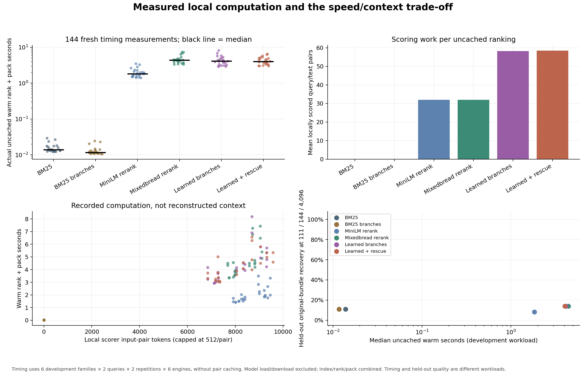

**Figure 8. Measured local computation and the speed/context trade-off.** Timing uses 6 development families × 2 queries × 2 repetitions × 6 engines, without pair caching. Model load/download excluded; index/rank/pack combined. Timing and held-out quality are different workloads. [SVG](figures/08-uncached-computation-frontier.svg)

## Downstream reader gates and diagnostics

The predeclared identity hash selects twelve held-out families per author; query 1 uses 144 documents/4 KB. Four arms each have 24 trials, one completion and no scored retry. First-six-per-author diagnostic families supply twelve full-collection/twelve oracle trials. Controls bypass the small budget; oracle is a diagnostic, not a deployable retriever. [Schedule](reader-schedule.json), [harness](run_readers.py)

Primary completion requires exact authored status/every expected value, sufficient valid original citations from supplied sources, accepted JSON, actual write, host structural pass, clean finish and no forbidden virtual action. Extra answer fields/valid citations are allowed. Free-form wording/list order are exact-scored. Critical agreement remains separate; structural success is not factual truth. Citation normalization accepts bare IDs or section suffixes without validating section existence.

All main/control schema, structure and clean-finish gates pass. Counts retain full scheduled denominators. Critical and all-value counts happen to coincide but remain distinct gates.

|Arm|N|Critical|All values/status|Sources|JSON|Structure|Clean|Complete|
|---|---|---|---|---|---|---|---|---|
|BM25 000|24|9/24|9/24|1/24|24/24|24/24|24/24|0/24|
|BM25 111|24|6/24|6/24|1/24|24/24|24/24|24/24|1/24|
|Mixedbread 111|24|3/24|3/24|0/24|24/24|24/24|24/24|0/24|
|Routing + rescue 111|24|5/24|5/24|0/24|24/24|24/24|24/24|0/24|
|Full collection|12|5/12|5/12|3/12|12/12|12/12|12/12|1/12|
|Oracle evidence|12|5/12|5/12|12/12|12/12|12/12|12/12|5/12|

BM25 111 completion is 4.2% [0.0,12.5]; other main arms are 0% [0,0]. Its paired gain over BM25 000 is+4.2 pp [0.0,12.5], not broad reliability. Full collection completes 8.3% [0.0,25.0], oracle 41.7% [16.7,66.7]. On matched twelve-family controls, oracle−full is+33.3 pp [8.3,58.3]. Oracle−matching main subsets is+41.7 pp for BM25 000/Mixedbread/rescue and+33.3 for BM25 111; no unpaired twelve-versus 24 subtraction is used.

Failure precedence assigns BM25 000 fifteen exact-value/status mismatches/nine source failures; BM25 111 eighteen/five plus one success; Mixedbread twenty-one/three; rescue nineteen/five. Oracle has sufficient supplied sources but seven exact-value/status failures. These first-failed-gate classifications are not semantic severity estimates or exhaustive causes.

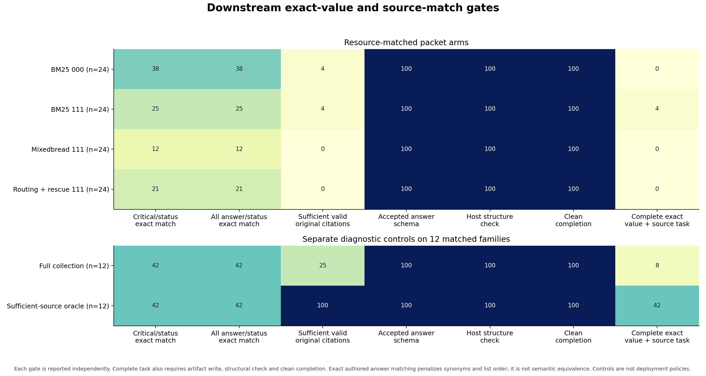

**Figure 9. Downstream exact-value and source-match gates.** Each gate is reported independently. Complete task also requires artifact write, structural check and clean completion. Exact authored answer matching penalizes synonyms and list order; it is not semantic equivalence. Controls are not deployment policies. [SVG](figures/09-reader-gates-and-controls.svg)

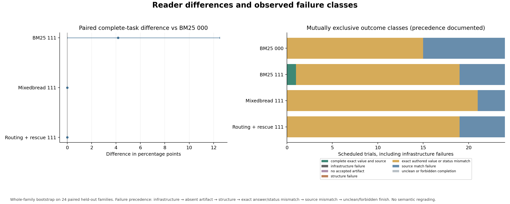

**Figure 10. Reader differences and observed failure classes.** Whole-family bootstrap on 24 paired held-out families. Failure precedence: infrastructure → absent artifact → structure → exact answer/status mismatch → source mismatch → unclean/forbidden finish. No semantic regrading. [SVG](figures/10-reader-paired-effects-and-failures.svg)

### Resources, missingness and freshness

Muse `muse-spark-1.3-contributor`, high effort, uses fresh rootless local processes/ephemeral sessions without supplied prior-trial history, workspace or personal skills. Virtual tools never expose native host files. Checks cover upstream user-text digests, disabled capabilities, pinned runtime, `store:false` and absent continuation associations. Unicode caller-to-upstream equality passed development preflight. Provider erasure, account-wide history and hidden system-prefix contents remain uncertified.

All 216 recorded model calls were accepted; no infrastructure failure class appears. All six recorded usage fields are known for every scheduled trial and calls_unknown_usage is 0. Missing usage would remain unknown, not zero; failures stay in their scheduled denominator. Provider input/output/reasoning and cache fields are separate. Reasoning is not summed with output under assumed non-overlap. Nonzero cache receipts also preclude claiming globally cache-cold provider execution.

Provider medians and resource observations follow. Main/control elapsed and supplied bytes are known for all trials; discovery elapsed/returned bytes for all twelve each. Fixed-packet returned-byte resources and discovery supplied-packet-byte resources are unmeasured, not zero.

|Arm|Elapsed median s|Context median bytes|Provider input|Provider output|Provider reasoning|Unknown usage trials|
|---|---|---|---|---|---|---|
|BM25 000|16.31|supplied 3,697.0|10,755.0|2,600.5|2,414.5|0/24|
|BM25 111|13.82|supplied 3,787.5|10,761.5|1,772.0|1,629.0|0/24|
|Mixedbread 111|16.84|supplied 3,837.5|10,785.5|2,285.5|2,133.0|0/24|
|Routing + rescue 111|18.77|supplied 3,837.5|10,794.0|2,485.5|2,327.5|0/24|
|Full collection|16.21|supplied 137,763.5|40,443.5|2,135.5|1,957.5|0/12|
|Oracle evidence|12.45|supplied 4,243.5|10,865.0|1,440.5|1,311.0|0/12|
|Raw filesystem|48.12|returned 13,633.0|80,630.0|2,960.5|2,125.0|0/12|
|Filesystem + retriever|49.95|returned 13,272.5|90,353.5|4,132.0|3,016.0|0/12|

Full collection's 137,763.5-byte median is not resource-matched to 3.7–3.8 KB packets. Oracle's 4,243.5-byte median can exceed 4 KB. Provider input includes protocol/system overhead and repeated discovery history, not just document size.

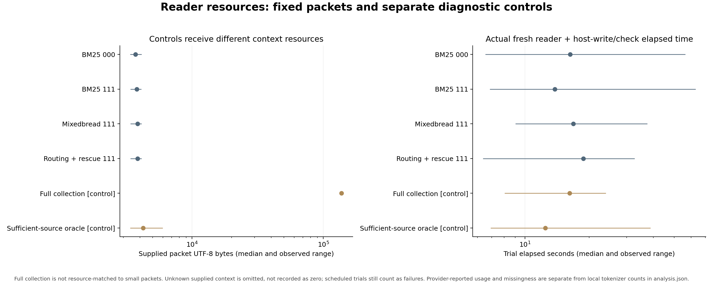

**Figure 14. Reader resources: fixed packets and separate diagnostic controls.** Full collection is not resource-matched to small packets. Unknown supplied context is omitted, not recorded as zero; scheduled trials still count as failures. Provider-reported usage and missingness are separate from local tokenizer counts in analysis.json. [SVG](figures/14-reader-context-and-time.svg)

## Fresh virtual-filesystem discovery

The same twelve diagnostic families receive both discovery arms separately from main/control scoring. Discovery starts with five fictional PARA root folders, neutral tasks and external JSON `list/read/search/write`. Records/hubs principally sit under `1-Projects`, without personal-vault onboarding. The helper advertises `retrieve` only for the original query/fixed Mixedbread 111 packet, without reformulation or unrestricted semantic search.

Host caps are four responses, sixteen actions and 16,384 returned bytes, with 256 reserved for control errors. Oversized whole observations are refused. Search returns at most forty matching lines and may be partial; read supplies complete records. Source receipt requires observation IDs replayed in a later prompt before final write. Same-batch read/write does not prove prior receipt, and an ID proxy does not certify comprehension.

|Arm|N|All values/status|Sources|JSON|Structure|Clean|Complete|Turn-cap trials|
|---|---|---|---|---|---|---|---|---|
|Raw filesystem|12|0/12|1/12|2/12|2/12|2/12|0/12|10|
|Filesystem + retriever|12|0/12|0/12|1/12|1/12|1/12|0/12|11|

Both arms complete 0/12, paired difference 0 pp [0,0]. All 24 trials use four responses; ten raw/eleven helper trials hit the response cap without accepted artifacts. Two raw/one helper artifacts fail exact values/status. Advertisement did not ensure use: six retrieve operations occur across twelve helper trials. Raw requests/executes 125 actions with seven refusals; helper requests 130, executes 127 and records fifteen refusals. These counters are distinct, not additive failure categories.

Summed per-trial host-delivered source counts are 92 raw/76 helper. Only one raw trial has pre-final-write replay receipts: eight IDs, five full-read/three partial-search; helper has none. No-write trials cannot establish pre-write completion receipts, so zeros do not prove no reading. Native-disabled capability counts are 22 raw/28 helper across call receipts, not distinct failed trials. No forbidden virtual actions are recorded and native access stays disabled. The bounded test combines tool adherence, strategy, caps and completion; it does not estimate natural-vault search quality.

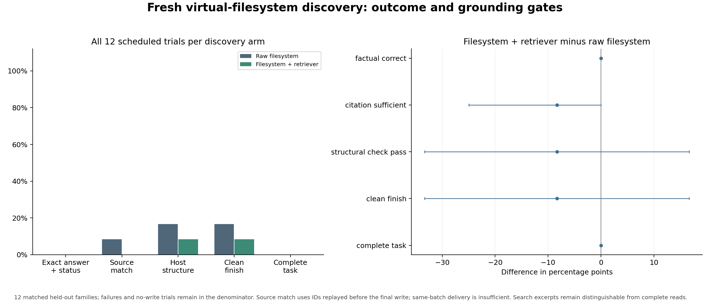

**Figure 11. Fresh virtual-filesystem discovery: outcome and grounding gates.** 12 matched held-out families; failures and no-write trials remain in the denominator. Source match uses IDs replayed before the final write; same-batch delivery is insufficient. Search excerpts remain distinguishable from complete reads. [SVG](figures/11-discovery-outcomes.svg)

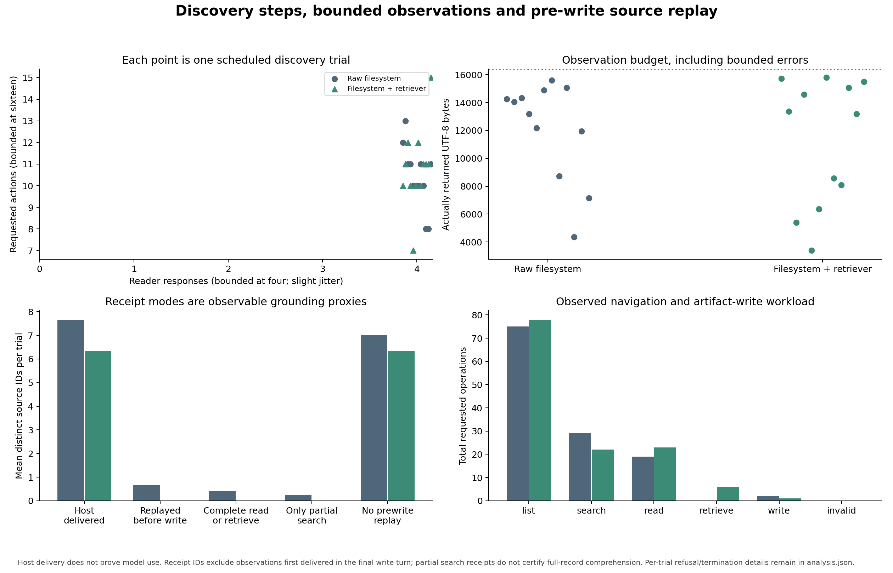

**Figure 12. Discovery steps, bounded observations and pre-write source replay.** Host delivery does not prove model use. Receipt IDs exclude observations first delivered in the final write turn; partial search receipts do not certify full-record comprehension. Per-trial refusal/termination details remain in analysis.json. [SVG](figures/12-discovery-steps-and-replay.svg)

## Supplementary blinded source-entailment review

All 123 actual artifacts were reviewed by three fresh-context LLM reviewers, one per case, with arm/model/score labels and authored expectations withheld. Only actually exposed original sources or exact fragments were supplied; packet cues/quantity can still make assignment inferable. All 21 absent artifacts stay in the original denominator. Input SHA, required-key and supplied-citation checks pass; no human review or duplicate-rater agreement is available.

Every requested value/status is judged source-supported in 66 artifacts; 37 of those fail frozen exact answer matching. Full-query support is judged in 65 and citation entailment in 91; these independent marginal judgments are not adjusted task-success rates. Qualified times/actions and added source-supported wording produce identifiable convention sensitivity, while missing evidence, different epistemic meanings, unsupported citations and incomplete queries require separate treatment. A bounded conservative hold does not establish agreement with the globally authored decision. All frozen scores remain unchanged. [Methods, counts, examples and limits](SEMANTIC-REVIEW.md), [all fictional packets and judgments](semantic-review.json), [census/intersection check](check_review.py).

All twelve oracle and twelve full-collection artifacts receive full-query support judgments. Four 4 KB main arms receive 9, 11, 9 and 11 of 24 respectively. This is evidence-bounded supplemental reading support, not a new accuracy leaderboard; one rating per case and post-collection labels constrain inference. Four artifacts that pass primary exact values/status do not receive complete source-support judgments, illustrating that agreement with gold can also occur without established support from the supplied originals.

## Frozen execution and acceptance status

The prospective freeze is commit [`eb1ecd575a2d6d1e3bf9e9907a2bd7e3abe52085`](https://github.com/BlueRaddish/filesystem-agent-memory-research/commit/eb1ecd575a2d6d1e3bf9e9907a2bd7e3abe52085). [freeze.json](freeze.json) pins corpus, protocol, split, schedules, benchmark, schema, model/tokenizer and public-safe runtime hashes. Its no-collection status is immutable prospective history, not live progress. No held-out score changes policy parameters or reader selection.

The first run preserved 576 interrupted rows. [Execution amendment](EXECUTION-AMENDMENT.md) added durable checkpoints/four workers. Following observed host memory pressure, the pinned [resource amendment](RESOURCE-AMENDMENT.md) retained sixteen complete chunks/3,072 packets and capped fresh collection at two workers without model changes. [Resource receipt](resource-receipt.json) records unchanged reused checkpoint bytes, four historical worker identities and two fresh identities. [Recovery receipt](recovery-receipt.json) reports all 576 rows reproduced exactly plus 18,432 packets, 4,608 rankings and 144 serial timings. Resource receipts override historical four-worker wording in model-execution; cached/concurrent collection timings cannot rank engines. Serial timing is unchanged and scored reader failures have no replacement completion.

Analysis is complete with passed family/bootstrap/failure/replay self-checks; it reconstructs packet bytes/digests and rejects missing/duplicate schedules. The [execution and artifact audit](AUDIT.md) passed all scheduled rows, rankings, timings and reader trials, independently checking recorded files/receipts with the frozen procedure's shared helpers. All 123 actual artifact files match their declared JSON/write hashes; the 21 no-artifact trials remain failures. Learned numerical ranking order was not reinferred and authored gold was not independently adjudicated. [Machine-readable audit](audit.json)

Fifteen PNG/SVG pairs accompany the results and were visually inspected. A separate [display amendment](VISUAL-AMENDMENT.md) repairs label/legend overlap in 05/07/08/15, verifies unchanged numeric artists and all computational tables, and leaves the other twenty-two files intact. Analyzer input hashes exclude resource/execution receipts, which the separate audit checked. The execution audit does not bind final analysis bytes or certify figure layout. Later corrections must be versioned amendments or labeled sensitivity analyses, never silent primary-score edits.

## Conditional next steps and limits

For this bank, investigate complete-evidence representation/packing before adopting expensive CPU rerankers or relying on branch pruning. Feasibility and ordering limit 4 KB recovery; 8 KB helps expansion, while reader source use/exact agreement remain separate bottlenecks. No downstream 8 KB reader arm was scheduled. Small packets and structurally valid artifacts are insufficient accuracy evidence.

[Followup research](FOLLOWUP-RESEARCH.md) proposes moving computation to indexing: learned sparse documents, query-once dense/lexical hybrids with exact-ID candidates, ColBERT multi-vector retrieval and deterministic scope/entity/version features. None ran here. Source corrections must invalidate versioned index/cache entries atomically; branch filters need global fallback. A relevance score or declared ledger cannot automatically become source-of-truth authority. Lightweight supervised classifiers require labels/evaluated routing recall, not assumed zero-shot branch discovery.

The next design should isolate mechanisms that this run combined. These are proposals for a new preregistered bank, not additional executed arms:

|Atomic hypothesis|Matched comparison|Failure that must remain visible|
|---|---|---|
|Search cues help when they do not consume reader space|Ranking-only metadata on/off with identical packet serialization|Alias collision, misleading title and missing natural-language extraction|
|Evidence-sized passages reduce whole-record packing loss|Whole records versus source-linked passages under equal budgets|A rule separated from its exception; require recoverable full-source access|
|Deterministic closure improves dependency completeness|Explicit scope/entity/version expansion on/off|Missing/wrong edges, false ledgers and conflicting originals|
|Cached indexing reduces online scoring work|Lexical retrieval versus frozen dense or neural-sparse document indexes|Offline build/update cost, stale version, misspelled/exact IDs and incomplete first-stage recall|
|Verification improves source use|Reader alone versus field/status checks with identical supplied evidence|Semantically false but structurally valid answers; failed checks cannot silently retry into success|
|A discoverable completion path improves fresh onboarding|Same hierarchy with a native tool adapter and explicit progress/finish feedback on/off|No-write, cap and unavailable-tool failures; onboarding instructions count as context|

Use explicit answer types and accepted action vocabulary, audit multiple sufficient evidence sets before collection, and retain blind source-entailment review beside deterministic gates. Select any favored configuration using a development bank, then confirm it on newly authored held-out histories, paraphrases and longer cross-project timelines. Test the observed MiniLM `011` configuration in a separately frozen 8 KB reader comparison rather than carrying its retrieval rate into an answer-accuracy claim. Timing should match those same queries, with cold/warm index costs and update invalidation recorded separately. Human gold checks and duplicate independent semantic ratings would strengthen this study's single-reviewer supplemental evidence.

For filing practice, the mechanisms worth testing remain original evidence, stable source/version references, explicit scoped dependencies and a current-state view that can expand back to sources. PARA can provide human navigation while retrieval uses those references across folders. This experiment does not compare alternative folder taxonomies, automatic curation or natural-vault startup, and it supplies no reason to reorganize a production vault now. Biological and human-memory analogies remain candidate design ideas with their own evidence boundaries in the [transfer review](../../research/brain-agent-transfer.md).

Limits are 48 related LLM-authored histories, 36 held-out retrieval families, small reader subsets, non-exhaustive sufficient bundles, exact wording/list-order scoring, authored metadata, descriptive uncorrected intervals, one CPU/backend and bounded fictional discovery. No human gold validation, natural-vault benchmark, production migration, provider-erasure certification or universal retrieval winner follows. The October 9 pilot remains separate. The supplement identifies scoring sensitivity without changing primary outcomes; a production recommendation still requires new independent tasks and stronger gold/review validation.
