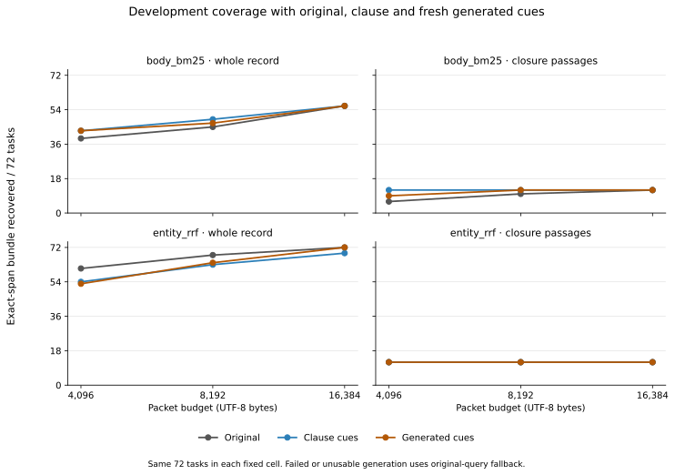
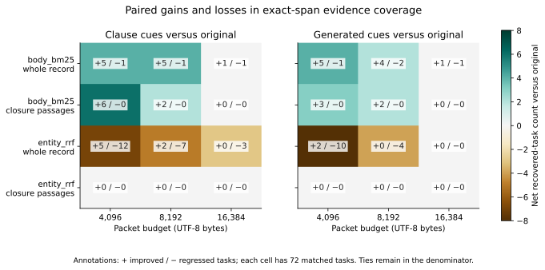

# Development-only fresh query cues

The completed supplement scheduled 72 fresh calls and scored all 2,592 fixed packets. 62 calls yielded usable cues; 10 workflows used original-query fallback. Generated cues increased exact-span bundle coverage in 4 of the 12 fixed retriever/packer/budget cells, tied in 6, and reduced it in 2.

No fixed cell had generated coverage above both original and deterministic clause cues.

This is development evidence only. It neither changes the frozen main experiment nor establishes a confirmation winner or answer-quality improvement. The same 72 tasks recur across the fixed cells, so their packet counts are not independent samples.

Primary outcome: at least one declared source-exact span bundle recovered. Each count below has 72 scheduled tasks, including all fallback workflows. Only retrieval ranking receives expanded cues; packing uses the original query.

| Retriever | Packer | Bytes | Original | Clause cues | Generated cues | Generated + / − vs original |
|---|---|---:|---:|---:|---:|---:|
| body_bm25 | whole_record | 4,096 | 39 | 43 | 43 | +5 / −1 |
| body_bm25 | whole_record | 8,192 | 45 | 49 | 47 | +4 / −2 |
| body_bm25 | whole_record | 16,384 | 56 | 56 | 56 | +1 / −1 |
| body_bm25 | closure_passages | 4,096 | 6 | 12 | 9 | +3 / −0 |
| body_bm25 | closure_passages | 8,192 | 10 | 12 | 12 | +2 / −0 |
| body_bm25 | closure_passages | 16,384 | 12 | 12 | 12 | +0 / −0 |
| entity_rrf | whole_record | 4,096 | 61 | 54 | 53 | +2 / −10 |
| entity_rrf | whole_record | 8,192 | 68 | 63 | 64 | +0 / −4 |
| entity_rrf | whole_record | 16,384 | 72 | 69 | 72 | +0 / −0 |
| entity_rrf | closure_passages | 4,096 | 12 | 12 | 12 | +0 / −0 |
| entity_rrf | closure_passages | 8,192 | 12 | 12 | 12 | +0 / −0 |
| entity_rrf | closure_passages | 16,384 | 12 | 12 | 12 | +0 / −0 |

Conditional usable-generation diagnostic: 62 matched tasks per cell. All three policies are restricted to this same selected subset; this conditional result does not replace the scheduled-workflow outcome.

| Retriever | Packer | Bytes | Original | Clause cues | Generated cues |
|---|---|---:|---:|---:|---:|
| body_bm25 | whole_record | 4,096 | 34 | 39 | 38 |
| body_bm25 | whole_record | 8,192 | 39 | 43 | 41 |
| body_bm25 | whole_record | 16,384 | 49 | 48 | 49 |
| body_bm25 | closure_passages | 4,096 | 6 | 11 | 9 |
| body_bm25 | closure_passages | 8,192 | 9 | 11 | 11 |
| body_bm25 | closure_passages | 16,384 | 11 | 11 | 11 |
| entity_rrf | whole_record | 4,096 | 52 | 47 | 44 |
| entity_rrf | whole_record | 8,192 | 59 | 54 | 55 |
| entity_rrf | whole_record | 16,384 | 62 | 60 | 62 |
| entity_rrf | closure_passages | 4,096 | 11 | 11 | 11 |
| entity_rrf | closure_passages | 8,192 | 11 | 11 | 11 |
| entity_rrf | closure_passages | 16,384 | 11 | 11 | 11 |

Recorded call provenance: 72 returned call receipts, 0 unknown pending calls without a receipt, 62 accepted calls, and 10 unusable or failed generations. Failure categories: `{"adapter_nonzero_exit": 10}`. Generation was not retried or hand edited.

Timing is separated by measured source and work unit. Transport call time is measured on the host; the adapter control receipt’s elapsed field has no independently established provider-server timing semantics. Cache order and concurrent workloads prevent causal hardware-speed claims.

| Measurement | Reported / missing | Sum seconds | Median seconds |
|---|---:|---:|---:|
| Transport host call elapsed (72 scheduled calls) | 72 / 0 | 634.9168 | 9.3262 |
| Adapter control receipt elapsed field (72 scheduled calls) | 62 / 10 | 553.4240 | 8.7805 |
| Computed cue rankings (684 cached entries) | 684 / 0 | 13.1478 | 0.0132 |
| Policy fusion (432 fixed rankings) | 432 / 0 | 0.2595 | 0.0006 |
| Packing (2,592 packets) | 2592 / 0 | 37.7496 | 0.0132 |

Generation execution wall time: 319.46 seconds; index preparation: 0.3266 seconds; evaluation execution wall time: 87.34 seconds. These wall times and overlapping component clocks are not added together.

Only numeric fields retained by the frozen transport from accepted envelopes are available. Each exact counter name stays separate; meanings and overlap are unverified. Missing fields are not zeros. No cross-counter total or price estimate is provided.

| Retained usage field | Reported / missing calls | Field-specific sum |
|---|---:|---:|
| `cache_read_tokens` | 62 / 10 | 9713 |
| `cache_write_tokens` | 62 / 10 | 0 |
| `cached_tokens` | 62 / 10 | 9713 |
| `input_tokens` | 62 / 10 | 612655 |
| `output_tokens` | 62 / 10 | 46829 |
| `reasoning_tokens` | 62 / 10 | 40636 |

The implementation validates new and reused call/packet checkpoints and aggregate inputs. It checks exact source bounds, text and hashes, canonical packet serialization, UTF-8 byte caps, complete unique rankings and recomputed coverage scores. Local evaluation faults halt an incomplete stage; public aggregation requires all 2,592 packets. No model retry or confirmation data was used.

The generator sees fictional task text alone. Its structural cue checks do not establish that every phrasing is free of an implicit factual assumption. One fixed model and prompt are tested; published full query-expansion systems are not reproduced.

[Query2doc](https://aclanthology.org/2023.emnlp-main.585/) is adjacent pseudo-document expansion research; [HyDE](https://aclanthology.org/2023.acl-long.99/) uses hypothetical-document dense retrieval; [RQ-RAG](https://arxiv.org/abs/2404.00610) learns rewriting/decomposition in a larger retrieval-augmented system. The present bounded query-cue experiment claims no equivalence to those systems.

Frozen manifest SHA-256: `619a397cbcfc27e26e909635f541f187c6c3018364f7229567cb8fe9d483cf04`. Safe aggregate SHA-256: `58169b6085fa20bebedfde4a5d92aa1ab5c291c3d5172ed9fa6030efce822b67`. [Protocol](AGENT-QUERY-PLAN.md) · [Runnable code](agent_query_lab.py) · [Safe aggregate](agent-query-results.json) · [Figure registry](agent-query-figures.json).
