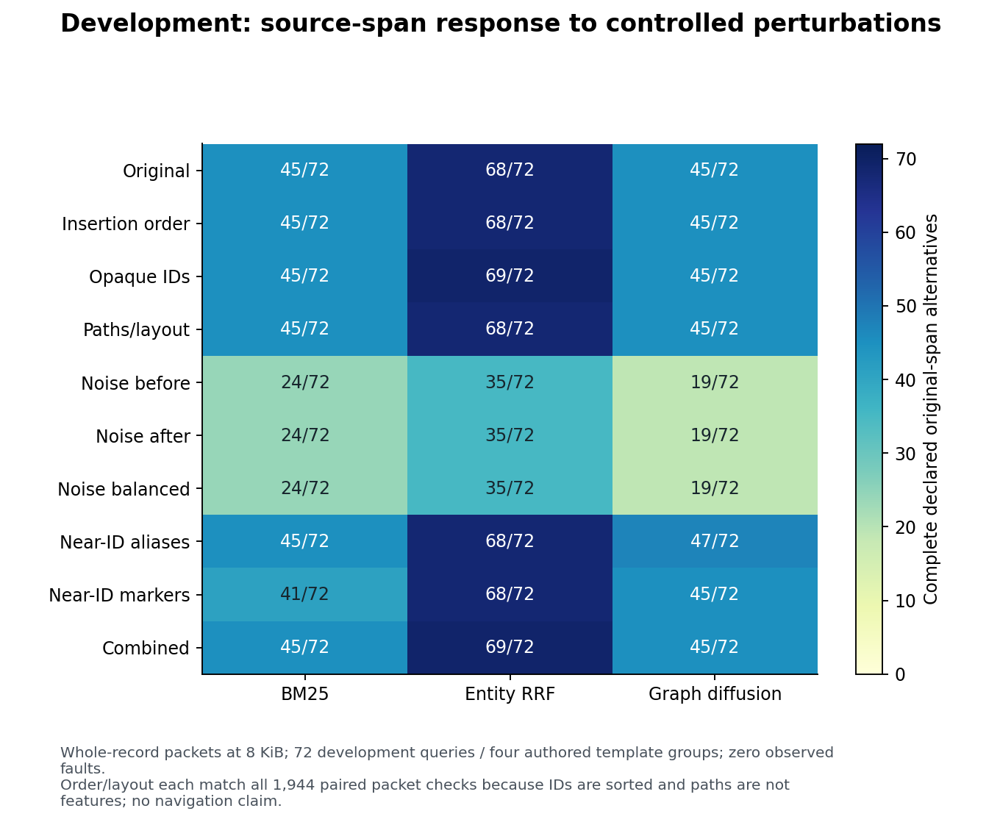
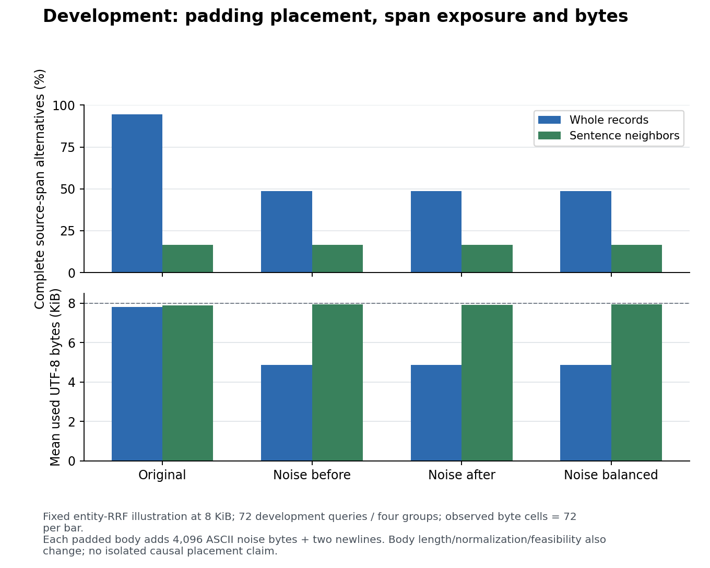
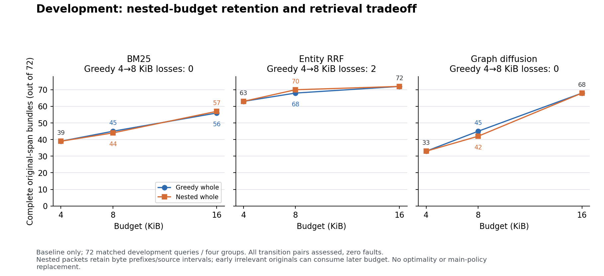
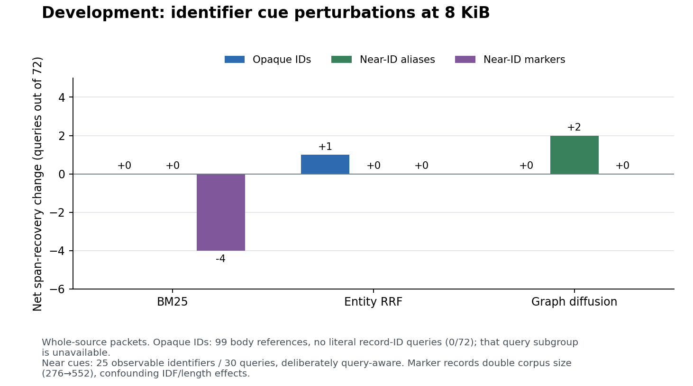

# Development-only robustness diagnostics

All **19,440/19,440** scheduled cells completed with zero observed cell faults. This separate exploratory lane follows [DEV-PLAN.md](DEV-PLAN.md) and uses only the verified excerpt of four declared development groups: 24 histories, 72 queries and 276 observable records. It did not read confirmation gold, the full challenge bank or main result files. No main policy or score was changed.

The ten matched conditions cover iteration order, equal-width opaque record-ID/reference remapping, path/layout permutation, three identical-length padding placements, adversarial near-identifier aliases/markers, and combined changes. Three stdlib rankers cross two existing packers and a hard-coded nested whole-original prototype at three budgets, for 19,440 scheduled packets. All methods share the declared source-kind/32-candidate adaptation; derived records affect rankings but are not packed.

Preparation checks pass without computing rankings: every transformed declared source span resolves to its intended unchanged passage (or its exact equal-width renamed version), all opaque references remain coherent, and padding offsets are explicit. The actual excerpt contains **zero literal record-ID mentions in queries**, zero such mentions in aliases, and 99 in record bodies. Therefore the real opaque-ID comparison cannot establish handling of explicit record-ID query requests; the runnable fictional fixture checks that remapping path. The near-identifier conditions separately use 25 observable numeric query cues appearing in 30 queries, with deliberately query-aware adversarial placement independent of gold/relevance.

The self-check also exercises missing-cost/failure cases. Failed cells count as failed primary recovery, while unobserved byte/candidate/feasibility values stay null with observed denominators. Equivalence and nested-budget assertions assess successful matched pairs and report unassessed fault pairs. Each executed cell is flushed and synced privately; a start marker prevents silent restart after interruption. Setup/index/persistence exceptions retain partial receipts and leave the run incomplete.

Iteration and layout checks verify a feature boundary: these implementations sort records and ignore paths. They do not test live navigation or onboarding. Padding changes body lengths, lexical normalization and byte feasibility; near-marker insertion also changes corpus statistics. The nested prototype guarantees preservation of prior source exposure across its fixed 4/8/16 KB steps, while retaining early irrelevant choices can harm larger-budget retrieval. This is a mechanical guarantee; it does not establish truth or successful tasks.

Independent prospective review accepted the plan/code and negative-fault fixtures before scoring (review receipt SHA-256 `7eb86c30eb602de75b59343b6d1105a5bda886c6d264a0782f26290fd11ccdb6`). The local freeze was written at **2026-10-13 10:53:30 UTC**, digest `e4f68d5cfd90a866ad24f1a87c6059c0b43844b6708af4591f11a65518c1c998`. Execution completed at **10:58:21 UTC** in one stdlib process. Every cell receipt was flushed/synced; the 26,906,597-byte private receipt has SHA-256 `50c458f637034a43a3606a68934ad59617f61141845c75aa87412c191a798fe6`. No failed stage/cell was retried. The [result JSON](development-results.json) contains all 270 aggregate cells, 1,080 template-group cells, fault/cost denominators and budget transitions. Frozen protocol/code/source hashes are unchanged.

## Source-span outcomes

The primary endpoint is complete exposure of any declared sufficient **original-span alternative**, including qualifier spans, through the union of actual source-exact observations. These are authored sufficiency labels, not proved minimal/exhaustive evidence or answer accuracy. Source-kind filtering keeps the first 32 original records after ranking the full development collection; this differs from the main study's candidate interface.

The table shows primary successes out of 72 at **8,192 UTF-8 bytes with whole-record packing**. Each of the four template groups contributes 18 queries, so the fractions also equal the declared equal-group average. All other packer/budget/condition cells remain available in the JSON.

| Condition | Body BM25 | Entity RRF | Graph diffusion |
|---|---:|---:|---:|
| Original | 45 | 68 | 45 |
| Insertion shuffle | 45 | 68 | 45 |
| Opaque record IDs | 45 | 69 | 45 |
| Paths/layout | 45 | 68 | 45 |
| Noise before originals | 24 | 35 | 19 |
| Noise after originals | 24 | 35 | 19 |
| Noise balanced | 24 | 35 | 19 |
| Near-ID aliases | 45 | 68 | 47 |
| Near-ID marker records | 41 | 68 | 45 |
| Shuffle + opaque IDs + paths | 45 | 69 | 45 |

At the unchanged baseline/8 KiB/whole-record cell, the four template-group counts out of 18 are: body BM25 **15/9/8/13**, entity RRF **17/15/18/18**, and graph diffusion **15/7/8/15**, in the declared dependency-closure/map-page-chain/queue-limits/service-alias order. These four authored groups are the analysis units. No independent-72-query interval, population p-value, confirmed winner, or held-out confirmation claim is made.

Insertion and layout each preserve every ranking and packet digest for **1,944/1,944** successful paired cells, with zero unassessed fault pairs. That is expected: sorting removes insertion order, and paths are outside these policies' retained features/packet headers. It does not establish resilience of real navigation or onboarding. Opaque renaming is not exact invariance: its 99 literal body-ID replacements alter lexical tokens and tie order while preserving reference/character-coordinate coherence. Its observed one-query entity-RRF improvement at this cell is descriptive; the actual literal record-ID-query subgroup is empty (**0/72**, unavailable), so no query-ID remapping performance can be estimated.

## Padding placement and packing cost

All three padding variants have the same 4,096-byte noise token multiset and two fixed newline separators. The complete original passage remains contiguous, with exact prefix shifts of 4,097, 1 and 2,049 characters respectively. All **72/72** ranking digests match between before/after and before/balanced padding for each of the three rankers (zero unassessed queries). Thus their small passage-packing differences arise downstream of identical rankings in these fixtures.

Whole-record success falls substantially because padding changes original lengths, lexical normalization and budget feasibility as well as position. For entity RRF at 8 KiB, whole-record recovery is 68/72 without padding and 35/72 with any padding position; sentence-neighbor recovery is 12/72 in all four cases. Graph-diffusion sentence neighbors recover 8/72 with before/balanced padding and 9/72 with after padding. A one-query difference among these authored layouts does not establish a generally superior passage position.

Whole-original byte bounds are not bounds on the primary span endpoint: compact required passages can fit even when padded whole bodies cannot. The sentence-neighbor heuristic often fails the declared multi-span alternative despite filling nearly the available bytes; spending bytes or selecting a source ID is not proof that the required qualifiers were exposed. Exact used-byte means and their observed denominators are reported separately in the JSON and figure below.

## Nested-budget retention and tradeoff

The prototype seeds the existing greedy 4 KiB packet and preserves it as a byte prefix at 8/16 KiB, appending remaining candidates without replacement. The following baseline counts are complete original-span successes out of 72:

| Ranker | Greedy 4/8/16 KiB | Nested 4/8/16 KiB |
|---|---|---|
| Body BM25 | 39 / 45 / 56 | 39 / 44 / 57 |
| Entity RRF | 63 / 68 / 72 | 63 / 70 / 72 |
| Graph diffusion | 33 / 45 / 68 | 33 / 42 / 68 |

Across 4,320 assessed, repeated condition/query/ranker budget-transition pairs, nested packing loses no previously exposed original ID, interval or successful span alternative; zero pairs are unassessed. These are repeated mechanical checks on 72 queries, not 4,320 independent tasks. Greedy packing loses prior source intervals in 289 repeated transition pairs. At the baseline entity-RRF 4→8 KiB transition, two of 72 previously successful queries lose their complete span alternative and fifteen lose some source interval, even while total successes rise from 63 to 68.

Preserving earlier evidence has a cost. At baseline 8 KiB, nested versus greedy has **0 gains/1 regression/71 ties** for BM25, **2/0/70** for entity RRF, and **0/3/69** for graph diffusion, with no fault pairs. At 16 KiB, BM25 has **1/0/71** and the other two have **0/0/72**. These preplanned paired comparisons are computed by streaming existing private cell receipts into the [safe supplementary registry](supplement-figure-registry.json), without recomputing rankings or changing frozen outcomes. Retaining early less useful originals can reduce later recovery; there is no optimality or main-policy replacement claim. The prototype remains deliberately limited to three hard-coded budgets and 32 source candidates.

## Identifier cues and limits

The near-alias condition keeps corpus size fixed and leaves body text/gold unchanged; at the displayed 8 KiB whole-record cell it leaves BM25/entity RRF unchanged and raises graph diffusion from 45 to 47. Adding 276 non-governing near-ID marker records lowers body BM25 from 45 to 41, with entity RRF and graph diffusion unchanged. These fixtures use observable query cues deliberately and adversarially. They are not evidence of automatic extraction quality. Marker insertion doubles the corpus, changing IDF, average body length and competition for the source-candidate cap; identifier similarity is not isolated causally.

No models, new dependencies, providers, external corpus text, tool actions or live app behavior were involved. Span exposure is distinct from comprehension, truth, typed-answer agreement and successful actions. Source labels remain authored, four development templates are a narrow scaffold, and the experiment supplies no confirmation result. Packet/rank/interval digests use `index_lab.sha` over canonical JSON values; file/row-receipt SHA-256 values hash actual file bytes. Missing-cost/fault logic was tested with fictional negative fixtures, while actual executed cells had zero faults and complete cost observations.

## Scientific figures

The renderer uses only completed external/development aggregates, with a bounded stream of existing cell receipts for the planned paired comparison and padding-rank check. It never reads main outcomes or the full bank. [Figure registry](supplement-figure-registry.json) records input-table/source-code hashes separately from PNG/SVG hashes. All nine final PNGs were visually inspected individually; layout fixes changed legends/captions/annotations only, without changing numeric tables. SVGs omit dates and private paths. No confidence intervals are drawn.

Vector versions: [conditions](supplement-figures/06-dev-conditions.svg), [placement/bytes](supplement-figures/07-dev-placement-bytes.svg), [nested growth](supplement-figures/08-dev-nested-growth.svg), [identifier cues](supplement-figures/09-dev-identifier-cues.svg). The separate [external report](EXTERNAL-TRANSFER.md) links its five figures; none of their scores is pooled here.
