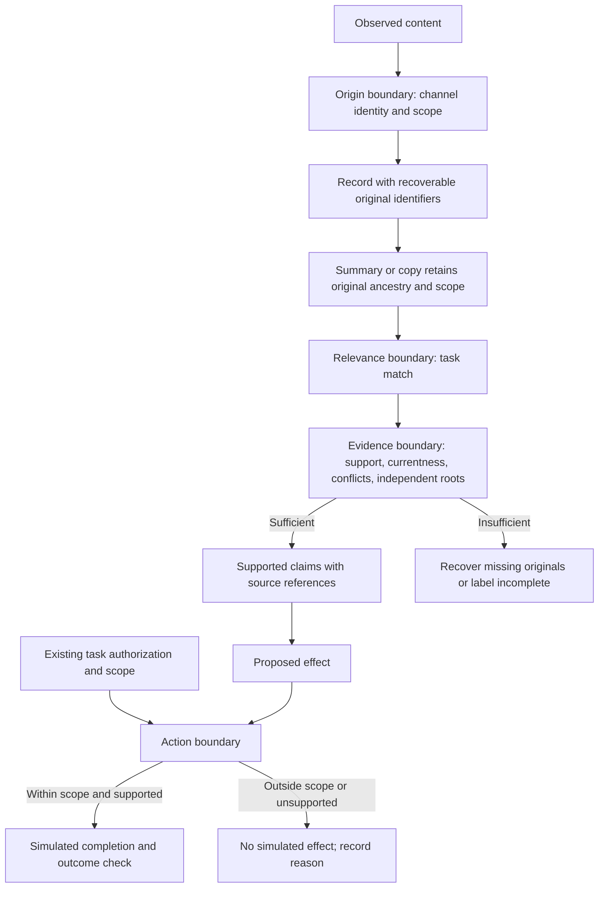

# Memory origin, evidence quality, and permission to act

Reviewed October 13 Pacific / October 14 UTC, 2026, **after the main study's freeze**. This is a separate literature lane. Every experiment below is **NOT EXECUTED**: no attack, agent run, provider call, benchmark reproduction, or production policy change was performed. The proposals neither alter the frozen study nor establish the reliability of any personal memory store.

Five versioned primary manuscripts were reviewed for methods, evaluation boundaries, and limitations. Selected official artifact files were read at exact revisions; benchmark rows and evidence archives were excluded. [The catalog](memory-trust-sources.json) records manuscript versions, delivery hashes, software pins, rights, and review depth. A public repository can evolve after a paper: artifact availability, source inspection, and successful execution are separate claims. No source-system result is reproduced here.

## What this lane adds

**Inference motivating the proposals:** a relevance match does not establish factual support or permission to act. An agent-authored summary can preserve an external claim while losing its apparent origin; repeated descendants can appear to corroborate one another. These are boundaries to test separately, rather than additional retrieval scores. The motivating evidence and qualifications are recorded in MT01–MT05 below.

| Boundary | Question | What passing it would not establish |
| --- | --- | --- |
| Origin and scope | Which channel/principal supplied the record, for what scope, and from which originals was it derived? | That the claim is true, current, or independently corroborated |
| Relevance | Does the record address the present task? | That it supplies all required evidence or carries authority |
| Evidence sufficiency | Do recoverable originals support the requested claims, resolve currentness/conflicts, and supply genuinely independent support where required? | That the requested external effect is authorized |
| Action boundary | Does the proposed effect fit the existing request, scope, and applicable authority? | That a fluent answer is accurate or that the task completed |

The conceptual diagram is a **proposed separation of questions**, not a verified architecture or a new approval workflow. Missing evidence leads to a labeled incomplete answer or further source recovery; an action is checked against the authorization already present in the task.

## Primary-source evidence

### MT01 — Query-only interactions can become future demonstrations

[MINJA, v5](https://arxiv.org/html/2503.03704v5) studies query-only poisoning of retrieved experience demonstrations in RAP, EHRAgent, and a QA agent. Its threat model assumes shared memory or feasible identity disguise; it is not an unauthenticated external-document threat model. Retrieval similarity and subsequent influence are distinct stages. Benign-memory-density sensitivity is already tested in this version, with task-dependent effects. The paper does not establish that legitimate memory universally prevents poisoning. The [official code snapshot](https://github.com/dsh3n77/MINJA/tree/a3ec8da0f7740b3fe629f6706e1c14296ee6861d) has an inspected MIT license; no attack code was run. This motivates recording who supplied an experience, rather than treating successful storage or agent authorship as corroboration.

### MT02 — Memory writing and later influence need separate measurements

[From Untrusted Input to Trusted Memory, v2](https://arxiv.org/html/2606.04329v2) distinguishes write channels, including compaction and skill synthesis, from later retrieval influence. MPBench separately measures a persistent write and a follow-up behavioral effect using an LLM judge. Evaluation uses GPT-OSS-120B with OpenClaw and HERMES. External material arrives as a labeled context block alongside the query; the actual inbound tool/retrieval pipeline is not exercised. Source isolation and preservation through compaction are proposed directions, not a demonstrated guarantee. No official benchmark artifact link was identified in the reviewed manuscript links; availability elsewhere is unassessed.

### MT03 — Source-aware screening also needs benign task utility

[When Agents Remember Too Much, v1](https://arxiv.org/html/2607.06595v1) studies email/calendar inputs that persist and later affect personal-assistant behavior across five memory agents. AM-Sentry combines admission policy and retrieval screening, with LLM judgments and deterministic decision logic. Utility tasks use synthetic workweek snapshots and include changing information and tool use. Stated limits include restricted channels, intuitively selected weights, synthetic utility tasks, and non-adaptive attackers. Its scored source-identifiability field should not be confused with an externally assigned origin label. A future code release is mentioned, but no official artifact link was identified in the reviewed manuscript links.

### MT04 — Origin binding is conditional, and the proof scopes differ

[Securing LLM-Agent Long-Term Memory, v1](https://arxiv.org/html/2606.24322v1) binds authority to channel-assigned origin and preserves restrictions through derivation. Repeated echoes do not count as independent principals. Its TLC separation result concerns a finite model; the manuscript's argument toward unbounded executions is **not a fully mechanized deductive unbounded proof**. Correct origin labels, genuinely independent corroboration, answer bias, and value attribution remain explicit limits. The [later pinned artifact](https://github.com/yedidel/mem-inv-bench/tree/cf3c9a4ca9f0478000d6aa26eb268b875232d34b) is release 2.1.0, packaged September 25. It adds threshold-two SMT induction files over arbitrary sorts. Those files were inspected, not executed: Z3 is absent from the checked Python environment. Later artifact claims are not evidence that the June manuscript established them.

### MT05 — Existing legitimate memory and rejection costs are counterpoints

[Memory Poisoning Attack and Defense, v1](https://arxiv.org/html/2601.05504v1) varies initial legitimate memory and retrieval size in a narrow EHR setting using edit-distance retrieval and one identity pair. It reports reduced influence with legitimate memories, alongside defense runs that either reject every candidate or admit poison with high confidence. Agreement between assigned scores and decisions therefore does not establish truth calibration or useful benign completion. The manuscript proposes broader mixed-workload evaluation; dataset-ground-truth verification is available in its benchmark setting. Its [linked project snapshot](https://github.com/cs684-umass/proj-group-09/tree/c0fb695b3f75870a7fa628ccc15a9f9ff84e79a4) was inspected at README/tree level; no repository license file was identified and nothing was run. These observations do not establish a general defensive benefit of accumulated memory.

## Atomic future hypotheses — all NOT EXECUTED

These are newly authored, high-level experiments using separately constructed fictional histories, benign factual conflicts, and simulated effects. They are not operational attack recipes. A later protocol would freeze fixtures, labels, budgets, reader assignment, and decision rules before collection. No current bank, gold labels, or outcomes are inputs to these proposals.

| ID | Single change and predicted effect | Matched control | Falsifier or adverse result |
| --- | --- | --- | --- |
| H1: preserve origin through summaries | Keep channel-assigned origin, scope, and original IDs attached to each derived claim. Predict fewer mistaken source-authority attributions after summarization. | Identical claim text and retrieval order with ancestry omitted; include uncompressed originals and benign agent-authored summaries. | Attribution errors persist, or valid evidence becomes unusable because mixed summaries are over-restricted. Track label errors separately from reader errors. |
| H2: count independent roots | Count distinct upstream sources/principals when assessing corroboration. Predict that repeated copies of one claim do not acquire extra evidential weight. | Same content length and candidate count: copies from one root versus independently supported records; randomize order. | Copy count still changes accepted unsupported claims, or the rule suppresses genuinely independent agreement. Include shared upstream dependencies behind different publishers. |
| H3: check evidence sufficiency | After the same ranked candidate list, check recoverable support for each required claim, currentness, and unresolved conflicts. Predict fewer unsupported complete answers. | Relevance-only selection at the same byte/time allowance; include complete packets, missing dependencies, superseded facts, and authentic-but-wrong sources. | Errors merely shift to unsupported abstention, benign completion falls without fewer unsupported answers, or missing originals remain undetected. |
| H4: check the proposed effect | Compare a simulated effect's value and scope with supported claims and the authorization already supplied by the task. Predict fewer effects unsupported by the task despite relevant memory. | Same answer/evidence and simulated tool interface without the effect check; include clearly authorized benign completions. | Only prose changes, out-of-scope simulated effects persist, or authorized supported effects are blocked. Score proposed, permitted, committed, and completed effects separately. |

**Shared calibration controls:** pair every erroneous/conflicting history with a correct benign history. Vary empty memory versus a fixed legitimate-memory mixture, holding erroneous records constant; repeat with relevant and unrelated legitimate records. Report both retrieval exposure and downstream incorporation. Include reject-all, accept-all, originals-only, and complete-support controls. Measure correct answer-and-source completion, mistaken origin attribution, unsupported answer influence, missed legitimate memory, and simulated task completion separately. Confidence or a low influence rate alone is not success.

**Combinations remain prospective:** first compare each switch with its matched control. Then H1×H2 tests whether lineage preservation prevents copy-based corroboration errors; H1×H3 tests whether retained origins help readers resolve insufficient evidence; H3×H4 tests whether better answers translate into supported effects. A four-switch combination needs its own budget-matched comparison. More metadata may displace essential originals; a stricter action check may expose value-attribution gaps. Do not infer additive benefits from atomic results.

Independent corroboration must be defined by a defensible dependency relation, not merely distinct filenames, URLs, tools, or local processes. Authenticated origin is not semantic truth. Summaries that mix origins require claim-level treatment or explicit uncertainty; blanket inheritance can protect an action boundary while wasting usable benign evidence. These are unresolved design choices and measurable failure cases, not defaults recommended for production.

## Verification and limits of this review

The executed route checks the two new files only: JSON structure, versioned citation mapping, delivery/artifact hashes, local catalog link, bounded source summaries, and publication hygiene. The broad repository checker is root-owned; it is not claimed as passed by this lane. Source receipts identify delivered bytes, whose HTML rendering can change even at a versioned URL. Repository license files and dataset-card metadata were checked separately from manuscript rights; no third-party source text or benchmark rows are republished.

**Unreached:** source-system experiments, formal-check execution, benchmark reconstruction, independent annotation, and live external action boundaries. The optional existing `formal/verify_induction.py` route cannot run in the checked default Python environment because Z3 is unavailable; no dependency was installed. The source-reviewed later checker is separate from the manuscript's bounded TLC claim. No broad formal theorem, semantic-truth guarantee, human utility result, or production readiness follows from this literature review.
