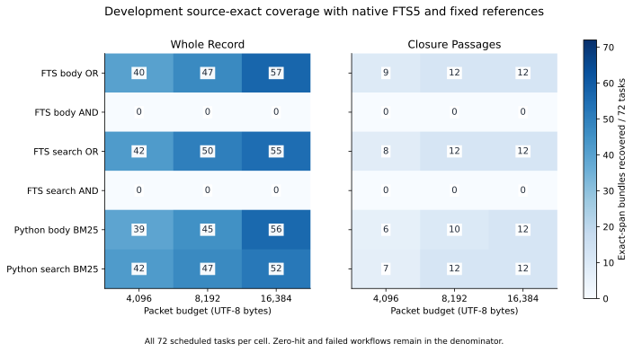
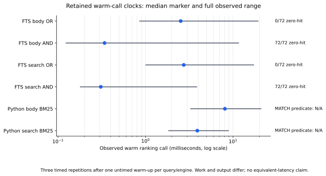

# Development-only SQLite FTS5

The completed serial supplement retained all 432 ranking jobs and 2,592 packets. It recorded 0 ranking faults, 0 packet faults, and 144 native zero-hit queries (864 scheduled packet workflows). Provider/model calls: zero.

This is a development comparison of four fixed literal FTS5 policies and two unchanged lexical references. It does not establish a main or confirmation winner, answer correctness, equivalent algorithms, or causal hardware/latency performance.

Every cell below has 72 scheduled tasks. Primary recovery means at least one declared authored exact-span bundle was delivered. The same tasks recur across cells; the counts are not independent samples.

| Engine | Packer | Bytes | Exact-span bundles | Original-ID bundles | Candidate-ID bundles | Zero-hit workflows | Faults |
|---|---|---:|---:|---:|---:|---:|---:|
| fts_body_or | whole_record | 4,096 | 40 | 40 | 61 | 0 | 0 |
| fts_body_or | whole_record | 8,192 | 47 | 47 | 61 | 0 | 0 |
| fts_body_or | whole_record | 16,384 | 57 | 57 | 61 | 0 | 0 |
| fts_body_or | closure_passages | 4,096 | 9 | 63 | 61 | 0 | 0 |
| fts_body_or | closure_passages | 8,192 | 12 | 72 | 61 | 0 | 0 |
| fts_body_or | closure_passages | 16,384 | 12 | 72 | 61 | 0 | 0 |
| fts_body_and | whole_record | 4,096 | 0 | 0 | 0 | 72 | 0 |
| fts_body_and | whole_record | 8,192 | 0 | 0 | 0 | 72 | 0 |
| fts_body_and | whole_record | 16,384 | 0 | 0 | 0 | 72 | 0 |
| fts_body_and | closure_passages | 4,096 | 0 | 0 | 0 | 72 | 0 |
| fts_body_and | closure_passages | 8,192 | 0 | 0 | 0 | 72 | 0 |
| fts_body_and | closure_passages | 16,384 | 0 | 0 | 0 | 72 | 0 |
| fts_search_or | whole_record | 4,096 | 42 | 42 | 61 | 0 | 0 |
| fts_search_or | whole_record | 8,192 | 50 | 50 | 61 | 0 | 0 |
| fts_search_or | whole_record | 16,384 | 55 | 55 | 61 | 0 | 0 |
| fts_search_or | closure_passages | 4,096 | 8 | 65 | 61 | 0 | 0 |
| fts_search_or | closure_passages | 8,192 | 12 | 72 | 61 | 0 | 0 |
| fts_search_or | closure_passages | 16,384 | 12 | 72 | 61 | 0 | 0 |
| fts_search_and | whole_record | 4,096 | 0 | 0 | 0 | 72 | 0 |
| fts_search_and | whole_record | 8,192 | 0 | 0 | 0 | 72 | 0 |
| fts_search_and | whole_record | 16,384 | 0 | 0 | 0 | 72 | 0 |
| fts_search_and | closure_passages | 4,096 | 0 | 0 | 0 | 72 | 0 |
| fts_search_and | closure_passages | 8,192 | 0 | 0 | 0 | 72 | 0 |
| fts_search_and | closure_passages | 16,384 | 0 | 0 | 0 | 72 | 0 |
| body_bm25 | whole_record | 4,096 | 39 | 39 | 57 | N/A | 0 |
| body_bm25 | whole_record | 8,192 | 45 | 45 | 57 | N/A | 0 |
| body_bm25 | whole_record | 16,384 | 56 | 56 | 57 | N/A | 0 |
| body_bm25 | closure_passages | 4,096 | 6 | 60 | 57 | N/A | 0 |
| body_bm25 | closure_passages | 8,192 | 10 | 70 | 57 | N/A | 0 |
| body_bm25 | closure_passages | 16,384 | 12 | 72 | 57 | N/A | 0 |
| search_bm25 | whole_record | 4,096 | 42 | 42 | 60 | N/A | 0 |
| search_bm25 | whole_record | 8,192 | 47 | 47 | 60 | N/A | 0 |
| search_bm25 | whole_record | 16,384 | 52 | 52 | 60 | N/A | 0 |
| search_bm25 | closure_passages | 4,096 | 7 | 64 | 60 | N/A | 0 |
| search_bm25 | closure_passages | 8,192 | 12 | 72 | 60 | N/A | 0 |
| search_bm25 | closure_passages | 16,384 | 12 | 72 | 60 | N/A | 0 |

The native AND predicates retain every distinct token from the full task text. A zero-hit result remains an empty candidate list and an empty packet; no unrelated tail IDs are appended. Reference rankings cover all documents and have no native MATCH hit predicate. Fault-free counts, including zero hits, remain available in the safe JSON as a diagnostic.

Each job performed one untimed warm-up and three timed serial repetitions, with exact result agreement checked. The table reports all retained repetition clocks. Native literal normalization is outside these clocks; reference normalization remains inside the frozen ranking call. Native ranking fetches the complete matching order before the candidate cap. The work and output differ, so these observations are not equivalent latency measurements.

| Engine | Timed calls reported / missing | Median milliseconds | Minimum milliseconds | Maximum milliseconds | Native zero-hit queries | Ranking faults |
|---|---:|---:|---:|---:|---:|---:|
| fts_body_or | 216 / 0 | 2.5263 | 0.8596 | 19.2870 | 0 | 0 |
| fts_body_and | 216 / 0 | 0.3405 | 0.1240 | 11.5471 | 72 | 0 |
| fts_search_or | 216 / 0 | 2.7368 | 1.0119 | 17.1513 | 0 | 0 |
| fts_search_and | 216 / 0 | 0.3081 | 0.1806 | 3.8470 | 72 | 0 |
| body_bm25 | 216 / 0 | 8.0839 | 3.2945 | 20.8395 | N/A | 0 |
| search_bm25 | 216 / 0 | 3.9114 | 1.8438 | 8.8600 | N/A | 0 |

Preparation and work clocks remain separate:

| Measurement | Retained value |
|---|---:|
| Native database build/commit/close | 0.04763640003511682 seconds |
| Native database bytes after close | 1028096 |
| Native read-only reopen | 0.008278799999970943 seconds |
| Native source/revision integrity validation | 0.006481499993242323 seconds |
| Reference index preparation | 0.09150659997249022 seconds |
| Query-tokenizer setup | 0.0009729000157676637 seconds |
| Packing clock sum across 2,592 scheduled packets | 31.025198301300406 seconds; missing 0 |
| Current execution wall time | 100.41984919999959 seconds |

Component clocks are not added to wall time. The small fixed warm schedule and shared-host load limit timing interpretation. No provider clock or price is estimated.

The source ledger and both contentful FTS views were built once, committed, closed and reopened read-only. Reopened rows were checked against unchanged source IDs, canonical revisions, bodies and search surfaces. Packet validation checks the original text, character bounds, body hashes, canonical wrappers, UTF-8 budgets and recomputed authored-span/ID scores. Fault and interrupted-step checkpoints are retained, and public aggregation requires the complete scheduled grid.

The runnable fictional self-check exercises Unicode/diacritics, punctuation, injection-looking literal strings, quote escaping, duplicate-ID rejection and an actual disk index across source revision update, deletion, reopen and rollback. This supplement changes no production index. The actual native run and aggregate both exited successfully. Independent execution audit remains a separate publication gate; repository hygiene, source-exact execution checks and figure QA cover different scopes. Compilation alone is not an acceptance verdict.

SQLite [query strings](https://www.sqlite.org/fts5.html#fts5_strings), [unicode61](https://www.sqlite.org/fts5.html#unicode61_tokenizer), [bm25](https://www.sqlite.org/fts5.html#the_bm25_function), [fts5vocab](https://www.sqlite.org/fts5.html#the_fts5vocab_virtual_table_module), [parameters](https://www.sqlite.org/lang_expr.html#parameters) and [transactions](https://www.sqlite.org/lang_transaction.html) are the primary documentation. Native tokenization, Boolean hit predicates, deduplicated query terms and score convention differ from the fixed references.

Frozen manifest SHA-256: `bc6f449586036d462e0336ce99aeb89fd5a5206ac533f81a91344d6153cdc740`. Safe aggregate SHA-256: `ebb542a096e949638b508e0adce04a252231acafe7f8460b25d38248c02d8d9b`. [Protocol](NATIVE-INDEX-PLAN.md) | [Code](native_index_lab.py) | [Aggregate](native-index-results.json) | [Sources](native-index-sources.json) | [Figure registry](native-index-figures.json).
