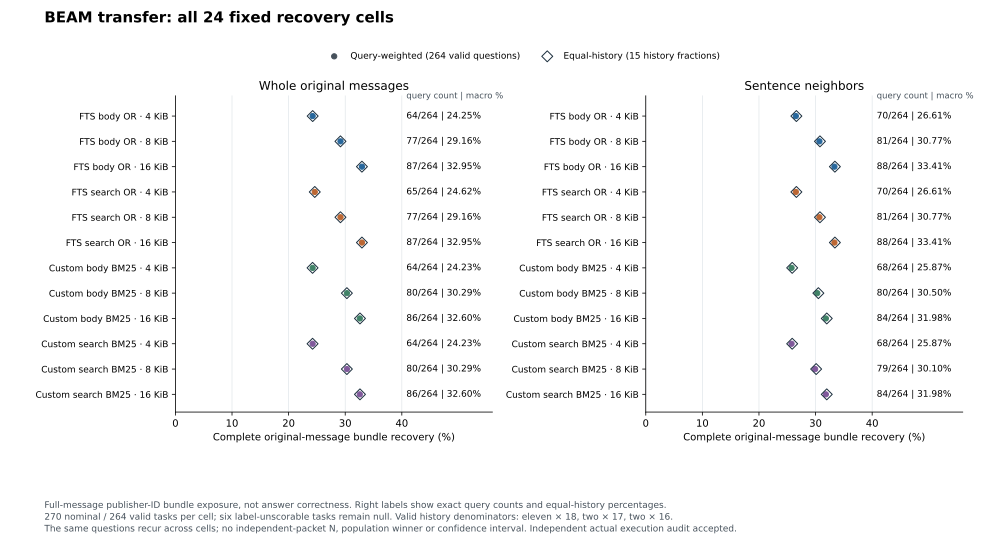
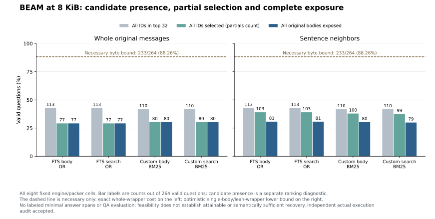
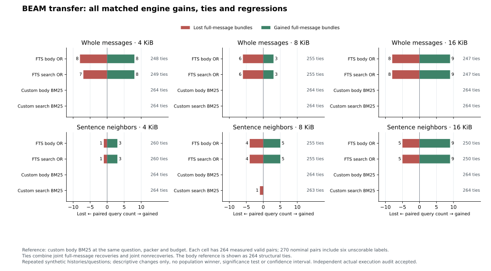

# Native deterministic BEAM transfer

**The complete-census actual execution audit is accepted by root. Public report and figure delivery review remain pending.**

All 1,080 ranking jobs and 6,480 scheduled packets completed in one authorized run over fifteen additional BEAM synthetic histories. All 6,336 scorable packets were measured; 144 publisher-label-unscorable packets retain null metrics. There were zero algorithm faults, zero native zero-hit jobs and zero model/provider calls. This separate source-exposure adaptation changes no primary study input or score.

Complete original-message recovery ranges from 64/264 (24.24%) to 88/264 (33.33%) across the full fixed grid. Recovery increases with budget within each fixed engine/packer sequence. At 8 KiB, partial ID selection and complete-message exposure differ; paired engine changes include both gains and losses. These observations motivate checking packing and evidence sufficiency separately. They establish no answer accuracy, official BEAM score, semantic truth, general engine winner or production recommendation.

[Protocol](NATIVE-TRANSFER-PLAN.md) | [Frozen runner](native_transfer.py) | [Source fixity and attribution](native-transfer-sources.json) | [Safe results](native-transfer-results.json) | [Figure registry](native-transfer-figures.json)

The source/schema census precedes engine outcomes:

| Publisher question class | Questions | Scheduled packet rows | Treatment |
|---|---:|---:|---|
| Valid positive support groups | 264 | 6,336 | Measured source-exposure proxies |
| Empty non-abstention support | 5 | 120 | Explicit label-unscorable nulls |
| Empty named criterion group | 1 | 24 | Explicit label-unscorable nulls |
| Unlabeled abstention | 30 | 0 | Separate audit only |
| All questions available | 300 | 6,480 | 270 nominal non-abstention tasks |

The five empty labels are publisher history 9 preference-following question 2 and both summarization questions in histories 18 and 20. History 12 knowledge-update question 1 has an empty named group. No source text or answer was used to replace a missing label. Earlier scored histories 14, 6, 7, 16 and 10 remain excluded and are not pooled.

| History | Publisher history | Messages | Available questions | Nominal positive tasks | Valid positive tasks |
|---|---:|---:|---:|---:|---:|
| NT01 | 19 | 328 | 20 | 18 | 18 |
| NT02 | 8 | 268 | 20 | 18 | 18 |
| NT03 | 17 | 286 | 20 | 18 | 18 |
| NT04 | 15 | 272 | 20 | 18 | 18 |
| NT05 | 9 | 270 | 20 | 18 | 17 |
| NT06 | 18 | 362 | 20 | 18 | 16 |
| NT07 | 2 | 200 | 20 | 18 | 18 |
| NT08 | 13 | 310 | 20 | 18 | 18 |
| NT09 | 5 | 238 | 20 | 18 | 18 |
| NT10 | 20 | 372 | 20 | 18 | 16 |
| NT11 | 3 | 194 | 20 | 18 | 18 |
| NT12 | 4 | 212 | 20 | 18 | 18 |
| NT13 | 11 | 388 | 20 | 18 | 18 |
| NT14 | 1 | 188 | 20 | 18 | 18 |
| NT15 | 12 | 392 | 20 | 18 | 17 |

Query-weighted recovery divides verified full-message bundles by all 264 valid questions. Equal-history recovery averages fifteen history-specific fractions: eleven denominators are 18, two are 17 and two are 16. Label-unscorable tasks enter neither valid-label endpoint. No packet or query is an independent population replicate; the same questions recur across cells.



| Engine | Packer | Budget KiB | Full-message bundles / 264 | Query-weighted % | Equal-history % | Necessary feasible / 264 |
|---|---|---:|---:|---:|---:|---:|
| fts_body_or | whole_record | 4 | 64 | 24.24 | 24.25 | 209 |
| fts_body_or | whole_record | 8 | 77 | 29.17 | 29.16 | 233 |
| fts_body_or | whole_record | 16 | 87 | 32.95 | 32.95 | 242 |
| fts_body_or | sentence_neighbors | 4 | 70 | 26.52 | 26.61 | 209 |
| fts_body_or | sentence_neighbors | 8 | 81 | 30.68 | 30.77 | 233 |
| fts_body_or | sentence_neighbors | 16 | 88 | 33.33 | 33.41 | 243 |
| fts_search_or | whole_record | 4 | 65 | 24.62 | 24.62 | 209 |
| fts_search_or | whole_record | 8 | 77 | 29.17 | 29.16 | 233 |
| fts_search_or | whole_record | 16 | 87 | 32.95 | 32.95 | 242 |
| fts_search_or | sentence_neighbors | 4 | 70 | 26.52 | 26.61 | 209 |
| fts_search_or | sentence_neighbors | 8 | 81 | 30.68 | 30.77 | 233 |
| fts_search_or | sentence_neighbors | 16 | 88 | 33.33 | 33.41 | 243 |
| body_bm25 | whole_record | 4 | 64 | 24.24 | 24.23 | 209 |
| body_bm25 | whole_record | 8 | 80 | 30.30 | 30.29 | 233 |
| body_bm25 | whole_record | 16 | 86 | 32.58 | 32.60 | 242 |
| body_bm25 | sentence_neighbors | 4 | 68 | 25.76 | 25.87 | 209 |
| body_bm25 | sentence_neighbors | 8 | 80 | 30.30 | 30.50 | 233 |
| body_bm25 | sentence_neighbors | 16 | 84 | 31.82 | 31.98 | 243 |
| search_bm25 | whole_record | 4 | 64 | 24.24 | 24.23 | 209 |
| search_bm25 | whole_record | 8 | 80 | 30.30 | 30.29 | 233 |
| search_bm25 | whole_record | 16 | 86 | 32.58 | 32.60 | 242 |
| search_bm25 | sentence_neighbors | 4 | 68 | 25.76 | 25.87 | 209 |
| search_bm25 | sentence_neighbors | 8 | 79 | 29.92 | 30.10 | 233 |
| search_bm25 | sentence_neighbors | 16 | 84 | 31.82 | 31.98 | 243 |

The necessary byte bound is exact whole-wrapper cost for whole_record and an optimistic one-body/lean-wrapper lower bound for sentence_neighbors. Additional wrappers and the unchanged two-window ceiling can prevent full exposure. Impossible bundles remain in the 264-valid-question denominator. Feasible-only values in the JSON are conditional diagnostics.



| Engine | Packer at 8 KiB | All declared IDs in top 32 | All IDs selected, partials count | All original message bodies exposed | Necessary feasible |
|---|---|---:|---:|---:|---:|
| fts_body_or | whole_record | 113 / 264 | 77 / 264 | 77 / 264 | 233 / 264 |
| fts_body_or | sentence_neighbors | 113 / 264 | 103 / 264 | 81 / 264 | 233 / 264 |
| fts_search_or | whole_record | 113 / 264 | 77 / 264 | 77 / 264 | 233 / 264 |
| fts_search_or | sentence_neighbors | 113 / 264 | 103 / 264 | 81 / 264 | 233 / 264 |
| body_bm25 | whole_record | 110 / 264 | 80 / 264 | 80 / 264 | 233 / 264 |
| body_bm25 | sentence_neighbors | 110 / 264 | 100 / 264 | 80 / 264 | 233 / 264 |
| search_bm25 | whole_record | 110 / 264 | 80 / 264 | 80 / 264 | 233 / 264 |
| search_bm25 | sentence_neighbors | 110 / 264 | 99 / 264 | 79 / 264 | 233 / 264 |

At 8 KiB, all-declared-ID candidate presence is 113/264 for native FTS5 and 110/264 for the custom references. This is a ranking diagnostic. Selected-ID bundle recovery counts partial passages; it reaches 103/264 for native sentence-neighbor packets while full-message bundles reach 81/264. The 233/264 (88.26%) necessary byte bound is not attainable-recovery or semantic-sufficiency evidence. No answer-bearing minimal spans are labeled.



The reference is body_bm25 at the same question, packer and budget. Every row has 270 nominal pairs, 264 valid-label measured pairs and zero missing valid pairs. Ties include both joint recoveries and joint nonrecoveries. Differences are descriptive; no confidence interval or significance claim is inferred.

| Engine | Packer | Budget KiB | Gains | Ties | Regressions | Net questions | Query difference pp | Equal-history difference pp |
|---|---|---:|---:|---:|---:|---:|---:|---:|
| fts_body_or | whole_record | 4 | 8 | 248 | 8 | +0 | +0.00 | +0.02 |
| fts_body_or | whole_record | 8 | 3 | 255 | 6 | -3 | -1.14 | -1.14 |
| fts_body_or | whole_record | 16 | 9 | 247 | 8 | +1 | +0.38 | +0.35 |
| fts_body_or | sentence_neighbors | 4 | 3 | 260 | 1 | +2 | +0.76 | +0.74 |
| fts_body_or | sentence_neighbors | 8 | 5 | 255 | 4 | +1 | +0.38 | +0.28 |
| fts_body_or | sentence_neighbors | 16 | 9 | 250 | 5 | +4 | +1.52 | +1.44 |
| fts_search_or | whole_record | 4 | 8 | 249 | 7 | +1 | +0.38 | +0.39 |
| fts_search_or | whole_record | 8 | 3 | 255 | 6 | -3 | -1.14 | -1.14 |
| fts_search_or | whole_record | 16 | 9 | 247 | 8 | +1 | +0.38 | +0.35 |
| fts_search_or | sentence_neighbors | 4 | 3 | 260 | 1 | +2 | +0.76 | +0.74 |
| fts_search_or | sentence_neighbors | 8 | 5 | 255 | 4 | +1 | +0.38 | +0.28 |
| fts_search_or | sentence_neighbors | 16 | 9 | 250 | 5 | +4 | +1.52 | +1.44 |
| body_bm25 | whole_record | 4 | 0 | 264 | 0 | +0 | +0.00 | +0.00 |
| body_bm25 | whole_record | 8 | 0 | 264 | 0 | +0 | +0.00 | +0.00 |
| body_bm25 | whole_record | 16 | 0 | 264 | 0 | +0 | +0.00 | +0.00 |
| body_bm25 | sentence_neighbors | 4 | 0 | 264 | 0 | +0 | +0.00 | +0.00 |
| body_bm25 | sentence_neighbors | 8 | 0 | 264 | 0 | +0 | +0.00 | +0.00 |
| body_bm25 | sentence_neighbors | 16 | 0 | 264 | 0 | +0 | +0.00 | +0.00 |
| search_bm25 | whole_record | 4 | 0 | 264 | 0 | +0 | +0.00 | +0.00 |
| search_bm25 | whole_record | 8 | 0 | 264 | 0 | +0 | +0.00 | +0.00 |
| search_bm25 | whole_record | 16 | 0 | 264 | 0 | +0 | +0.00 | +0.00 |
| search_bm25 | sentence_neighbors | 4 | 0 | 264 | 0 | +0 | +0.00 | +0.00 |
| search_bm25 | sentence_neighbors | 8 | 0 | 263 | 1 | -1 | -0.38 | -0.39 |
| search_bm25 | sentence_neighbors | 16 | 0 | 264 | 0 | +0 | +0.00 | +0.00 |

Matched net changes range from -3 to +4 questions (-1.14 to +1.52 percentage points), with 247–264 ties out of 264. Equal aggregate counts can conceal paired swaps: at 4 KiB whole_record, fts_body_or has eight gains and eight regressions versus body_bm25. No ranking-equivalence claim follows.

Publisher categories are label strata, not successful downstream actions. The following 8 KiB values are full-message counts with explicit category-valid denominators. Each category has 30 nominal tasks.

| Category | Valid / nominal | FTS body W / S | FTS search W / S | Custom body W / S | Custom search W / S | All-history macro availability |
|---|---:|---|---|---|---|---|
| contradiction_resolution | 30 / 30 | 14/30 / 14/30 | 14/30 / 14/30 | 15/30 / 14/30 | 15/30 / 14/30 | 15 history fractions |
| event_ordering | 30 / 30 | 0/30 / 0/30 | 0/30 / 0/30 | 0/30 / 0/30 | 0/30 / 0/30 | 15 history fractions |
| information_extraction | 30 / 30 | 15/30 / 11/30 | 15/30 / 11/30 | 15/30 / 11/30 | 15/30 / 11/30 | 15 history fractions |
| instruction_following | 30 / 30 | 2/30 / 5/30 | 2/30 / 5/30 | 2/30 / 3/30 | 2/30 / 3/30 | 15 history fractions |
| knowledge_update | 29 / 30 | 16/29 / 18/29 | 16/29 / 18/29 | 15/29 / 17/29 | 15/29 / 17/29 | 15 history fractions |
| multi_session_reasoning | 30 / 30 | 5/30 / 3/30 | 5/30 / 3/30 | 6/30 / 4/30 | 6/30 / 4/30 | 15 history fractions |
| preference_following | 29 / 30 | 7/29 / 7/29 | 7/29 / 7/29 | 8/29 / 9/29 | 8/29 / 8/29 | 15 history fractions |
| summarization | 26 / 30 | 0/26 / 0/26 | 0/26 / 0/26 | 0/26 / 0/26 | 0/26 / 0/26 | null (two histories lack valid labels) |
| temporal_reasoning | 30 / 30 | 18/30 / 23/30 | 18/30 / 23/30 | 19/30 / 22/30 | 19/30 / 22/30 | 15 history fractions |

W = whole_record; S = sentence_neighbors. Summarization has 26 valid tasks and zero full-message recoveries in these eight 8 KiB cells. Its all-fifteen-history macro and bounds stay null because histories 18 and 20 have no valid summarization labels. The explicitly named fault-free conditional diagnostic averages the thirteen eligible histories and is 0% here; it does not replace the unavailable all-history macro. Event-ordering also has zero full-message bundles among its 30 valid 8 KiB tasks; category names do not imply that event-ordering correctness was evaluated.

All preparation states and failure boundaries were retained:

| Preparation phase | Sealed states | Faults | Not reached |
|---|---:|---:|---:|
| Query tokenizer | 1 ok | 0 | 0 |
| History index stage | 15 complete | 0 | 0 |
| Native build | 15 ok | 0 | 0 |
| Native reopen / source integrity | 15 ok | 0 | 0 |
| Custom reference preparation | 15 ok | 0 | 0 |

One coordinator processed one history at a time and closed its native index before the next history. Run and aggregate exited 0; no retry or resume occurred. Completion binds all 1,080 ranking identities and 6,480 packet identities, including the unscorable rows. Cleanup removed the coordinator lock and left zero pending records; proof remains private.

The retained run wall time is 446.86383079999996 seconds and aggregate wall time is 16.427008200000273 seconds. These are operational shared-host receipts. Native normalization and custom-reference work have different boundaries; no speed-winner chart or causal latency claim is reported. The prelaunch GlobalMemoryStatusEx guard compared available physical memory against 1 GiB (2,790,338,560 bytes observed). Available pagefile bytes (7,833,452,544) were observed separately. Root’s distinct postlaunch CIM sample recorded 7,636,160,512 bytes of commit headroom. The physical guard is not renamed a commit-memory guard.

The independent actual audit reports PASS over the complete source/index/ranking/packet census and aggregate reconstruction, accepted by root. The separate figure/data validation checks the public projection, exact plotted tables, hashes and rendered layout; it does not create new scientific outcomes. Reproduce the figure route from the repository root:

```sh
python evaluation/study-2026-10-13/render_native_transfer.py --self-check
python evaluation/study-2026-10-13/render_native_transfer.py
```

The renderer reads only the safe public results; it invokes no source corpus, model, provider or retrieval runner. Figure registry tables store unrounded values and asset fixity. The broad repository check is root-owned.

BEAM attribution: [pinned publisher source and synthetic-data provenance](https://github.com/mohammadtavakoli78/BEAM/blob/b2da22eac88bb0874c64665f13457eb99835774a/README.md) distinguishes MIT code from CC BY-SA 4.0 benchmark data; [paper v2](https://arxiv.org/abs/2510.27246v2) supplies provenance only. Public outputs publish safe aggregates and primary links, with no raw chats, questions, answers, packets or local native paths. SQLite [FTS5 tokenization and ranking](https://www.sqlite.org/fts5.html) do not make these policies equivalent to the custom BM25 references.

| Bound artifact | SHA-256 |
|---|---|
| prospective_freeze_sha256 | `d4518feaa1af677d48b3f52a73d474bb0037f2e44f0202f826636606f32a93b0` |
| manifest_sha256 | `fb0dc924143eccd1f3214700ff98a0cf3fa6aad480303623f0f83d413acb0b7f` |
| private_aggregate_sha256 | `f55e0cf3a781d5a67d7d48a4e36dafd58f3f1432ecfa6bef09c5a81e9588cf86` |
| complete_sha256 | `b3c1e8c30675dc0458144fd292a2c3035f92fe16850d5d70be99b80151c412dc` |
| checkpoint_state_sha256 | `92d268e001d5a67e6045a3c7848d9b769fc11e445740fcb7b0d2beeb3c6cc3bb` |
| actual_control_sha256 | `a5eabc6addbfb6b510094c4f0aaee3a4fe09806b06d02717dd5f3baa52751a97` |
| independent_actual_review_sha256 | `314ba4feeaa1613a30d2d8fb4e0098ab47b588568b7c9ba7676237d594746a62` |
| root_actual_execution_acceptance_sha256 | `87ab75ac144e6e8d738964e79e55ec1e25eb19af36e5687730c212501052a825` |
| safe_results_sha256 | `af5c3dd256cc260ba1ec2326ab67a1307456c9259e8d09ecc5e57d3c4ab53b0c` |

No natural-history, human-validity, minimal-answer-span, downstream QA/action, production-scalability, cost or token-speed endpoint was reached. The prior five-history external lane and main authored-bank outcomes remain separate.
