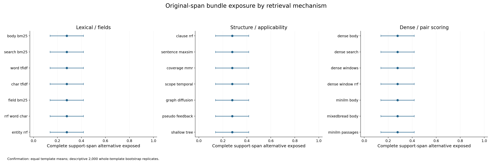
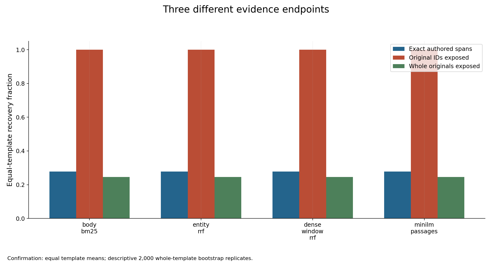
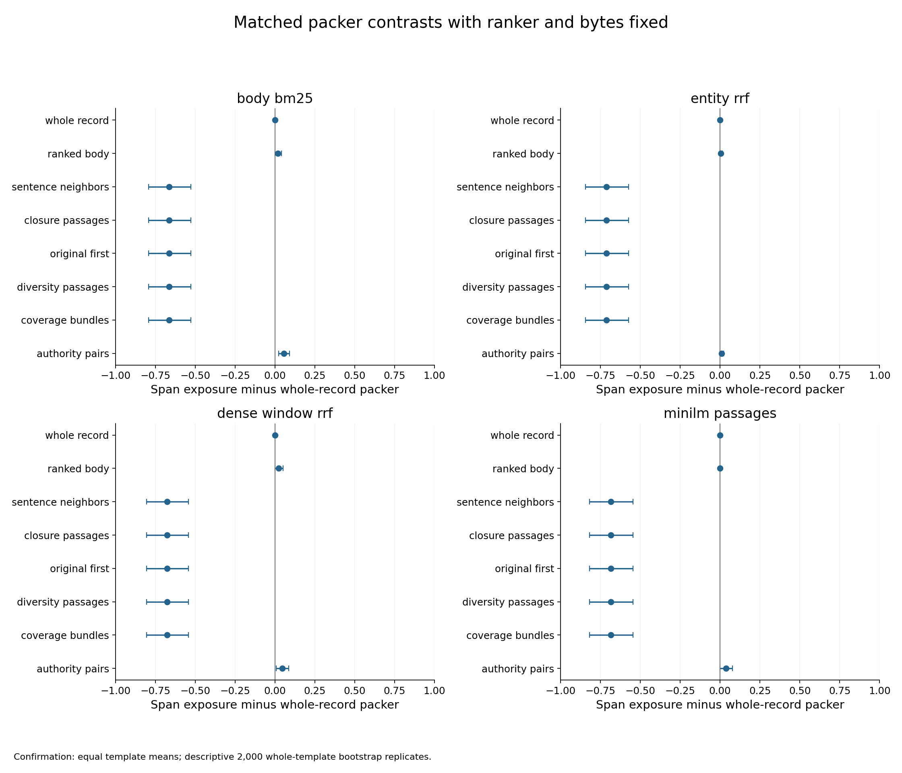
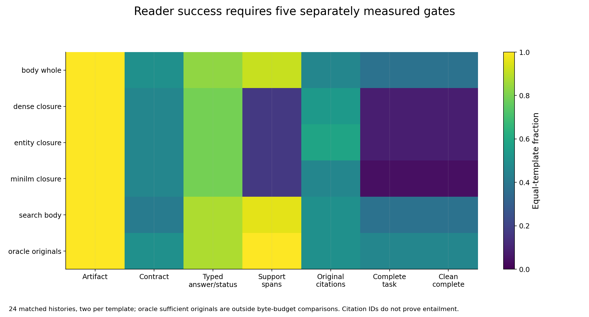
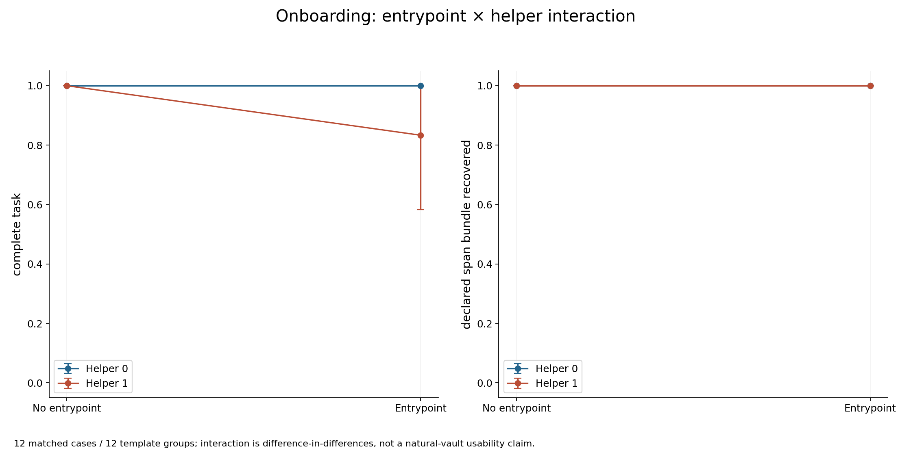
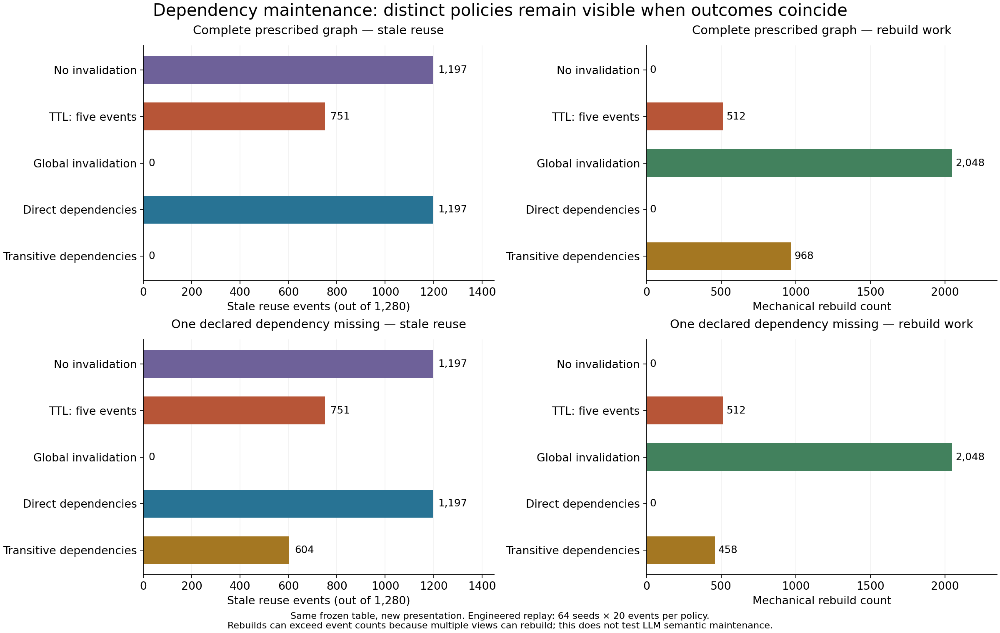

# October 13 study: primary results

Collection and the computational execution audit are complete. The separately planned blinded semantic review is **pending**. These results concern an authored fictional bank and the frozen implementations tested here.

At the selected 8 KiB / 144-record passage cell, all 21 rankers exposed a complete authored original-span alternative in **60/216 confirmation queries (27.78%)**. Changing the packer within fixed rankers produced much larger differences at that cell: whole-record and declared-authority packing often preserved spans that the narrow passage pipeline missed. This is a result about these implementations, supplied metadata and related fictional scaffolds; it does not identify a universal retrieval winner.

The reader experiment also separates exposure from task completion. The body-whole, search-body, entity-closure, dense-closure and MiniLM-closure direct arms completed 9, 9, 2, 2 and 1 of 24 tasks under the frozen five-gate conjunction. Oracle originals completed 11/24 outside the budget comparisons. Interactive discovery completed 46/48 tasks across four arms, but only 9/48 were clean protocol completions. Those blocks use different tasks and interaction protocols and do not support an across-block causal comparison.

## Design and endpoint

The bank contains 96 histories and 288 queries. Development has 24 histories / 72 queries in four template groups; confirmation has **72 histories / 216 queries in 12 related template groups**. Every history contributes three queries. The mechanism grid contains 21 rankers, eight packers where scheduled, three UTF-8 byte budgets (4, 8 and 16 KiB), and two nested corpus conditions (`144` and `all`). It produced 12,096 ranking cells and 114,048 packet cells, with zero recorded grid faults. Those repeated cells are not 114,048 independent scientific tasks. See [the frozen plan](PLAN.md), [analysis specification](ANALYSIS-SPEC.md), [freeze](freeze.json), and [mechanism research](INDEX-RESEARCH.md).

The primary endpoint asks whether the **actual source-exact character spans delivered in the packet contain any complete authored sufficient-span alternative**. Candidate original-ID recovery, observed original-ID coverage and whole-original recovery are separate proxies. None alone proves factual answer accuracy or citation entailment. The primary endpoint does not require whole documents, while an original ID can be present even when its governing span is absent.

Estimates average queries within a history, histories within a template, and templates equally. The confirmation grid is balanced, so its point estimates also equal the displayed raw numerator / 216. Intervals use 2,000 whole-template bootstrap replicates with seed 1013 and descriptive 2.5/97.5 percentiles. There are only 12 confirmation clusters, with related authored scaffolds. These are not population intervals, significance tests, independent human judgments, or multiplicity-adjusted evidence for a unique winner. Development and confirmation remain separate in [the computational tables](analysis.json).

## Retrieval and packing

### Rankers at a fixed packer and corpus

The following illustrative mechanism rows all use **whole_record, 8,192 bytes and confirmation queries**. `144` and `all` are separate corpus conditions; neither column is substituted for the other. Full tables retain all 21 engines, all scheduled conditions, ties and regressions. These rows are not a maximum-score ranking.

| Ranker | 144 records: span recovery | Descriptive interval | all records: span recovery | Descriptive interval |
| --- | --- | --- | --- | --- |
| `body_bm25` | 203/216 (93.98%) | [89.81%, 97.69%] | 181/216 (83.80%) | [78.70%, 89.35%] |
| `entity_rrf` | 214/216 (99.07%) | [97.69%, 100.00%] | 213/216 (98.61%) | [97.22%, 100.00%] |
| `dense_windows` | 213/216 (98.61%) | [96.76%, 100.00%] | 205/216 (94.91%) | [90.28%, 99.07%] |
| `shallow_tree` | 193/216 (89.35%) | [84.72%, 93.98%] | 138/216 (63.89%) | [52.78%, 75.46%] |

`entity_rrf` includes a channel matching explicit authored IDs and aliases. It should not be read as demonstrating learned entity extraction from an unstructured personal vault. `dense_windows` and `dense_window_rrf` are different scheduled engines; their names and results are not interchangeable. The frozen depth-three classifier is a development-trained, uncalibrated relevance mechanism, not a factual-authority classifier.

For **closure_passages / 8 KiB / 144 records**, all 21 rankers tie at 60/216 span recovery, with descriptive interval [13.89%, 41.67%]. Each comparison with body BM25 has 0 improved, 216 tied and 0 regressed queries at that exact cell. Whole-original recovery is 53/216 and observed original-ID bundle coverage is 216/216 there. This tie is specific to the measured passage implementation, not evidence that all rankers are equivalent under every condition: 318 of the 504 scheduled ranker contrasts contain changed paired queries.

Figure 2 fixes confirmation / closure_passages / 8 KiB / 144 records. It displays descriptive cluster intervals for the primary span endpoint. The full candidate and whole-record tables can differ despite this tie.

Figure 4 uses the same fixed cell for four declared extended engines. Its bars are point estimates. The common bootstrap footer does not mean interval bars are drawn here. The original-ID endpoint is not a claim that complete support or an accurate answer was delivered.

### Packers with the ranker held fixed

The complete eight-packer comparison below fixes **entity_rrf / 8 KiB / confirmation** and shows both corpus sizes. Every numerator has denominator 216. The other three extended engines and all matched packer contrasts remain in the computational tables and Figure 7.

| Packer | 144 records: span recovery | all records: span recovery |
| --- | --- | --- |
| `whole_record` | 214/216 | 213/216 |
| `ranked_body` | 215/216 | 214/216 |
| `sentence_neighbors` | 60/216 | 60/216 |
| `closure_passages` | 60/216 | 60/216 |
| `original_first` | 60/216 | 60/216 |
| `diversity_passages` | 60/216 | 60/216 |
| `coverage_bundles` | 60/216 | 60/216 |
| `authority_pairs` | 216/216 | 216/216 |

The passage family uses at most two lexical sentence-neighbor windows per document. The frozen source warns that these windows can miss qualifications elsewhere; adding budget does not generate a third window. The results are consistent with that implementation ceiling, but no new adaptive-expansion experiment or atomic causal ablation was run. `authority_pairs` uses declared scope compatibility, supersession components and view-currentness ledgers; those dependencies are supplied scaffold information. Its favorable exposure results do not validate automatic authority extraction, semantic truth, or correctness under missing metadata. [Packing source](packing_lab.py) and [packing research](PACKING-RESEARCH.md) describe the mechanisms and limits.

Figure 7 compares each scheduled packer with whole-record packing at confirmation / 8 KiB / 144 records, within each fixed engine. The signed estimates are paired query differences with whole-template intervals. The historical filename does not make these isolated atomic switches.

Increasing budget and changing the nested corpus need not improve every implementation. For closure_passages at 4/8/16 KiB, the raw span numerators are body BM25 59/60/60 for `144` and 53/58/58 for `all`; entity RRF 59/60/60 and 60/60/60; dense-window RRF 60/60/60 and 57/58/60; MiniLM passages 60/60/60 and 60/60/60. Every point uses 216 confirmation queries. Candidate IDs are only a ceiling: for example, at k=32 / `all`, entity RRF has candidate recovery 100%, body BM25 and MiniLM passages 94.91%, and dense-window RRF 97.69%. These are not delivered-span or answer-quality rates.

## Reader gates and the interaction block

Reader generation used the frozen local transport for **`muse-spark-1.3-contributor`, reasoning effort `high`**. The public runtime file records binary, adapter and wrapper digests and the local/UTF-8 transport canaries. The private adapter is an access boundary, not a public provider API or a claim that anyone can reproduce authenticated reader calls from the repository alone.

The five direct arms use 24 matched cases each: 19 authored-ready and five authored-hold. Oracle originals use the same 24-case block outside budget comparisons. The table separates the five underlying gates, their complete-task conjunction and clean protocol completion. Counts are not semantic reviewer ratings.

| Arm | n | Artifact | Contract | Typed answer/status | Span support | Original citation set | Complete | Clean complete | Complete interval |
| --- | --- | --- | --- | --- | --- | --- | --- | --- | --- |
| `body_whole` | 24 | 24 | 12 | 20 | 22 | 11 | 9 | 9 | [20.83%, 54.17%] |
| `dense_closure` | 24 | 24 | 11 | 19 | 4 | 13 | 2 | 2 | [0.00%, 20.83%] |
| `entity_closure` | 24 | 24 | 11 | 19 | 4 | 14 | 2 | 2 | [0.00%, 20.83%] |
| `minilm_closure` | 24 | 24 | 11 | 19 | 4 | 11 | 1 | 1 | [0.00%, 12.50%] |
| `search_body` | 24 | 24 | 10 | 21 | 23 | 12 | 9 | 9 | [16.67%, 58.33%] |
| `oracle_originals` | 24 | 24 | 12 | 21 | 24 | 12 | 11 | 11 | [29.17%, 62.50%] |

Artifact production, schema/citation contract validity, exact typed agreement, support-span exposure and citation-set coverage remain distinct. A citation ID does not prove cited-span entailment. Exact number/type/null/list conventions are frozen; a later blinded supplement will be reported separately and will not replace these primary scores.

Figure 14 shows five underlying gates and two conjunction endpoints, for five direct arms plus the separate oracle. Each arm has 24 cases and 12 authored groups.

False holds use the 19 authored-ready tasks per direct/oracle arm. They are 0/19 for body whole, search body and oracle, and 2/19 for each of the three closure arms. Complete justified holds use five authored-hold tasks: body whole 2/5, search body 1/5, oracle 1/5, and each closure arm 0/5. Dense closure has one unsupported-ready decision on an authored-hold task (1/5); other direct/oracle arms have zero. No absent output is counted as a successful hold.

The four discovery arms instead use 12 matched cases / 12 groups each, including 11 ready and one hold case. Their entrypoint/helper factorial is a separate interactive block. It cannot be causally compared with the direct 24-case block.

| Discovery arm | Complete task | Clean complete | Support exposed | Complete interval |
| --- | --- | --- | --- | --- |
| `entry0_helper0` | 12/12 | 4/12 | 12/12 | [100.00%, 100.00%] |
| `entry0_helper1` | 12/12 | 1/12 | 12/12 | [100.00%, 100.00%] |
| `entry1_helper0` | 12/12 | 2/12 | 12/12 | [100.00%, 100.00%] |
| `entry1_helper1` | 10/12 | 2/12 | 12/12 | [58.33%, 100.00%] |

The complete-task difference-in-differences is −1/6, with descriptive interval [−5/12, 0]. Entrypoint at helper=0 and helper at entrypoint=0 each have 12 paired ties; the other two conditional contrasts have zero improvements, ten ties and two regressions. These are descriptive results from 12 authored clusters, not natural-desktop usability or general causal effects.

Figure 17 displays arm-level complete-task and span-exposure estimates. The numeric interaction comes from the separate matched table; connecting lines alone do not display it.

Across discovery, complete task is 46/48 but clean protocol completion is 9/48. Rejected actions or other frozen protocol violations can make a completed task unclean; this score is not a measured fatal-harm or real-world safety rate. All 48 discovery trials have verified support reached and fresh observed submission clocks, with zero reuse exclusions or unavailable clocks. Those clocks are host-delivery proxies, not measured comprehension or provider intake. Actions and returned UTF-8 tool bytes are observed for all 48; prompt-input byte counts are unavailable for all 48 and are not imputed as zero. Direct/oracle null action clocks are outside this measured discovery route.

The 192 scheduled reader rows include one retained `response_round_cap` failure, with observed artifact and gate values preserved. Preparation for the separate semantic review mechanically reconciled 192 cases: 191 auditable and one not auditable with zero extracted evidence. **No actual semantic ratings have been accepted. Three fresh, disjoint reviewer tasks have been launched**, under [the semantic review plan](SEMANTIC-REVIEW-PLAN.md) and [execution disclosure](SEMANTIC-REVIEW-EXECUTION.md). Their complete input traces, case census, bindings and citation coordinates remain subject to acceptance checks. Preparation and validator checks are not judging.

## Timing and mechanical maintenance

Warm timing has 378 observations: six fixed development queries × three serial repetitions × 21 engines, resident document indexes, two CPU threads, and fresh query/pair scoring without cross-call reuse. Medians and full ranges are descriptive on an uncontrolled desktop host. Example medians are body BM25 0.0183 s, dense-window RRF 0.0355 s, MiniLM passages 1.7745 s, MiniLM body 7.9591 s and mixedbread body 19.1054 s. Full per-engine and matched query/repetition tables retain all 378 observations; no isolated-hardware or population-latency claim follows.

Index build-or-load operations, model loading, verified reloads and vector storage are separate. The preparation receipt records cache flags false and body/search/window index operations of 48.9197 / 50.3109 / 74.2751 s, with 1,704,960 / 1,704,960 / 2,076,672 vector bytes. One bound worker receipt records cache flags true and reloads of 0.2672 / 0.3053 / 22.3578 s. Dense model load is 0.2161 s in the table. **Correction to the frozen generated limitation:** its sentence saying verified reload duration is unavailable is inaccurate for this invocation; reloads were supplied. Figure 21 plots that first bound worker reload, so model load is table-only in its populated-reload branch. The frozen analysis artifact is preserved.

Maintenance is an engineered replay: 64 seeds × 20 events × five policies × two ledger conditions. Each policy/ledger point has 1,280 events. Complete transitive dependencies have zero stale reuses with 968 rebuilds; removing one declared edge gives 604/1,280 stale reuses with 458 rebuilds. Global invalidation also has zero stale reuses but 2,048 rebuilds and 540 unnecessary-rebuild queries in each ledger condition. A rebuild count can exceed event count because one event can rebuild multiple views.

This separate presentation places coincident policies on distinct rows. It uses the exact ten original maintenance entries and changes no score or statistic. It is an additional readability pair, not a 27th preregistered scientific endpoint; the original 26-pair registry remains unchanged. Prescribed graphs, false-current counterexamples and local commit fixtures do not establish LLM maintenance quality, semantic correctness, learned dependency recovery or distributed compare-and-swap.

## Execution audit and analysis recovery

The completed execution audit verified the scheduled census, source-exact packet reconstruction, pinned cache/model identities, reader artifacts/checker effects and the retained failure row. Independent numeric checks matched all tables, paired counts and selected bootstrap calculations; all 26 main PNGs were individually inspected. Original Figure 23 has coincident policy labels, so the readable derivative above is the preferred presentation. The [audit record](AUDIT.md) distinguishes those scopes and their limits.

The first analysis invocation failed at the frozen compact-observation boundary with `KeyError: text`. That failed invocation is retained. After collection, a separate [reviewed compatibility wrapper](ANALYSIS-COMPATIBILITY.md) transiently supplies source-exact text from already validated source IDs, hashes and Unicode bounds. It delegates to the unchanged scorer, analyzer and statistics. The original 32 frozen inputs remain unchanged. The accepted recovery ran exactly once and exited zero, with separate execution provenance; no model was called, no score was repaired semantically, and no input observation was rewritten. This is a disclosed postcollection implementation recovery.

The prospective research, plan and specification documents remain historical records; wording such as “no outcome asserted” describes their writing time. They are not rewritten to imply that this report existed before collection.

## Figures and data

The original registry contains 26 PNG/SVG pairs. Numeric captions below identify explanatory or engineered panels and point-only displays. Each export is bound to a computational-table hash; [analysis.json](analysis.json) and [figure-registry.json](figure-registry.json) are the machine-readable records.

| Figure | Scope | PNG | SVG |
| --- | --- | --- | --- |
| 01-mechanism-grid | Explanatory schedule, not quality | [PNG](figures/01-mechanism-grid.png) | [SVG](figures/01-mechanism-grid.svg) |
| 02-primary-ranker-facets | Confirmation; closure / 8 KiB / 144 | [PNG](figures/02-primary-ranker-facets.png) | [SVG](figures/02-primary-ranker-facets.svg) |
| 03-candidate-ceilings | Candidate-ID ceilings; points only | [PNG](figures/03-candidate-ceilings.png) | [SVG](figures/03-candidate-ceilings.svg) |
| 04-span-id-whole | Span / ID / whole proxies; points only | [PNG](figures/04-span-id-whole.png) | [SVG](figures/04-span-id-whole.svg) |
| 05-budget-corpus-response | Budget and corpus response; points only | [PNG](figures/05-budget-corpus-response.png) | [SVG](figures/05-budget-corpus-response.svg) |
| 06-corpus-expansion-pairs | Paired corpus differences | [PNG](figures/06-corpus-expansion-pairs.png) | [SVG](figures/06-corpus-expansion-pairs.svg) |
| 07-atomic-packing-contrasts | Matched packer mechanisms | [PNG](figures/07-atomic-packing-contrasts.png) | [SVG](figures/07-atomic-packing-contrasts.svg) |
| 08-template-heterogeneity | Twelve authored group means; points only | [PNG](figures/08-template-heterogeneity.png) | [SVG](figures/08-template-heterogeneity.svg) |
| 09-paired-regressions | All 216 matched query counts | [PNG](figures/09-paired-regressions.png) | [SVG](figures/09-paired-regressions.svg) |
| 10-pipeline-failure-types | Recorded cell/trial faults; distinct units | [PNG](figures/10-pipeline-failure-types.png) | [SVG](figures/10-pipeline-failure-types.svg) |
| 11-byte-support-frontier | Observed bytes and partial recovery; points only | [PNG](figures/11-byte-support-frontier.png) | [SVG](figures/11-byte-support-frontier.svg) |
| 12-window-tail-mechanism | Illustrative source-window diagram | [PNG](figures/12-window-tail-mechanism.png) | [SVG](figures/12-window-tail-mechanism.svg) |
| 13-budget-omissions | Grid-wide skipped units, not missed tasks | [PNG](figures/13-budget-omissions.png) | [SVG](figures/13-budget-omissions.svg) |
| 14-reader-gates | Five gates plus complete/clean endpoints | [PNG](figures/14-reader-gates.png) | [SVG](figures/14-reader-gates.svg) |
| 15-reader-holds | False-hold /19 and justified-hold /5 | [PNG](figures/15-reader-holds.png) | [SVG](figures/15-reader-holds.svg) |
| 16-exact-typed-conventions | Explanatory frozen typed protocol | [PNG](figures/16-exact-typed-conventions.png) | [SVG](figures/16-exact-typed-conventions.svg) |
| 17-onboarding-factorial | Separate 12-case factorial | [PNG](figures/17-onboarding-factorial.png) | [SVG](figures/17-onboarding-factorial.svg) |
| 18-navigation-costs | Observed discovery resources with missingness | [PNG](figures/18-navigation-costs.png) | [SVG](figures/18-navigation-costs.svg) |
| 19-first-support-submission | Host support-submission proxy /12 | [PNG](figures/19-first-support-submission.png) | [SVG](figures/19-first-support-submission.svg) |
| 20-uncached-warm-timing | 18 serial development timings per engine | [PNG](figures/20-uncached-warm-timing.png) | [SVG](figures/20-uncached-warm-timing.svg) |
| 21-index-loading-storage | Separate build / storage / bound reload | [PNG](figures/21-index-loading-storage.png) | [SVG](figures/21-index-loading-storage.svg) |
| 22-classifier-structure | Development classifier structure | [PNG](figures/22-classifier-structure.png) | [SVG](figures/22-classifier-structure.svg) |
| 23-invalidation-tradeoffs | Engineered replay; prefer readable derivative | [PNG](figures/23-invalidation-tradeoffs.png) | [SVG](figures/23-invalidation-tradeoffs.svg) |
| 24-ledger-truth-boundary | Engineered fixity/truth counterexample | [PNG](figures/24-ledger-truth-boundary.png) | [SVG](figures/24-ledger-truth-boundary.svg) |
| 25-fictional-timeline | Illustrative fictional chronology | [PNG](figures/25-fictional-timeline.png) | [SVG](figures/25-fictional-timeline.svg) |
| 26-fictional-dependency-graph | Prescribed fictional dependency graph | [PNG](figures/26-fictional-dependency-graph.png) | [SVG](figures/26-fictional-dependency-graph.svg) |

Figure 23 readability supplement: [PNG](presentation/23-invalidation-tradeoffs-readable.png), [SVG](presentation/23-invalidation-tradeoffs-readable.svg), [source](render_readable_maintenance.py), and [presentation binding](presentation/presentation-receipt.json). Its two exports supplement the original 52 rather than replace them.

## Reuse and remaining work

Use these results as bounded implementation evidence and hypotheses for source-preserving, scope-aware memory systems. Supplied aliases, applicability labels, source hashes and dependency graphs make this a scaffolded test. The study does not establish automatic personal-memory extraction, hidden-prefix erasure, human validation, source authority, citation entailment or a production safety guarantee. The separately reported [native-transfer study](NATIVE-TRANSFER-REPORT.md) has different data and denominators and is not pooled into the main fictional-bank scores.

The next scientific step is the separately scoped blinded semantic review, retaining nonauditable cases and reporting disagreements without overwriting frozen primary scores. Full public reproduction also has an access boundary: the numeric artifacts and public sources can be checked, but authenticated reader generation and the exact bound worker reload receipt remain private. The hash-bound preparation receipt is published as `preparation.json`. [AUDIT.md](AUDIT.md) lists required files, identities and commands, and distinguishes completed checks from that unexecuted supplement.
