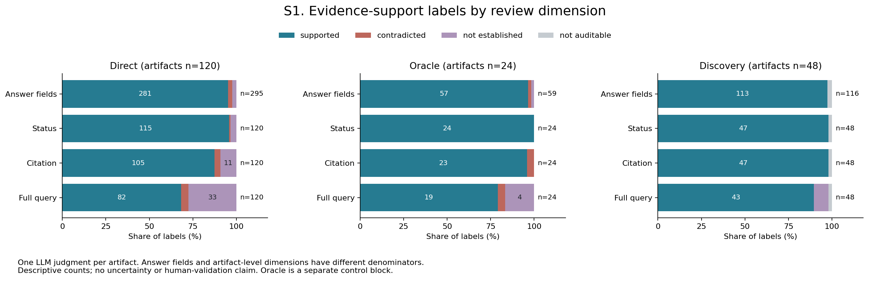
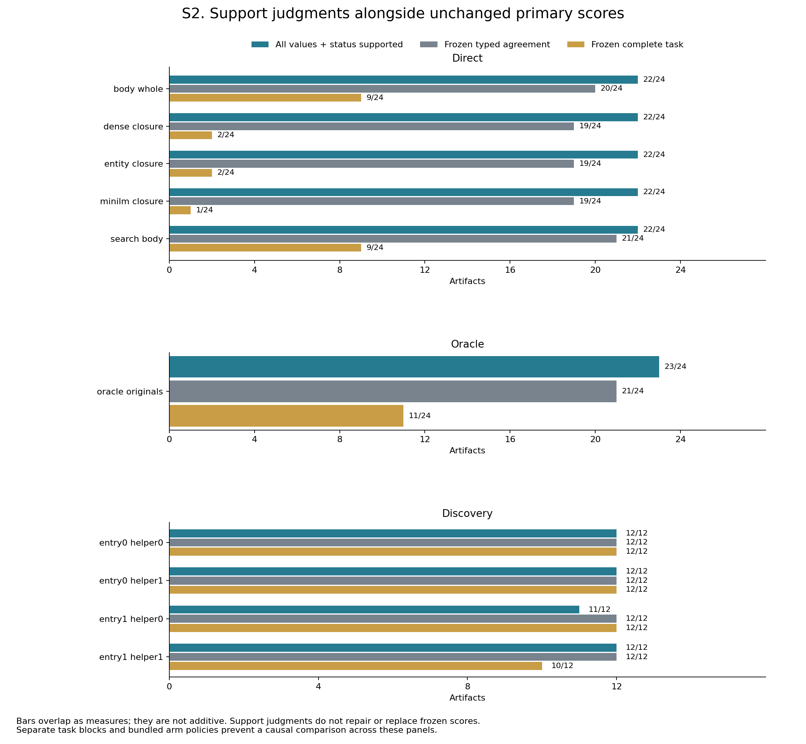
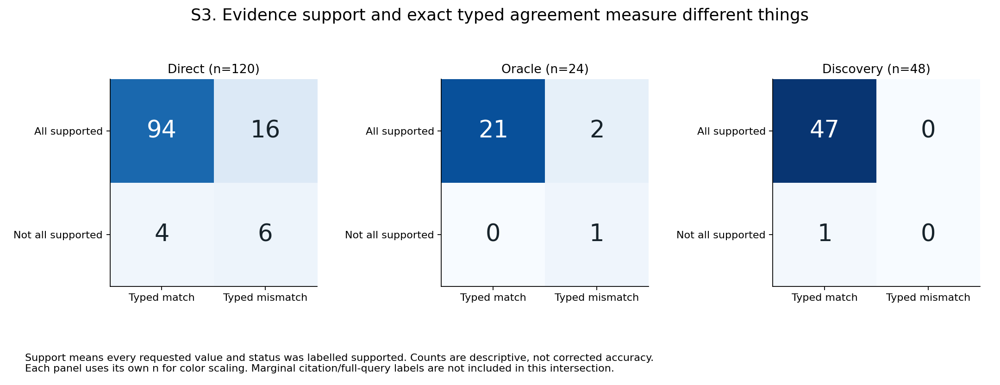
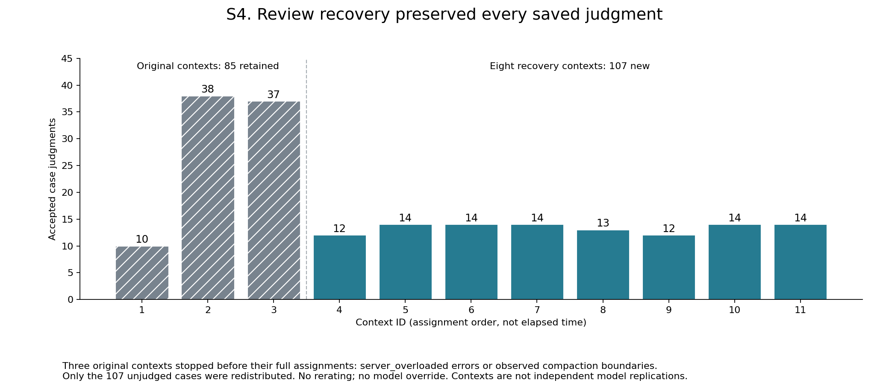

# Blinded reader review: evidence support and task completion

**Completed October 15, 2026 UTC.** All 192 scheduled artifacts received one
source-bounded LLM judgment. The original full-cohort validator passed before
the withheld condition mapping was opened. A separately reviewed compiler ran
once; an independent checker reproduced every block/arm count, raw UTF-8 hash,
original citation bound and frozen-score join. The bounded privacy scan found
zero sensitive-pattern matches. These are descriptive LLM judgments, without
human adjudication, duplicate ratings or a reliability estimate.

The main qualification is substantial: **every direct arm has 22/24 responses
labelled supported for all requested values and status**, although their frozen
complete-task scores differ greatly. Full-query support varies from 14 to 18
of 24. The primary completion score therefore must not be presented as a count
of factually correct answers. Nor does supported output establish that the
underlying information need was resolved: an appropriate hold can remain
unresolved. No frozen score, authored key or original artifact was changed.

## What was judged

The review used the [original rubric](SEMANTIC-REVIEW-PLAN.md), verified
pre-write source deliveries, literal artifacts and opaque case IDs. The
condition/gold mapping was withheld during judgment; visible source IDs,
format and content could still cue conditions. Only delivered original-source
intervals may support citations. Hashes establish byte identity, not entailment
or comprehension.

Four labels were available: `supported`, `contradicted`, `not_established` and
`not_auditable`. Each requested answer field is one unit. Status, artifact
citation quality and full-query resolution each have one judgment per artifact.
The latter dimensions remain separate rather than being forced into a support
hierarchy. The all-values-and-status measure is their specified conjunction;
it does not include the citation or full-query labels.

There are **120 direct artifacts, 24 outside-budget oracle controls and 48
interactive discovery artifacts**. Their requested-field denominators are
295, 59 and 116 respectively. Extraction is auditable for 191 artifacts; the
remaining artifact has zero extracted evidence and remains in its scheduled
block/arm denominators as not auditable. Its frozen execution and typed-score observations
are preserved separately. Direct/oracle use the same 24 tasks across 12 related
authored groups; discovery uses a different 12-task interactive block. Neither
the repeated arm cases nor the 11 review contexts are independent scientific
replications.

## Exclusive label marginals

Each row sums to its own denominator. Field rows must not be pooled with
artifact rows. The raw supplement also retains overlapping any-label presence
per artifact; those counts are not disjoint and are not stacked here.

| Block | Dimension | n | Supported | Contradicted | Not established | Not auditable |
| --- | --- | ---: | ---: | ---: | ---: | ---: |
| Direct | Requested fields | 295 | 281 | 7 | 7 | 0 |
| Direct | Status | 120 | 115 | 1 | 4 | 0 |
| Direct | Artifact citations | 120 | 105 | 4 | 11 | 0 |
| Direct | Full query | 120 | 82 | 5 | 33 | 0 |
| Oracle control | Requested fields | 59 | 57 | 1 | 1 | 0 |
| Oracle control | Status | 24 | 24 | 0 | 0 | 0 |
| Oracle control | Artifact citations | 24 | 23 | 1 | 0 | 0 |
| Oracle control | Full query | 24 | 19 | 1 | 4 | 0 |
| Discovery | Requested fields | 116 | 113 | 0 | 0 | 3 |
| Discovery | Status | 48 | 47 | 0 | 0 | 1 |
| Discovery | Artifact citations | 48 | 47 | 0 | 0 | 1 |
| Discovery | Full query | 48 | 43 | 0 | 4 | 1 |



S1 uses exclusive labels within each bar. Percentages have different field or
artifact denominators, printed beside each bar. Small segments remain present
even when their count does not fit inside them. These are descriptive counts,
without interval or human-validation claims.

## Per-arm comparison with unchanged primary gates

All six rows below have **n=24**; the oracle is a separate control. Support
columns are reviewer labels. Typed agreement and complete task are the original
frozen scores. Complete task conjoins artifact, contract, typed agreement,
authored-span exposure and original-citation-set gates.

| Direct arm / separate control | All values + status supported | Full query supported | Citation supported | Frozen typed agreement | Frozen complete task |
| --- | ---: | ---: | ---: | ---: | ---: |
| `body_whole` | 22 | 18 | 22 | 20 | 9 |
| `dense_closure` | 22 | 14 | 21 | 19 | 2 |
| `entity_closure` | 22 | 16 | 20 | 19 | 2 |
| `minilm_closure` | 22 | 16 | 20 | 19 | 1 |
| `search_body` | 22 | 18 | 22 | 21 | 9 |
| **Oracle: `oracle_originals`** | 23 | 19 | 23 | 21 | 11 |

All four discovery rows instead have **n=12**. All have frozen typed agreement
12/12. A not-auditable source history can coexist with an observed matching
artifact; it is not converted into a supported judgment.

| Discovery arm | All values + status supported | Full query supported | Citation supported | Frozen complete | Frozen clean complete |
| --- | ---: | ---: | ---: | ---: | ---: |
| `entry0_helper0` | 12 | 11 | 12 | 12 | 4 |
| `entry0_helper1` | 12 | 11 | 12 | 12 | 1 |
| `entry1_helper0` | 11 | 10 | 11 | 12 | 2 |
| `entry1_helper1` | 12 | 11 | 12 | 10 | 2 |



S2 bars represent overlapping measures, not additive parts. Alphabetical arm
order is a presentation choice. Direct 9/24 versus 2/24 compares bundled
ranking/packing policies, not a pure causal packer intervention. The intrinsic
entity whole-record 214/216 and authority-pair 216/216 span results were not
executed direct-reader arms; they have no reader score in this supplement.

## Strict agreement and source support disagree in both directions

| Block | Supported + typed match | Supported + typed mismatch | Not all supported + typed match | Not all supported + typed mismatch |
| --- | ---: | ---: | ---: | ---: |
| Direct (n=120) | 94 | 16 | 4 | 6 |
| Oracle control (n=24) | 21 | 2 | 0 | 1 |
| Discovery (n=48) | 47 | 0 | 1 | 0 |

Here “supported” means every requested value and status was labelled supported.
The 16 direct and two oracle support/typed disagreements are inspection targets,
not corrected accuracy. Conversely, typed agreement does not establish source
support. The planned advisory diagnostic found zero cases with full-query
support alongside a nonsupported requested value/status; that absence does not
validate the judgments.



S3 shows separate block panels for legibility; all per-arm intersections and
case IDs remain in the data. Each panel uses its own denominator for color.

Two **post-unblinding illustrative selections**, unchanged and not new
adjudications, show why these axes differ. In `CASE-020`, the reviewer supports
an equipment-class answer and an evidence-bounded null/hold because applicable
authorization is missing. Full-query authorization remains not established.
In `CASE-042`, a typed-matching acoustic rejection is not established by the
reviewer because the delivered excerpt omits the project/wave heading; another
delivered disposition does establish shipment prohibition. The rationales and
original interval citations are preserved for scrutiny. These examples are
not a representative sample or proof that the reviewer is right.

The authored span endpoint tests membership in declared sufficient alternatives.
It does not prove that every other set is insufficient. Differences among that
endpoint, field support, full-query labels and strict contracts require separate
validation rather than selecting whichever produces the largest score.

## Execution recovery and audit limits

The original three contexts stopped after **85 saved judgments**. The disclosed
[recovery amendment](SEMANTIC-REVIEW-CAPACITY-RECOVERY.md) redistributed only the
107 unjudged cases into eight smaller fresh contexts. All 192 saved judgments
were retained once; no ratings were rerun or repaired. All individual native
frame/scope/order checks and the complete original validator passed before
unblinding. Compilation made zero model calls and ran once.



S4 uses context assignment order, without a duration, capacity-cause or
independence inference. Original errors, the unauthorized directory retry,
observed compaction boundaries, auditor corrections and incidental diagnostic
exposures remain disclosed in the [execution supplement](SEMANTIC-REVIEW-EXECUTION-RESULTS.md)
and [safe execution projection](semantic-review-execution.json). Instructional scope is
not OS confinement or proof that inherited memory was empty. Native traces,
account details, private commands and host paths are deliberately not published.

## Data, figures and consuming checks

The [full fictional supplement](semantic-review.json) preserves raw case and
judgment UTF-8 strings, byte counts/SHA values, original-only citation bounds,
all 192 condition joins and unchanged frozen flags. Its compilation-time
`PRIVATE_CANDIDATE_REQUIRES_PUBLICATION_PRIVACY_REVIEW` state and the generated
figure registry's pending visual field are retained as historical fields;
the separate [acceptance record](semantic-acceptance.json) records the completed
count/privacy/visual review of those exact bytes. Neither warning is silently
rewritten after compilation.

The [compiler](compile_reader_semantics.py) public check reproduces internal
fixity, joins and all summaries using the published candidate and pinned
analysis. It does not authenticate private extraction or the original withheld
mapping, attest provider intake, adjudicate entailment or regenerate reader
calls. From this study directory:

```text
python compile_reader_semantics.py --check --candidate semantic-review.json --analysis analysis.json
python compile_reader_semantics.py --self-check
python render_reader_semantics.py --self-check
```

The separately authored [independent checker](check_semantic_candidate.py)
recounts raw labels without importing the compiler's summary/join functions.
Its public self-check is `python check_semantic_candidate.py --self-check --study .`.
For its full `--check` route, supply this candidate's SHA from the acceptance
record, pinned `analysis.json`, the exact [root gate](semantic-root-acceptance.json)
and its SHA from the same record, plus a new output path outside the repository.
It reproduces counts and bounded privacy scans, not the original private native
audit or semantic truth. Its neutral example email is a fictional test fixture.

The original independent count check passed with an absolute study path. Final
editorial verification then retained an `IndexError` from the documented relative
`--study .` route. The published checker's shared module loader now resolves that
path once; no label, count or scoring logic changed. The relative self-check and
full candidate check both passed afterward, with identical numeric/privacy
results apart from checker identity. The acceptance record distinguishes the
historical independent source from this portability correction; the failure is
retained rather than rewriting its earlier receipt.

The [renderer](render_reader_semantics.py), [figure tables](semantic-figures/figure-tables.json)
and [registry](semantic-figures/figure-registry.json) bind four new descriptive
PNG/SVG pairs. All four PNGs were individually inspected. S2's ordering and S3's
block panels were selected before actual label aggregation; full arm data is
retained. The original 26 primary figure pairs are unchanged. Python 3.13 was
used; Python 3.10 grammar passed, with no 3.10 runtime execution.

The [primary report](REPORT.md) remains the source for frozen outcomes. The
[new evidence-completion literature](EVIDENCE-COMPLETION-RESEARCH.md) proposes
matched requirement-set, observed-state, provenance and query-blind retention
tests. Those follow-ups remain unexecuted. This supplement supports careful
measurement design, without establishing a universal filing scheme, natural
PARA onboarding success or human-grounded factual accuracy.
